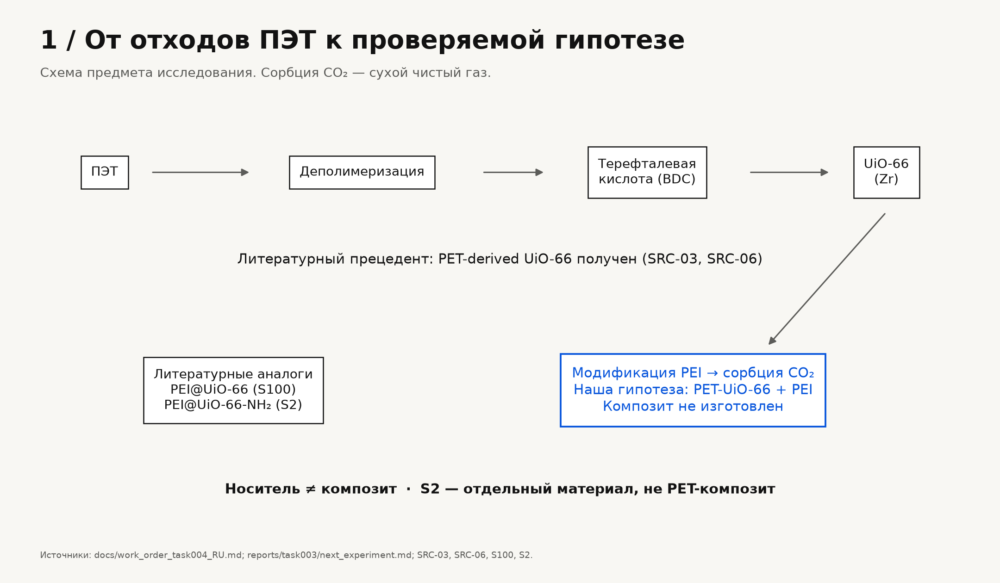
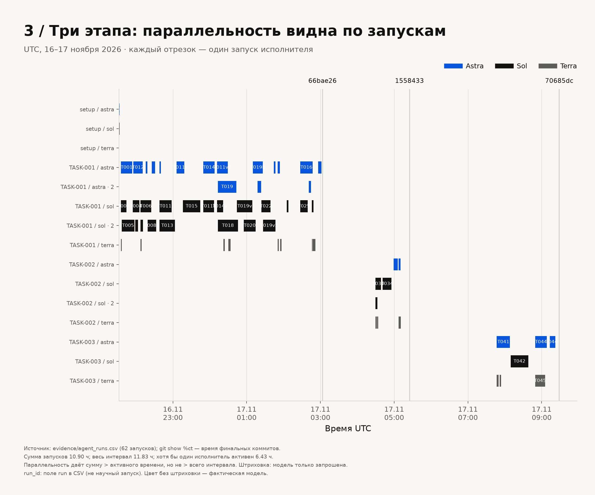
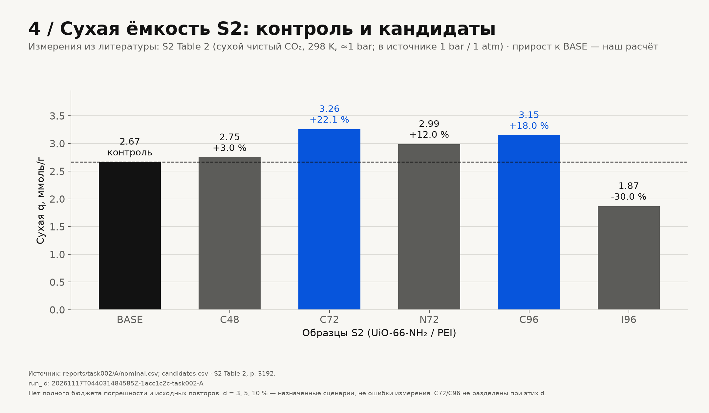
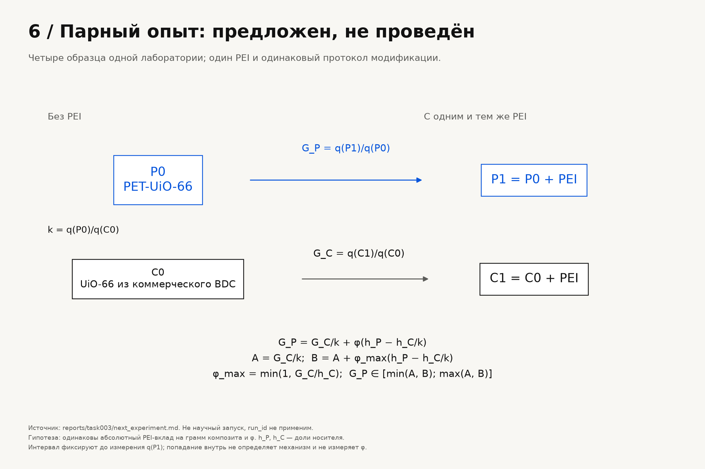

# Агентская система в работе исследователя: от научного вопроса к проверяемым расчётам

## Кратко

Одна ночь, три гипотезы, три вердикта. С вечера 16 до утра 17 ноября 2026 года агентская система, которую я собрал под незнакомую мне научную задачу, провела 59 рабочих запусков исполнителей, до четырёх одновременно. За это время она извлекла и сверила данные из литературы, написала и протестировала код, просчитала ансамбль из 360 сценариев и побайтово повторила его в чистой копии. Она нашла и исправила собственную критическую ошибку и закончила планом опыта, который можно передать в лабораторию.

Тема — сорбенты CO₂ из переработанного ПЭТ. Органическую часть пористого каркаса UiO-66 получают из пластиковых бутылок, а сам каркас модифицируют полиэтиленимином. Это не моя область, и именно поэтому она стала хорошим испытанием: может ли исследователь вместе с агентской командой за считанные часы войти в чужую тему и довести вопросы до проверяемых ответов?

Вышло так:

- **Первый, широкий вопрос** за пять с половиной часов дошёл до честного «данных недостаточно» — с точным списком того, чего не хватает.
- **Второй, суженный,** за час дал двух литературных кандидатов и требование к точности опыта, который их различит.
- **Третий** за два часа перенёс результат на материал из ПЭТ. Он дал условие, при котором PEI даёт выигрыш не меньше 10 %, и парный эксперимент из четырёх образцов, исход которого истолкован заранее.

Дальше — почему тема того стоит, как устроен конвейер, что он сделал на каждом этапе, как ловил собственные ошибки и куда его развивать.

## Местные отходы против местных выбросов

### Проблема

В 2024 году мировые выбросы CO₂ достигли рекордных 41.6 млрд тонн — эту цифру приводит [Гданьский университет в сообщении о проекте CO2MAT](https://ug.edu.pl/news/pl/10481/innowacyjna-technologia-wychwytu-co2-grant-dla-wydzialu-chemii). Особенно трудно улавливать его из промышленных газовых потоков, где концентрация CO₂ низкая, — именно на такие потоки нацелен CO2MAT.

Одна из основных промышленных технологий сегодня — аминная промывка: раствор амина обратимо связывает CO₂. Руководитель CO2MAT профессор Адриана Залеска-Медыньска в том же сообщении перечисляет её слабые места: выбросы летучих соединений, потери растворителя, высокое энергопотребление, большие габариты установок. Отсюда интерес к твёрдым сорбентам. Амины, закреплённые на пористом носителе, работают без жидкого растворителя, а сам носитель можно подбирать под задачу.

### Идея: бутылка становится фильтром

ПЭТ — полиэтилентерефталат, материал бутылок и плёнок. При химической переработке его разлагают до терефталевой кислоты (BDC). Это тот самый «кирпич», из которого собирают известный пористый каркас UiO-66. UiO-66 относится к MOF (metal–organic frameworks): это кристалл из кластеров циркония, связанных органическими линкерами, с порами размером около нанометра.

Получение UiO-66 из ПЭТ уже описано в литературе, и результат впечатляет. В опубликованной паре образцов удельная поверхность каркаса из реального ПЭТ-отхода — 874.6 м²/г, у каркаса из чистой кислоты — 873.9 м²/г: практически одинаково.

Второй компонент — PEI, полиэтиленимин: разветвлённый полимер с большим числом аминогрупп. Амины химически связывают CO₂, поэтому PEI наносят на пористые носители, чтобы поднять поглощение. Ёмкость сорбента — сколько миллимолей CO₂ удерживает грамм материала при заданных давлении и температуре.

Меня в этой идее привлекает замкнутость. Город собирает бутылки: с 1 октября 2025 года в Польше вводится [система залога на ПЭТ-бутылки до 3 литров](https://bank.pl/system-kaucyjny-obowiazkowy-od-1-pazdziernika-2025-roku). Рядом работает промышленность, которая выбрасывает CO₂. Если делать из одного фильтр для другого, у отхода появляется понятный местный потребитель, а у переработки — ещё одна ценность.


*Рис. 1. Предметная задача. Схема. Литературный прецедент — получение UiO-66 из ПЭТ и PEI-модификация литературных аналогов на обычном сырье; наша гипотеза — PEI на PET-derived UiO-66; такой материал в проекте не изготавливался.*

### Гданьск уже работает в этом направлении

Это не кабинетная фантазия. На кафедре технологии окружающей среды химического факультета Гданьского университета, которую возглавляет профессор Залеска-Медыньска, металлоорганическими каркасами занимаются не первый год. В [списке публикаций кафедры](https://envir-tech.ug.edu.pl/publications) такие работы видны как минимум с 2022 года. Среди них MOF-фотокатализаторы, MOF-сорбенты для очистки воды и MOF-катализаторы химической переработки пластиков, в том числе биметаллический MOF-74 для деполимеризации ПЭТ (2024).

В конце 2025 года группа получила [грант OPUS 29 Национального научного центра Польши на 3.3 млн злотых](https://new.ug.edu.pl/news/en/node/9569) на тонкие плёнки MOF для захвата молекул и фотоконверсии CO₂. В июне 2026 года последовал CO2MAT: 6 933 076.25 злотых в третьем конкурсе программы NEON, которую совместно ведут Национальный центр исследований и разработок и ORLEN. Цель — технология улавливания CO₂ из промышленных газовых потоков с низкой концентрацией CO₂. Сорбент — пористый координационный полимер из отходов ПЭТ. В план входят метод синтеза, прототипная установка для производства сорбента и проверка улавливания на исследовательской установке.

Программу NEON софинансирует нефтеперерабатывающий концерн, а в самом Гданьске работает [нефтеперерабатывающий завод](https://en.wikipedia.org/wiki/Gda%C5%84sk_Refinery). Для меня это и есть связка «местный отход — местный выброс» в реальной экономике.

Сразу оговорю: с этой группой я не работаю, и мой проект не часть CO2MAT. Конкретная система — UiO-66 из ПЭТ с PEI — моя самостоятельная постановка в том же направлении. Гданьск для меня — свидетельство того, что направление признано и получает промышленное финансирование.

## Почему агентская система

### Я загорелся идеей — но она не из моей области

Мои научные интересы — полимерные композиционные материалы, полиолефиновые и полиамидные матрицы, углеродные наполнители, переработка вторичного полимерного сырья. ПЭТ и его переработку я понимаю. Металлоорганическими каркасами, PEI-модификацией и сорбцией CO₂ я раньше не занимался.

Идея меня зажгла, и сразу встал практический вопрос: как быстро войти в чужую тему так, чтобы не утонуть в литературе и не принять красивую гипотезу за результат? Я провёл ресерч: как сегодня применяют агентские системы в исследовательской работе. Потом решил проверить на своей задаче, можно ли собрать конвейер, который перемалывает идеи и гипотезы в проверяемые расчёты.

### Кто есть кто

Ниже «я решил» означает мои решения: какой вопрос ставить, когда сужать, что принять. Поручения и пакеты данных мы готовили вместе с ChatGPT. Это была консультационная подготовка и аудит, а не расчёты проекта, и «мы подготовили» в статье означает именно её. Дальше работала агентская команда:

- **Claude Code** (Anthropic) — агентский руководитель: принимал поручение, писал план и карточки заданий, назначал исполнителей, принимал их работу, правил код и тексты, собирал итоговый отчёт;
- **Codex** (OpenAI) — исполнители и проверяющие, каждый в отдельной рабочей копии репозитория: модели с идентификаторами `gpt-6-astra`, `gpt-6.1-sol` и `gpt-6.1-terra`, как они записаны в журналах запусков.

Код, данные, отчёты и ревью лежат в открытом репозитории PET2MOF; приватными остаются только журналы сессий и закрытые тексты статей. Ссылки в статье ведут на зафиксированные commit, поэтому текст не разойдётся с кодом.

## Конвейер за один вечер

### Как он устроен

Каркас конвейера — правила команды `AGENTS.md`, скрипт запуска исполнителей и защита от утечки секретов — лёг в первый же коммит проекта вечером 16 ноября. Через пять с половиной часов первый этап был закрыт: отчёт, тесты, независимое воспроизведение.

Каждая гипотеза проходит одну и ту же линию: **поручение → карточка → исполнитель → расчёт с паспортом → независимая проверка → вывод**.

1. **Поручение владельца** задаёт цель, границы и критерии сдачи.
2. **Руководитель** превращает его в план и карточки. Карточка — короткое задание с целью, входами, ограничениями, моделью, уровнем рассуждений, ожидаемыми файлами, критериями приёмки и именем проверяющего. Без карточки работа не выполняется.
3. **Исполнитель** запускается одним скриптом, где явно заданы модель, уровень рассуждений, режим песочницы и доступ к сети. Он работает в своей рабочей копии на своей ветке, поэтому два исполнителя не пишут в один файл. Фактические модель и настройки берутся из журнала запуска, а не из запроса.
4. **Учитываемый расчёт** запускается только из чистого зафиксированного дерева Git. Каждый запуск получает уникальный `run_id` и паспорт: версия кода, входные файлы с хешами, параметры, выходы. Любой график в отчёте указывает свой `run_id`.
5. **Проверяющий** — другой исполнитель. Он сначала сам проверяет данные и расчёт по артефактам и первоисточникам, а выводы автора читает последними и сверяет с этими артефактами.
6. **Вывод** попадает в отчёт после этой проверки. Исключение записано в отчёте: последние правки после повторного ревью третьего этапа проверял только руководитель.


*Рис. 2. Организация команды и вычислений. Схема. Обратные связи: замечание проверяющего возвращает работу на исправление, итоговый отчёт — к владельцу и новому поручению.*

Два правила оказались самыми сильными. Первое — **у каждого числа есть тип и адрес**. Каждое число помечено как прямое измерение из публикации, оцифровка графика, подгонка авторов, чужая симуляция или наш расчёт, и каждая запись данных несёт `extraction_id` и ссылку на таблицу или рисунок источника. Свойства, которых нет в источниках, не заполняются догадками модели: либо обоснованный диапазон с источником, либо `unknown`. Второе — **прогноз фиксируется до проверки**. Код, параметры и критерии закрепляются тегом в Git до того, как проверочные данные раскрываются расчёту, поэтому любое изменение после раскрытия видно в истории и считается новой версией модели. Полной «слепоты» команды при этом не было: руководитель раньше видел часть таблиц, а проверочную выборку извлекали до тега. Тег не делает подгонку невозможной — он делает её заметной.

### Инструменты

Научный код — Python: NumPy и SciPy для расчётов и подгонок, pandas для таблиц, Matplotlib для графиков, PyMuPDF для текстового слоя PDF, PyYAML и jsonschema для паспортов данных, pytest для тестов. Зависимости закреплены файлом `uv.lock`. Расчёты воспроизводились без сети в заранее подготовленном окружении, а для установки окружения с нуля нужны пакеты в локальном кэше или загрузка из сети.

Все проверки запускаются локально командами `make`: тесты, сборка отчётов и проверка перед публикацией — поиск секретов по дереву и истории, отсутствие приватных путей. Внешнего CI нет. Распознавание текста шло по нарастающей: сначала таблицы, приложения и текстовый слой PDF с постраничной проверкой, затем локальный tesseract на трёх страницах, где графики встроены картинками. Адаптер к платному внешнему OCR был готов, но бюджет стоял на нуле, и он не понадобился.

### Скорость


*Рис. 3. Хронология трёх этапов. Наш учёт по журналам запусков исполнителей и истории Git. Перекрытия полос показывают параллельную работу: сумма длительностей запусков больше времени, когда активен хотя бы один исполнитель. В календарную длительность входят и паузы между запусками.*

Около двенадцати часов от первого запуска до финального commit третьего этапа, включая паузы между этапами. Внутри этапа исполнители работали параллельно: в первом этапе 44 запуска дали около 8.5 часа работы за 5.5 часа календарного времени. Пока один извлекал изотермы, другой писал модель, третий проверял безопасность репозитория.

## Прогон 1. Широкий вопрос — и точный диагноз

**Гипотеза.** Первое поручение было амбициозным: построить воспроизводимый прогноз для выбора физических опытов. Гипотеза: при фиксированных составе газа и режиме регенерации рабочая ёмкость по CO₂ имеет оптимум по содержанию PEI, и его положение меняется с влажностью и доступностью пор. Отсюда проверяемое следствие: ранжирование составов по сухой ёмкости может разойтись с ранжированием во влажном газе.

**Что я передал.** Поручение на 4 800 слов: научная постановка, правила извлечения данных, требования к секретам и прослеживаемости, список литературы, критерии сдачи. Данных не было — их предстояло найти.

**Что сделал конвейер.** За 5.5 часа и 44 запуска исполнители:

- проверили реестр из 26 первоисточников;
- загрузили 296 изотерм из открытой базы NIST;
- извлекли изотермы из статей и приложений с паспортом каждой операции;
- построили механистическую модель композита: физсорбция, связывание аминами, конкуренция воды, доступность пор;
- отложили часть серий как невиденную проверочную выборку и до её раскрытия закрепили прогнозы тегом `prereg-v1` с хешами файлов;
- просчитали условный ансамбль из 360 сочетаний допущений, по 4 × 4096 выборок в каждом.

Затем независимый исполнитель повторил полный расчёт в чистой локальной копии, без сети, с локальным кэшем пакетов. Все 360 из 360 файлов выборок совпали побайтово.

**Вердикт: данных недостаточно.** Из 31 записи проверочной выборки ни одна не допускала количественного сравнения: в источниках не хватало влажности, точной температуры, массовой основы или смысла давления. Контроль на калибровочных изотермах модель не прошла. В ансамбле ни одна из 360 ветвей не дала условного подтверждения гипотезы. Внутренний оптимум около 20 % PEI появлялся только в одной версии модели при одном прочтении маркировки образцов.

Звучит как неудача, но это диагноз, и поставлен он за одну ночь. Конвейер точно показал три величины, от которых в первую очередь зависит ответ: состав и размещение PEI, массовая основа ёмкости, влажность. Если в источнике не сказано, на массу чего пересчитана ёмкость, то 360 ветвей считают 360 вариантов незнания. Вдобавок этап оставил готовую инфраструктуру — правила, паспорта, проверенные извлечения, тесты, воспроизведение. На ней следующие два этапа заняли час и два.

**Решение.** Я сузил задачу до вопроса, на который существующие данные отвечают.

## Прогон 2. Узкий вопрос — ответ за час

**Вопрос.** Какие из уже измеренных PEI-модифицированных материалов приоритетно рассматривать дальше и насколько выбор устойчив к погрешности исходных чисел? Влажная химия, поиск общего оптимума, моделирование цикла и крупные ансамбли были прямо исключены.

**Что мы передали.** Вместе с ChatGPT мы подготовили пакет данных:

- шесть образцов из одной публикации (S2: UiO-66-NH₂ и его PEI-модификации), их сухие ёмкости и состав;
- пять оцифрованных изотерм из другой публикации (S100);
- словарь данных, разногласия первоисточника и контрольные хеши;
- **готовые контрольные расчёты**: эталонный скрипт кусочно-линейной интерполяции с ответами и фикстуру, которая воспроизводит старый дефект программы на искусственных данных.

Метод сравнения и сценарии погрешности ±3, ±5 и ±10 % задало поручение. Эталон пакета уже содержал часть ответов: C72 первый по номиналу, разрыв с C96 3.49 %, средняя ошибка интерполяции 0.029 ммоль/г.

**Что сделал конвейер.** Восемь запусков, около часа календарного времени:

- сверил каждую клетку таблиц S2 с открытым текстом первоисточника и побайтово повторил эталонные расчёты пакета;
- рассчитал приросты к контролю, устойчивость преимущества при ограниченных отклонениях и порог точности, при котором два лучших образца перестают различаться;
- независимо пересчитал всё другим способом — точными дробями, перебором вершин и бисекцией; наибольшее расхождение 1.4·10⁻¹⁴;
- сравнил интерполяцию с моделью Ленгмюра на заранее назначенном контрольном блоке давлений;
- исправил программный дефект первого этапа с регрессионным тестом;
- провёл научное ревью и чистое воспроизведение.

**Ответ.** Два кандидата — образцы C72 (3.26 ммоль/г, +22.1 % к контролю) и C96 (3.15 ммоль/г, +18.0 %) против немодифицированного UiO-66-NH₂ (2.67 ммоль/г). Все значения — сухой чистый CO₂ при 25 °C и около 1 бар; источник указывает давление то как 1 bar, то как 1 atm, и влияние этого на ранги не оценено. Оба остаются выше контроля при независимых отклонениях каждого значения до ±5 %, но не до ±10 %.

Победителя конвейер искусственно не назначил: разрыв 3.5 % различим, только если погрешность каждого измерения ниже 1.56 %. Это и стало ответом на вопрос «какой опыт нужен»: сухие изотермы обоих образцов, не менее трёх приготовлений, погрешность меньше 1.5 %.


*Рис. 4. Сухое сравнение TASK-002. Значения ёмкости — измерения из литературы (S2, табл. 2); приросты к контролю — наш расчёт (run `20261117T044031484585Z-1acc1c2c-task002-A`). Условия: сухой чистый CO₂, 298 K, около 1 бар (в источнике 1 bar / 1 atm). Сценарные допуски ±3/5/10 % — проверки устойчивости, не экспериментальные погрешности, поэтому планок погрешности нет.*

Это литературные образцы на UiO-66-NH₂ — каркасе с аминогруппой в линкере. Мы их не изготавливали, и их PET-происхождение не установлено. Результат этапа — ориентир и контроль для следующего шага.

Вспомогательная линия проверяла численную работу с кривыми. На девяти контрольных точках, не участвовавших в настройке, простая интерполяция ошибалась в среднем на 0.029 ммоль/г, однопозиционная модель Ленгмюра — на 0.135. Мы сохранили простую интерполяцию. Это внутренняя проверка на уже виденной серии, а не слепое подтверждение.


*Рис. 5. Сравнение численных методов. Точки — оцифровка графика из литературы (S100, рис. S5); линии — наш расчёт (run `20261117T045732361230Z-753cec58-task002-B`). Внутренняя проверка интерполяции одной серии на заранее назначенном блоке 0.33–0.46 бар, не независимая проверка.*

**Решение.** Узкая задача дала проверяемый ответ, но о другом материале. Следующий вопрос — что из этого переносится на UiO-66 из ПЭТ, у которого нет аминогруппы в каркасе.

## Прогон 3. Перенос на материал из ПЭТ — за два часа

**Вопрос.** Как наносить PEI на UiO-66 из ПЭТ и при каких условиях выигрыш хотя бы в 10 % к собственному носителю вообще возможен?

**Что мы передали.** Поручение TASK-003 и комплект передачи: реестр первоисточников о PET-derived UiO-66 с границами проверки и контрольные суммы. Формулу материального баланса и цель «+10 % к собственному носителю» задало поручение. Правило выбора маршрута руководитель записал в план анализа до расчёта.

**Что сделал конвейер.** Руководитель нашёл и проверил открытые источники о UiO-66 из ПЭТ. Они дали состав, пористость и дефектность каркаса, но пригодного проверенного набора CO₂-данных для выбранного расчёта команда не получила. Единственное число ёмкости (2.06 ммоль/г) нашлось во вторичном пересказе аннотации закрытой статьи — без температуры, давления, активации и массовой основы. По правилу «не заполнять догадками» оно получило статус `unknown` и в расчёт не вошло. Закрытые тексты и страницы с защитой от роботов не обходились.

Затем исполнители разобрали два маршрута:

- **R1** — прямое нанесение PEI на PET-UiO-66 (аналог — PEI@UiO-66 из S100);
- **R2** — закрепление PEI глутаровым альдегидом через аминогруппы каркаса (аналог — образец C72 из S2). У PET-UiO-66 таких групп нет. Поэтому R2 рассмотрен в форме смешанного каркаса, где часть линкеров — покупная аминотерефталевая кислота.

Для обоих маршрутов сведён массовый баланс на 1 кг сорбента: сколько каркаса, PEI и прочего, сколько ПЭТ уходит на килограмм. Затем построена карта требований: какая эффективность аминов (моль CO₂ на моль азота PEI) нужна, чтобы получить выигрыш 10 %. Это **требуемая** эффективность, а не предсказанная. Карта не говорит, какой она будет, — она говорит, какой она должна быть. Тем самым неизвестную величину она превращает в конкретную цель для лаборатории.

**Ответ.** Условный приоритет получил R1, резерв — R2 в форме смешанного каркаса. Выбор сделан по правилу, записанному до расчёта: при неразличимых порогах предпочтителен маршрут с меньшей массой не-ПЭТ компонентов. Попутно выяснилось, что при одном из прочтений опубликованных данных массовый баланс образцов S2 не замыкается: 18.5–25.0 % массы не являются ни каркасом, ни PEI. Это повод уточнить данные у авторов, а не доказанная ошибка публикации.

### Одна формула

Центральный результат этапа — условие переноса. Обозначим:

- *k* — отношение ёмкости PET-носителя к ёмкости UiO-66 из покупной кислоты (дальше — коммерческого UiO-66);
- *G* — выигрыш композита к собственному носителю;
- *h* — доля носителя в массе композита;
- *φ* — доля ёмкости носителя, которая сохраняется после нанесения PEI.

Если у PET-композита и коммерческого композита одинаковы вклад PEI на грамм и *φ*, то

```text
G_P = G_C / k + φ · (h_P − h_C / k)
0 ≤ φ ≤ φ_max = min(1, G_C / h_C)
```

Словами: выигрыш PET-композита равен выигрышу коммерческой пары, делённому на *k*, плюс поправка за ту часть ёмкости носителя, которая пережила нанесение полимера. Если PET-носитель сам поглощает больше (*k* > 1), тот же вклад PEI даёт меньший относительный выигрыш.

Сильная сторона формулы в том, что почти всё в ней измеримо. После опыта будут известны *k*, *G_C* и доли носителя *h_P*, *h_C*. Отдельно не измерить только *φ*, поэтому прогноз — интервал по *φ* от 0 до *φ_max*. Один конец интервала — *A* = *G_C*/*k* (при *φ* = 0), другой — значение при *φ* = *φ_max*. Требование к новой паре: нижняя граница интервала не меньше 1.10. Численный порог для *k* считается по её собственным *G_C* и составам.

Исторические пороги этапа — ориентиры, а не готовый критерий для новой пары. Они рассчитаны для аналогов при одинаковом составе PET-композита и аналога. Тогда условие сводится к 1 ≤ *k* ≤ *G*/1.10, где *G* — выигрыш аналога к носителю его статьи. Для S100 при 0.896 бар порог 1.06–1.52: это разные номинальные прочтения неустановленных в S100 основы массы и маркировки загрузки. Для R2 — около 1.11 по образцу C72 относительно его NH₂-носителя.

### Опыт, который всё решит

Следующий шаг — один парный опыт. Четыре образца одной лаборатории: PET-UiO-66 и коммерческий UiO-66, синтезированные по одному протоколу, каждый без PEI и с одним и тем же PEI. Сухие изотермы CO₂ при 298 K до 1 бар и выше, не менее трёх приготовлений каждого образца, погрешность среднего не более 2 %. Опыт даёт *k* и собственный выигрыш коммерческой пары и проверяет интервальный прогноз. Интервал считается без ёмкости PET-композита и фиксируется до её измерения.


*Рис. 6. Парный проверочный опыт. Предлагаемый опыт — не проведён. Отношения: k = q(P0)/q(C0), G_C = q(C1)/q(C0), G_P = q(P1)/q(P0).*

Исходы расписаны заранее. Попадание измеренного выигрыша в интервал — согласие с гипотезой переноса. Выход за ближайшую границу больше чем на заранее рассчитанные 2σ — опровержение совокупности допущений. В примере (*h* = 0.70, *G_C* = 1.17, *k* = 1.10) 2σ составляет около 5.7 % от нижней и 6.4 % от верхней границы. Это при точно известных долях носителя и независимых ошибках среднего каждого из четырёх q в 2 %; неопределённость состава добавляется отдельно. Ошибка проверки переноса и ошибка проверки самого выигрыша +10 % — разные величины. Различит ли опыт +10 %, покажет пилотная серия, поэтому её стоит поставить первой.

**Решение.** Расчёт выжал из чужих аналогов всё, что они могли дать. Дальше нужен эксперимент, и он сформулирован так, что любой его исход будет понятен.

## Как конвейер ловит собственные ошибки

Самое ценное в такой системе — даже не скорость, а то, что она проверяет сама себя. В журналах ошибок проекта десятки записей. Три эпизода показывают механизм лучше всего.

### Неверный порог переноса: критическая ошибка, пойманная до отчёта

В черновике TASK-003 руководитель написал эффектный прогноз: «если *k* ≤ 0.95, выигрыш PET-композита не меньше 10 % при любой *φ*». Число 0.95 было минимумом расчётной величины *G/g* по всем вариантам аналога.

Независимый рецензент разобрал прогноз за один проход. В той вершине, где получено 0.95, сам выигрыш аналога *G* = 1.048 меньше требуемых 1.10, и формула *k* ≤ *G/g* там не гарантирует ничего. Более того, при *k* < 1 худший случай — не *φ* = 0, а *φ* = 1. Контрпример: при *k* = 0.95 и *h* = 0.70 выигрыш получается 1.067, меньше 1.10. Рецензент нашёл ещё четыре серьёзных замечания, в том числе о знаменателе: в опыте *k* будет измерен к новому коммерческому образцу, а порог рассчитан к носителю чужой статьи.


*Рис. 7. До и после проверки. Наш расчёт по формуле переноса; значения вершины — из файла контрпримеров ревью T044. Слева — опровергнутое утверждение черновика; справа — интервальный прогноз, заменивший его (пример: h = 0.70, G_C = 1.17, k = 1.10).*

Однопороговый прогноз удалили отовсюду. Его место занял парный интервальный тест, где *k* и выигрыш коммерческой пары меряются в одной лаборатории. Повторное ревью исправлений нашло ещё три существенные неточности, в том числе бюджет погрешности, посчитанный как сумма независимых дисперсий для зависимых отношений. Их тоже исправили.

Арифметика расчёта при этом не изменилась: её подтвердили три независимых пересчёта и чистое воспроизведение. Изменилась логика вывода. Вместо «вот порог, ниже которого успех гарантирован» получилось «вот опыт и заранее посчитанный интервал, по которому его исход будет истолкован». Вывод стал сильнее, и всё это произошло внутри того же двухчасового этапа, до итогового отчёта.

### Чья это масса

Для образцов S2 ёмкость считали на массу композита после дегазации, рассматривая два прочтения неразъяснённого остатка массы. Рецензент показал третье: ёмкость могла быть отнесена к массе до удаления остатка. Тогда порог переноса для R2 сдвигается с 1.110 до 1.381. Третье прочтение вошло в анализ чувствительности, а резерв R2 стал условнее.

Это наглядный пример того, зачем в паспорте каждой величины записывается массовая основа. Один и тот же опубликованный столбец даёт разные требования к материалу в зависимости от ответа на вопрос «на грамм чего».

### Оператор, который требовал лишнего

В первом этапе одна из проверочных записей — отношение объёмов пор образца S2 до и после нанесения PEI — получила статус «непроверяемо», среди прочего из-за неизвестной влажности. Аудит кода при подготовке пакета данных ко второму этапу показал, в чём дело. Функция расчёта требовала относительную влажность, парциальное давление CO₂ и температурный коэффициент PEI, хотя её результат от них не зависит: отношение объёмов пор по азоту при 77 K вообще не про CO₂.

Во втором этапе исполнитель исправил функцию и написал регрессионный тест. Тест **падает** на коде первого этапа и проходит после правки — так проверено, что он ловит именно этот дефект. Реальные строки проверочной выборки в клоне исполнителя отсутствовали, поэтому руководитель отдельно прогнал исправленную функцию на шести реальных строках. Урок: дефект интерфейса может выглядеть как «недостаток данных», и это опаснее явной ошибки.

## Промпты, которые двигали работу

Ниже — семь реальных текстов, сгруппированных по этапам. Фрагменты приведены дословно, полные тексты — в [приложении](#приложение-а-полные-тексты-промптов). Поручения этапов писал я, готовя их с ChatGPT; правила команды и карточки исполнителей — агентский руководитель. Это три уровня управления: поручение задаёт вопрос и границы, правила — порядок работы всей команды, карточка — одно ограниченное задание одному исполнителю.

### P01. Исходное поручение: границы выводов

```text
Не заявлять по результатам симуляций доказанную синтезируемость, промышленную готовность, экологическое превосходство полного процесса или сохранение свойств после заданного числа циклов. Для каждого вывода указать, что подтверждено данными, что рассчитано и что остаётся гипотезой.
```

Автор — я (подготовка с ChatGPT), адресат — руководитель Claude Code, этап TASK-001; [исходник на commit](https://github.com/sergeionlyart/PET2MOF/blob/66bae26af9970c3142b72d25031c844b5461708f/docs/work_order_v1.1_RU.md). Это ограничение не дало симуляции превратиться в заявление о материале. Итог первого этапа — «данных недостаточно», без натяжек. Но само поручение оказалось слишком широким для имеющихся данных, и следующее я сузил.

### P02. Правила команды: независимая проверка

```text
5. Независимая проверка — другим субагентом, по артефактам и первоисточникам, без передачи ему
   выводов руководителя. Согласие нескольких LLM не является подтверждением.
```

Автор — руководитель, адресаты — все исполнители; файл `AGENTS.md` в первом коммите проекта ([исходник](https://github.com/sergeionlyart/PET2MOF/blob/66bae26af9970c3142b72d25031c844b5461708f/AGENTS.md)). Правило защищает от самой вероятной слабости такой системы: модели легко соглашаются друг с другом. Из него выросли все эпизоды проверки, описанные выше. В отчётах честно записано и ограничение: руководитель раньше видел таблицы S2, поэтому полная «слепота» команды к проверочной выборке не установлена.

### P03. Ограниченная карточка исполнителю

```text
`evaluate` для `Vp_ratio_to_w0` требует RH, `p_partial_bar`, CO2-носитель и совпадение температуры с T_fit PEI, хотя
возвращаемое выражение (`scale` или `scale/(1−w)`) от них не зависит.
```

Автор — руководитель, адресат — исполнитель `gpt-6.1-sol` с уровнем рассуждений medium, без сети; этап TASK-002 ([карточка T032](https://github.com/sergeionlyart/PET2MOF/blob/1558433614619e04102989d6b6f1479c50f364ce/tasks/T032-task002-vp-operator.md)). Карточка называет одну функцию и файлы, которые можно менять, и требует теста на актуальном коде, который падает на старом. Так узкая задача не превращается в переделку модели.

### P04. Сужение задачи во втором поручении

```text
На этом этапе исключаются: влажная химия, поиск общего оптимума содержания PEI, моделирование рабочего цикла, промышленная энергия регенерации, крупный ансамбль ветвей, обучение ML на шести образцах и совместная подгонка разнородных материалов.
```

Автор — я (подготовка с ChatGPT), адресат — руководитель; TASK-002 ([исходник](https://github.com/sergeionlyart/PET2MOF/blob/1558433614619e04102989d6b6f1479c50f364ce/docs/work_order_task002_RU.md)). Список исключений здесь важнее списка задач: он не дал повторить крупный ансамбль первого этапа. Там же стоит требование «не назначайте победителя искусственно», и два кандидата честно остались неразличимы при заданной точности.

### P05. Карточка независимого ревью

```text
Читать **артефакты и первоисточники, а не выводы руководителя**: `docs/work_order_task003_RU.md`;
`docs/task003/analysis_plan.md` (коммит `ab0b074`, зафиксирован до расчёта); код `src/pet2mof/task003/`,
`scripts/task003/`; выходы `reports/task003/*.csv|json|png`; входы `data/task003/`, `data/task002/…/data/`;
первоисточники `data/raw/task003/`, `data/raw/html/S2.xml`, `data/raw/html/S100_SI.text.txt`. Черновики
`reports/task003/decision_brief.md` и `final_report.md` — **читать последними**, только чтобы проверить, что
утверждения следуют из артефактов.
```

Автор — руководитель, адресат — исполнитель `gpt-6-astra` с уровнем high; TASK-003 ([карточка T044](https://github.com/sergeionlyart/PET2MOF/blob/70685dc686ce22505b303a60920980a02772f019/tasks/T044-task003-review.md)). Порядок чтения — сначала данные и код, выводы руководителя последними — нужен, чтобы рецензент не проверял текст на соответствие самому себе. Результат — критическое замечание T044-01 и ещё шесть замечаний к трактовке.

### P06. Третье поручение: баланс без ложной подгонки

```text
Это **не готовая физическая модель** и не доказанная аддитивность. Обоснуйте применимость по наблюдениям. Вклад прочих компонентов принят нулевым только в этой минимальной ветви; при подтверждённом ненулевом вкладе добавьте явный член. Не подгоняйте одновременно `phi` и `eta` по одному значению ёмкости: получите допустимые комбинации и диапазоны, не ложные точечные оценки. Изменение химии носителя требует собственного `q_host`, а не фиктивного коэффициента блокировки.
```

Автор — я (подготовка с ChatGPT), адресат — руководитель; TASK-003 ([исходник](https://github.com/sergeionlyart/PET2MOF/blob/70685dc686ce22505b303a60920980a02772f019/docs/work_order_task003_RU.md)). Запрет подгонять две неизвестные по одному числу ёмкости и привёл к карте **требуемой**, а не предсказанной эффективности аминов.

### P07. Повторная проверка исправлений

```text
Прочитать `reviews/T044_review.md` (замечания T044-01…07) и проверить, **закрыто ли каждое** в текущих
`reports/task003/final_report.md`, `decision_brief.md`, `next_experiment.md`, `README.md` (раздел v3), по выходам
`reports/task003/*.csv`. Для каждого: закрыто / частично / не закрыто, с вычислением, где применимо.
```

Автор — руководитель, адресат — `gpt-6-astra`; TASK-003 ([карточка T044r](https://github.com/sergeionlyart/PET2MOF/blob/70685dc686ce22505b303a60920980a02772f019/tasks/T044r-task003-rereview.md)). Исправление вывода само требует проверки. В исторической карточке остался неверный пример интервала `[1.063; 1.126]`. Повторное ревью нашло эту и ещё четыре неточности, их исправили; последние правки после него проверял только руководитель.

## Следующий уровень: движки моделирования

Пока весь проект стоит на стандартном научном Python. Но главный потенциал конвейера — в подключении расчётных движков молекулярного моделирования. Первое поручение их допускало — RASPA для адсорбции, LAMMPS для молекулярной динамики полимера, CP2K для квантовой химии — «если оно снимает конкретную неопределённость». На этих этапах их сознательно не запускали: сначала нужно было узнать, какую именно неопределённость снимать. Теперь это известно, и к каждой неизвестной из формулы переноса можно подойти своей расчётной цепочкой.

| Неизвестная | Что мешает | Движок | Что может дать |
| --- | --- | --- | --- |
| *k* — ёмкость PET-носителя | дефектность каркаса из ПЭТ: по данным термогравиметрии около 4.4 линкера на кластер циркония | GCMC (RASPA) для обоих носителей — идеального и с недостающими линкерами — в одинаковых условиях | ожидаемый диапазон отношения физсорбции CO₂ носителями до опыта |
| *φ* — сохранённая ёмкость носителя | неизвестно, где лежит PEI: модельный размер рассмотренного PEI (≈1.4–1.6 нм, зависит от молекулярной массы и конформации) больше окна UiO-66 (≈0.6 нм) | молекулярная динамика (LAMMPS) цепей PEI у кристалла, затем GCMC на полученных конфигурациях | сценарии размещения и блокировки пор, а из них — оценка *φ* |
| *η* — эффективность аминов | химия связывания CO₂ первичными и вторичными аминами | квантовая химия (CP2K) на кластерных моделях | механизмы, энергии и барьеры связывания — параметры для отдельной модели *η* с учётом доступности аминов |
| влажность | конкуренция воды за поры и амины | GCMC смесей CO₂/H₂O/N₂ для физсорбционной части | равновесная конкуренция воды при заданных T, p и влажности — первый шаг к рабочей ёмкости, которая потребует ещё модели аминов и режима регенерации |

Мост между квантовой точностью и масштабом молекулярной динамики могут дать машинно-обученные межатомные потенциалы. Здесь агентская система особенно сильна, потому что у движков больше всего рутины. Нужно готовить входные файлы и параметры силовых полей с их паспортами, проводить сотни запусков в параметрическом ансамбле, разбирать выходы и сверять их с экспериментом. Правила конвейера переносятся без изменений: паспорт и `run_id` у каждого запуска, малый пробный прогон перед тяжёлым, тяжёлые расчёты по одному, независимый пересчёт.

Здесь нужна физическая дисциплина. Стандартный GCMC с нереактивным потенциалом не моделирует хемосорбцию аминами, поэтому физсорбцию и аминное связывание придётся объединять явно, не считая дважды ни CO₂, ни объём пор. Это правило записано в `AGENTS.md` с первого дня.

Ни один из этих движков в проекте пока не устанавливался и не запускался. Это следующий этап, а не результат. Он превращает конвейер из машины проверки литературы в машину генерации гипотез для эксперимента.

## Что это дало мне как исследователю

Конкретно, без «в N раз быстрее»: ту же работу вручную я не делал, поэтому ускорение не измерено.

**Вход в чужую область.** За одну ночь я получил проверенную карту темы: какие данные существуют, какие величины в них отсутствуют, какой вопрос на них отвечает. Каждое число в ней несёт тип и адрес, поэтому неудобное отсутствие данных видно сразу. Это карта поиска нашей команды, а не полный обзор литературы.

**Программирование и расчёты.** Код, тесты, паспорта запусков и отчёты писали исполнители; руководитель правил и принимал. Независимые реализации одного расчёта — точные дроби против плавающей точки, бисекция против аналитической границы — в 124 сравнениях разошлись не более чем на 8.8·10⁻¹³. Это подтверждает арифметику, а не допущения переноса, и я эти вещи не смешиваю.

**Параллельность.** Извлечение данных, код модели и проверка безопасности шли одновременно, а не по очереди.

**Самопроверка.** Две из трёх описанных ошибок — порог переноса и массовую основу — нашли проверяющие агенты. Они сначала сами проверили данные и расчёты, а выводы автора прочитали последними. Третью ошибку показал аудит при подготовке пакета.

**Документы.** Отчёты, короткие решения и одностраничные планы опытов собирались из тех же данных, что и расчёт, с `run_id` у каждого рисунка. План парного опыта можно передать в лабораторию без пересказа.

**Что осталось за мной.** Выбор вопроса и моменты сужения: решение «спрашивать только то, на что отвечают данные» после первого этапа было моим, как и переход к материалу из ПЭТ. Предметное суждение о том, что сухая ёмкость — лишь первый фильтр. И понимание, что расчёт готовит эксперимент, но не заменяет его.

### Сколько это заняло

| Этап | Календарно (по журналам и Git) | Запусков исполнителей | Суммарно по запускам | Новые входные токены | Выходные токены |
| --- | --- | ---: | ---: | ---: | ---: |
| TASK-001 | ≈ 5.5 ч | 44 | ≈ 8.5 ч | ≈ 4.3 млн | ≈ 1.0 млн |
| TASK-002 | ≈ 1 ч | 8 | ≈ 44 мин | ≈ 0.48 млн | ≈ 0.10 млн |
| TASK-003 | ≈ 2 ч | 7 | ≈ 1.7 ч | ≈ 0.66 млн | ≈ 0.15 млн |

Новые входные токены — без повторно прочитанных из кэша; кэшированных было примерно в 19–31 раз больше. Расход руководителя (Claude Code) интерфейс не раскрывает, он неизвестен. Время подготовки поручений вместе с ChatGPT и моё время чтения отчётов не учтены, денежную стоимость я не считал. Подробности — в [приложении Б](#приложение-б-учёт-времени-и-токенов).

## Границы результата

Чтобы сильные места читались правильно, вот всё, чего в работе нет:

- **лабораторных опытов** — все выводы о материалах получены расчётами по опубликованным данным;
- **нашего материала** — C72, C96 и образцы S100 взяты из литературы; мы их не изготавливали, их PET-происхождение не установлено;
- **прогноза свойств PET-композита** — есть карта требуемой эффективности аминов, условный выбор маршрута по заранее записанному правилу и интервальный прогноз для опыта, который ещё не поставлен;
- **гарантии мощности опыта** — заявленная точность не гарантирует, что опыт различит +10 %;
- **оценки установки** — вся статья о сухой равновесной ёмкости. Реальный газ влажный, сорбент работает циклами, а рабочая ёмкость, энергия регенерации и ресурс не установлены;
- **сотрудничества с Гданьским университетом** — CO2MAT упомянут как контекст направления.

## Как повторить подход в своей области

Если убрать предметную часть, остаётся короткий сценарий:

1. **Ограниченная задача.** Один вопрос, на который существующие данные могут ответить, и явный список того, что исключено.
2. **Проверяемые входы.** Данные с адресом источника и типом каждого числа; контрольные ответы, которые исполнитель должен повторить; разногласия источника записаны, а не исправлены.
3. **Ожидаемый выход.** Таблица, файл, порог — то, что можно принять или отклонить, а не «исследуйте».
4. **Исполнитель.** Карточка с моделью, правами, сетью и списком файлов, которые можно менять.
5. **Отдельный проверяющий.** Другой исполнитель сначала проверяет артефакты и первоисточники, а выводы автора читает последними; порядок чтения записан в его карточке.
6. **Журнал решений и ошибок.** Каждая поправка плана и каждая найденная ошибка — с датой, причиной и влиянием.

В приложении есть [учебный шаблон поручения](#p08-учебный-шаблон-поручения-новый-обобщённый-шаблон-не-исторический-промпт) с полями для заполнения. Это **новый обобщённый шаблон**, написанный для статьи, а не исторический промпт PET2MOF.

Материалы проекта:

- **читать решение** — [короткое решение TASK-003](https://github.com/sergeionlyart/PET2MOF/blob/70685dc686ce22505b303a60920980a02772f019/reports/task003/decision_brief.md) и [план парного опыта](https://github.com/sergeionlyart/PET2MOF/blob/70685dc686ce22505b303a60920980a02772f019/reports/task003/next_experiment.md);
- **посмотреть промпты** — [полные тексты в приложении](#приложение-а-полные-тексты-промптов) и исходники поручений: [TASK-001](https://github.com/sergeionlyart/PET2MOF/blob/66bae26af9970c3142b72d25031c844b5461708f/docs/work_order_v1.1_RU.md), [TASK-002](https://github.com/sergeionlyart/PET2MOF/blob/1558433614619e04102989d6b6f1479c50f364ce/docs/work_order_task002_RU.md), [TASK-003](https://github.com/sergeionlyart/PET2MOF/blob/70685dc686ce22505b303a60920980a02772f019/docs/work_order_task003_RU.md);
- **воспроизвести расчёт** — [README с командами](https://github.com/sergeionlyart/PET2MOF/blob/70685dc686ce22505b303a60920980a02772f019/README.md): `make task003-test`, `make task003-reproduce`, `make task003-agreement`. Ключи и агенты для этого не нужны; без сети расчёт воспроизводится в подготовленном окружении или с локальным кэшем пакетов.

Совет коллеге: начинайте не с самой интересной задачи, а с той, где вы сможете отличить хороший ответ от плохого. Агентская система отлично масштабирует работу, но вместе с ней масштабирует и неточность постановки. Если вопрос поставлен точно, конвейер за ночь доведёт его до ответа, который можно проверить.

## Приложение А. Полные тексты промптов

Тексты P01–P07 — исторические, скопированы из Git на указанном commit; единственная правка — в P02 удалена строка с учётным адресом Git (см. шапку файла). P08 — новый учебный шаблон, написанный для этой статьи. Те же тексты лежат отдельными UTF-8 файлами в каталоге `prompts/` комплекта статьи.

### P01. Исходное исследовательское поручение TASK-001 v1.1

````text
<!-- PET2MOF historical prompt
source_path: docs/work_order_v1.1_RU.md
commit: 009a8b9060ca9d333b633fb1afa22079137e3e2b
blob_sha256: c9d1d6b60d44fa084cb62bd2d06dbc4d32312032d7f796f9a81321abcbedb88e
cleaning_edits: без правок
-->
# Служебное задание

## Вычислительное исследование сорбента CO2 из отходов ПЭТ

**Идентификатор:** PET-CO2-TASK-001  
**Версия:** 1.1  
**Дата:** 13 ноября 2026 года  
**Инициатор:** владелец проекта  
**Исполнитель и руководитель:** агент на платформе Anthropic Claude Code  
**Исследовательская команда:** субагенты платформы OpenAI Codex

Организуйте и доведите до проверяемого результата открытое вычислительное исследование материалов для улавливания CO2, получаемых с использованием продуктов переработки полиэтилентерефталата. Вы отвечаете за научную постановку, планирование, делегирование, контроль качества и окончательную редакцию отчёта. Основную исследовательскую и программную работу выполняют назначаемые Вами субагенты OpenAI Codex.

Работа должна дать воспроизводимый прогноз, полезный для выбора следующих физических экспериментов. Публичный репозиторий служит для хранения, демонстрации результатов и прослеживаемости. **GitHub Actions не использовать. Тесты, сборку отчётов и проверки перед публикацией выполнять локально.**

**Изменения редакции 1.1.** Добавлены правила извлечения данных из публикаций и резервного OCR (§§4.1–4.5); уточнены хранение секретов в корневом `.env`, авторизация Google Document AI и изоляция ключей (§10); дополнены этап 0, прослеживаемость, локальные тесты и критерии сдачи. Научная гипотеза, расчётная постановка, роли команды и запрет GitHub Actions сохранены. Это полная обновлённая редакция задания, а не отдельная методология.

## 1 Цель и границы исследования

Исследовать сорбент семейства UiO-66, органический компонент которого может быть получен из продуктов переработки ПЭТ, с модификацией полиэтиленимином (PEI). Оценить, при каких составах и условиях такая модификация даёт устойчивое преимущество при улавливании CO2 из влажного газа.

Научный контекст связан с направлением CO2MAT Гданьского университета: получение пористых координационных материалов из отходов ПЭТ для улавливания CO2. Конкретная система UiO-66/PEI и приведённая ниже гипотеза являются постановкой нашего самостоятельного исследования. Не представлять их как утверждённую методику университета и не заявлять о сотрудничестве без основания [S1].

В текущий объём входят анализ открытой литературы и данных, численные эксперименты, проверка кода, оценка неопределённости и подготовка предложений для лабораторной проверки. Синтез, работа на лабораторном оборудовании и физические испытания не требуются для завершения вычислительной работы. Упомянутые в распределении ролей «лёгкие лабораторные эксперименты» означают здесь малые вычислительные опыты и подготовку протоколов будущих физических опытов.

Не заявлять по результатам симуляций доказанную синтезируемость, промышленную готовность, экологическое превосходство полного процесса или сохранение свойств после заданного числа циклов. Для каждого вывода указать, что подтверждено данными, что рассчитано и что остаётся гипотезой.

## 2 Руководство и распределение работ

Ваши обязанности как руководителя:

- уточнить научный вопрос, определить критерии проверки и составить план с зависимостями;
- декомпозировать работу и передать основные исследования, расчёты, программирование и проверки субагентам;
- выбирать для каждого задания модель и поддерживаемый уровень рассуждений с учётом сложности, риска ошибки и затрат;
- принимать результаты по источникам, численным выходам и проверкам, разбирать противоречия;
- обеспечить независимую проверку ключевых расчётов другим субагентом;
- свести результаты в единый отчёт, отредактировать выводы и отвечать за научную корректность публикации.

| Модель субагента | Основное назначение в проекте |
| --- | --- |
| GPT-6 Astra (`gpt-6-astra`) | Сложные научные исследования и расчёты, аналитика, содержательная суммаризация литературы, выдвижение и проверка гипотез, выбор физических моделей, разбор противоречий, независимая научная экспертиза. |
| GPT-6.1 Sol (`gpt-6.1-sol`) | Основные вычислительные работы, написание и проверка кода, тесты, поиск и проверка информации, подготовка данных, реализация моделей, запуск и анализ численных экспериментов. |
| GPT-6.1 Terra (`gpt-6.1-terra`) | Вспомогательные работы, нормализация таблиц и метаданных, ограниченные задачи тестирования, малые вычислительные опыты по утверждённому протоколу, оформление результатов и проверка полноты артефактов. |

Перед распределением работ изучите актуальные официальные рекомендации OpenAI по моделям, Codex и reasoning effort [S9-S13]. Подготовьте краткую матрицу выбора в `docs/model_policy.md`: официальная рекомендация, проектная роль, фактическая доступность, поддерживаемые настройки, результат небольшой проверки на типовой задаче. Распределение выше задаёт роли команды; оно не означает, что производитель отдельно гарантирует пригодность Terra для научных экспериментов.

Уровень рассуждений назначайте отдельно каждому субагенту. Не устанавливайте максимальный уровень автоматически для всех работ. На сложных заданиях повышайте его по необходимости; экономию оценивайте по качеству принятого результата и времени исправлений. Записывайте фактические, а не только запрошенные модель и настройки. Если интерфейс их не раскрывает, прямо фиксируйте это ограничение. При недоступности модели используйте подходящую из разрешённых, документируя замену.

Каждому заданию присвойте `task_id` и зафиксируйте цель, входы, ограничения, модель, reasoning effort, ожидаемые артефакты, критерии приёмки и проверяющего. Независимая экспертиза означает отдельную проверку источников и расчётов; согласие нескольких LLM само по себе не подтверждает результат. Параллелизм выбирайте по доступным ресурсам, избегая конкурирующей записи в одни файлы. Правила закрепите в корневом `AGENTS.md`.

## 3 Научная гипотеза и сравниваемые материалы

**Основная гипотеза:** при фиксированных составе газа и режиме регенерации зависимость рабочей ёмкости по CO2 от содержания PEI имеет оптимум, положение и выраженность которого меняются с влажностью и доступностью пор. Дополнительное химическое связывание конкурирует с заполнением пор, ограничением переноса и затратами на удаление воды.

**Проверяемое следствие:** ранжирование составов по сухой равновесной ёмкости может отличаться от ранжирования по рабочей ёмкости во влажном газе. Рассмотреть и альтернативы: монотонное изменение, отсутствие устойчивого выигрыша, преимущество немодифицированного материала.

Отдельно учитывать UiO-66, UiO-66-NH2 и их композиты с PEI. Опубликованная система PEI@UiO-66-NH2 является самостоятельным контрольным материалом; её нельзя отождествлять с PEI@UiO-66, полученным из ПЭТ [S2-S3]. Само происхождение из ПЭТ не задаёт нового поведения молекулярной модели. Отличия связывать с подтверждёнными примесями, дефектностью, пористостью и условиями подготовки.

Немонотонное влияние PEI и блокирование пор уже обсуждаются в литературе [S2]. До заявления о новизне проверить предшествующие работы. Возможный новый результат проекта - количественная область устойчивого преимущества и границы переноса закономерностей между материалами и условиями.

## 4 Исходные данные и открытые расчётные средства

Сформируйте реестр первичных публикаций, дополнительных материалов, структур и измерений. Для каждого источника укажите DOI/URL, авторов, дату доступа, лицензию, доступные файлы, материал, условия опыта и ограничения. Начальные ориентиры приведены в разделе 13; перечень необходимо расширить по научной необходимости.

Разделяйте прямые измерения, оцифрованные графики, параметры авторской подгонки, чужие симуляции и собственные прогнозы. Для каждой численной записи сохраняйте ссылку на таблицу, рисунок или файл. Оцифровку сопровождать оценкой ошибки. Не заполнять отсутствующие свойства догадками LLM; явно задавать обоснованный диапазон допущений либо оставлять параметр неизвестным.

Проверить ресурсы NIST по адсорбции, открытые структурные файлы и данные авторов [S4]. Наличие базы не означает наличие измерений именно для нужного PEI-композита во влажном газе. До масштабных расчётов установить, какие серии пригодны для настройки, какие для независимой проверки, а каких данных нет.

| Расчётная задача | Предпочтительные открытые средства |
| --- | --- |
| Данные, статистика, калибровка, балансы | Python, NumPy, SciPy, pandas и необходимые открытые библиотеки визуализации. |
| Физическая адсорбция и конкуренция компонентов | RASPA подходящей версии с проверенными потенциалами и зарядами [S5]. |
| Структура полимера и перенос молекул | LAMMPS при наличии обоснованного силового поля и достаточного объёма данных [S7]. |
| Локальные химические взаимодействия | Ограниченные расчёты DFT в CP2K, если они снимают конкретную неопределённость [S6]. |
| Проверки и воспроизведение | pytest, статические проверки, зафиксированное окружение; контейнер только при практической пользе. |

Выбор движка обосновывать задачей. Не включать все инструменты ради полноты стека. Для основного результата использовать открытые движки и публично доступные входы; обязательные коммерческие лицензии и закрытые базы не должны быть частью цепочки воспроизведения. Зафиксировать версии, лицензии и происхождение параметров.

### 4.1 Порядок извлечения информации

Основной путь — локальные инструменты. Внешние Mistral OCR и Google Document AI являются резервом для проблемных страниц, а не обязательной обработкой всех публикаций. Наличие ключа не означает разрешения на неограниченные расходы. Под OCR далее понимается распознавание текста и структуры; получение численных данных из графиков рассматривается отдельно.

Сначала искать исходные таблицы, CSV/JSON, дополнительные материалы и авторские данные. Для PDF проверять качество текстового слоя постранично: читаемость символов, порядок колонок, сохранность чисел, единиц, индексов, знаков и таблиц. Наличие текстового слоя само по себе не является критерием достаточного качества.

Для локального разбора использовать минимально достаточный набор: Docling для представления документа и таблиц; GROBID — при необходимости структуры научной статьи и библиографии. Для сканов или повреждённого текста включать подходящий локальный OCR только там, где он нужен. Не требовать обязательного последовательного запуска всех движков [S17–S18].

Критические таблицы, формулы и рисунки просматривать в отрисованной исходной странице. Извлечённый текст не заменяет такую проверку. При неудовлетворительном результате локального пути применять резервный сервис по §4.4 либо помечать данные как неподтверждённые. Не выдумывать отсутствующие значения и не исправлять их по ожидаемой физической тенденции.

### 4.2 Численные данные из графиков

Если исходных численных данных нет, оцифровывать график в открытой локально исполняемой версии WebPlotDigitizer или эквивалентным проверяемым инструментом [S19]. Сохранять версию программы, изображение или его разрешённый идентификатор, проект оцифровки, калибровочные точки, настройки и экспортированные координаты.

Для каждой серии проверять линейную или логарифмическую шкалу, диапазон осей, единицы, легенду, температуру, давление, влажность, загрузку PEI и нормировку ёмкости. Разделять экспериментальные маркеры, авторскую подгонку и полосы погрешности: точки, снятые со сглаженной линии, не становятся исходными измерениями.

Проверяющий должен сопоставить координаты с оригиналом, проверить наложение извлечённых точек и оценить погрешность калибровки и считывания. Эту погрешность учитывать в последующем анализе неопределённости. OCR и мультимодальные агенты могут помогать читать оси и легенды, но их ответ о координатах не принимается как самостоятельное измерение. Не использовать улучшение изображения, дорисовывающее научные детали.

### 4.3 Контроль качества извлечения

На этапе 0 сформировать контрольную выборку из **15–20 содержательных страниц** реально используемых публикаций: обычный текст, многоколоночная вёрстка, таблицы, формулы, графики и сканы при их наличии. Это проектный пилот, а не универсальный показатель качества OCR. До сравнения зафиксировать проверяемые поля и допуски, соответствующие точности научного вывода.

Оценивать прежде всего правильность чисел, знаков, степеней, единиц, связей «ячейка — заголовок», «кривая — материал — условия». Отдельно учитывать пропуски, стоимость и трудоёмкость исправлений. Эталонную разметку сверять с оригиналом; она не должна состоять из неподтверждённого ответа другой LLM.

Если локальная обработка достаточна, внешний сервис не вызывать ради формального сравнения. Если существенные ошибки остаются, после разрешения расходов проверить один доступный сервис на тех же проблемных страницах. Второй сервис подключать только по обоснованной необходимости. Решение и выявленные ограничения записать в `reviews/document_extraction_benchmark.md`.

Присваивать записям статус `verified`, `provisional` или `excluded`. Все величины и соответствия серий, определяющие основной вывод, должны пройти независимую проверку по первоисточнику. `provisional` допустимы только в явно помеченном анализе чувствительности, но не как подтверждённые измерения. Неразрешимые неоднозначности передавать владельцу для точечной проверки либо исключать, продолжая остальные работы. Confidence OCR и совпадение ответов двух движков не заменяют проверку оригинала.

### 4.4 Условия использования внешнего OCR

Руководитель выбирает Mistral OCR **или** подходящий процессор Google Document AI по контрольному примеру. Конкретную модель/версию процессора, возможности, авторизацию и актуальный тариф проверить по официальной документации перед вызовами; не считать разные продукты Google взаимозаменяемыми [S20–S23].

Внешние обращения разрешены для открытых или отдельно разрешённых материалов при документированной необходимости, включённом доступе и установленном владельцем бюджете. До первого платного вызова зафиксировать сервис, предельную сумму и объём страниц. В пределах утверждённого лимита рутинные вызовы не требуют повторного согласования. При отсутствии лимита выполнять локальные работы, оставляя платный путь отключённым.

Вызовы выполнять через небольшой локальный OCR-адаптер, читающий разрешённые настройки из корневого `.env` по §10. Передавать только нужные страницы или области с достаточным контекстом и соответствием исходной нумерации. Не отправлять каталог проекта, конфигурацию, журналы агентов или приватные документы вместе с публикацией.

Кэшировать результат по хешу входа, выбранным страницам/областям, преобразованиям, версии движка и параметрам. Ограничить повторы при сбоях, учитывать повторно оплачиваемые запросы и резервировать бюджет для параллельных задач. При достижении лимита, неизвестной цене или ошибке авторизации останавливать платный путь; не переключаться автоматически на другой платный сервис. Batch-режим применять только при документированной поддержке выбранной операции и реальной выгоде.

Дополнительные API OpenAI и Anthropic не являются частью этого OCR-уточнения и по умолчанию не используются. Подключение отдельного агентского API требует самостоятельного обоснования и разрешения. Ключи иных сервисов, включая Stripe при их наличии, OCR-адаптер не читает и не использует.

### 4.5 Происхождение и воспроизводимость извлечённых данных

Каждой операции присвоить `extraction_id`. Сохранить: DOI/URL и SHA-256 входа; страницу PDF и соответствие нумерации API; рисунок/таблицу/область; инструмент и версию; параметры; дату; исходный ответ; преобразования единиц; хеш производных данных; статус проверки; проверяющего; исправления; оценку ошибки. Для облачного сервиса указать фактическую версию, если она раскрывается. Одного изменяемого псевдонима `latest` для описания происхождения недостаточно.

Исходный ответ хранить неизменным в защищённом локальном кэше. Для публикации готовить отдельную очищенную копию, фиксируя преобразование; не включать заголовки авторизации, подписанные URL и ненужные идентификаторы аккаунта. Права на распространение PDF, изображений и производных данных проверять отдельно (§10).

В публичный выпуск включать разрешённые проверенные численные данные и их происхождение. Воспроизведение научных расчётов должно работать **без повторного платного OCR, без `.env` и без коммерческих API-ключей**. Повторное получение OCR-ответа считать отдельной необязательной операцией: облачный сервис может измениться. Если необходимые входы нельзя открыть, обозначить ограничение и выбрать для контрольного примера доступные данные.

## 5 Расчётная постановка

Предварительная сетка для планирования:

| Параметр | Стартовый вариант |
| --- | --- |
| Газ | CO2/N2; 5 мол.% CO2 в сухой газовой смеси. |
| Адсорбция | 35 °C, абсолютное давление 1 бар. |
| Влажность | RH 0, 40 и 70% при температуре адсорбции. |
| PEI | 0, 10, 20 и 30 мас.% от массы сухого композита. |
| Состояние MOF | Исходный материал и обоснованные варианты дефектности, обеспеченные данными. |

Это стартовые сценарии, а не требования проекта CO2MAT и не заранее доказанные оптимумы. После аудита источников руководитель уточняет диапазоны, фиксируя причины. При добавлении воды пересчитывать влажные мольные доли и парциальные давления; не сохранять одновременно несовместимые сухую и влажную нормировки.

Для PEI задать молекулярную массу, разветвлённость, подготовку, измеренную или номинальную загрузку и расположение. Обосновать размещение полимера внутри доступных пор, на внешней поверхности или в межчастичном пространстве. Для дефектов указать тип, концентрацию, завершение и компенсацию заряда. При неоднозначности структуры исследовать несколько физически допустимых реализаций.

Разделите три уровня модели:

1. **Физическая сорбция:** структура, доступные поры, CO2/N2/H2O, потенциалы, заряды, сходимость и статистическая ошибка.
2. **Химическое связывание:** взаимодействие аминов с CO2 и водой, обоснованное измерениями и/или отдельными квантовохимическими расчётами. Стандартный GCMC с нереактивным потенциалом не является моделью этой реакции. При объединении механизмов исключить двойной учёт связанного CO2 и объёма недоступных пор.
3. **Перенос и рабочий цикл:** скорости поглощения и выделения, режимы адсорбции и регенерации в пределах доступных данных. Усложнять модель только для проверки конкретного следствия гипотезы.

Основная метрика: `q_work = q_ads - q_des`, с нормировкой на массу сухого композита. Для обоих состояний определить температуру, давление, состав газа и время выдержки. Пока режим десорбции не выбран, сообщать только ёмкость соответствующего состояния. Отдельно рассчитывать или оценивать селективность CO2/N2, скорость процесса и влияние воды; указывать, является ли результат равновесным либо динамическим.

Оценка регенерации должна учитывать существенные затраты на нагрев и десорбцию CO2 и воды, а также допущения о рекуперации. Энергия связывания молекулы не равна энергопотреблению установки. При нехватке входов ограничиться сценарными диапазонами. Не назначать условием успеха заранее выбранное увеличение ёмкости, например на 30%.

## 6 Этапы выполнения

**Этап 0 Подготовка и реализуемость.** Изучить предоставленные материалы и состояние проекта, официальные рекомендации по моделям, доступные ресурсы и данные. Создать `AGENTS.md`, план, реестр источников, правила защиты данных и локальные команды проверки. Зафиксировать исходную гипотезу, сравнения, разделение данных и критерии точности. Выполнить пилот извлечения по §4.3; проверить защиту корневого `.env` без вывода его содержимого; записать решение о необходимости резервного OCR и лимитах его использования. Результат: короткий паспорт исследования и решение руководителя, какие выводы достижимы при имеющихся данных.

**Этап 1 Контрольное воспроизведение.** Выбрать один хорошо описанный случай из открытой публикации и воспроизвести его простой моделью. Проверить единицы, нормировки, физические балансы и численную сходимость. Сопоставить расчёт с измерениями, сохранив отклонения. К расширению переходить после объяснения критических расхождений или явного ограничения применимости модели.

**Этап 2 Проверка гипотезы.** Построить минимально достаточную модель влияния PEI и воды. Сравнить её с простой базовой моделью. До внешней проверки зафиксировать код, параметры, критерии и проверочные серии. Изменения после просмотра проверочных результатов оформлять новой версией; прежние данные перестают быть независимой проверкой этой версии.

**Этап 3 Прогнозы и практический выбор.** Исследовать обоснованную сетку условий, оценить чувствительность и неопределённость, определить устойчивость ранжирования. Выделить 2-3 перспективных состава/режима либо обосновать отсутствие надёжного преимущества. Предложить минимальные физические опыты, которые лучше всего различают конкурирующие прогнозы.

**Этап 4 Независимая проверка и выпуск.** Другой субагент проверяет ключевые источники, воспроизводит контрольный расчёт из чистого локального клона и оценивает главный вывод. Руководитель устраняет существенные замечания, редактирует отчёт, проверяет публичный пакет и публикует принятую версию с привязкой к коммитам и запускам.

Переходы между этапами принимает руководитель в пределах этого поручения, записывая основания. При нехватке данных продолжать доступные работы, обозначать ограничение и предлагать минимальный способ его устранения. Недоказанность исходной гипотезы является допустимым научным результатом.

## 7 Проверка научной достоверности

- Отделять проверку программной реализации от проверки соответствия модели физическим измерениям.
- Удерживать вне калибровки целые серии по статье, партии или режиму. Случайное разделение соседних точек одной кривой не использовать как доказательство переносимости.
- Для основной наблюдаемой величины заранее выбрать метрики ошибки и допуски с учётом экспериментальной, численной и оцифровочной погрешности. Обосновать их до просмотра проверочных результатов.
- Проверять размер системы, длину расчёта, равновесие и влияние численных настроек. Для стохастических расчётов использовать независимые seed и оценку ошибки, достаточные для вывода; число повторов обосновать.
- Проверять чувствительность к силовому полю, зарядам, дефектам, структуре PEI и ключевым плохо известным параметрам. Не объявлять состав лучшим, если различие меньше неопределённости.
- Отличать улучшение подгонки от улучшения прогноза на независимых данных; сравнивать с простой базовой моделью.
- Если подходящих независимых влажных данных нет, явно ограничить итог статусом проверяемого прогноза. Не называть целевую влажную систему валидированной на основании сухого или химически отличающегося аналога.

Протокол независимой проверки должен содержать проверенные артефакты, обнаруженные ошибки, принятые исправления и оставшиеся ограничения. Оценка агентов дополняет численную и экспериментальную проверку, но не заменяет их.

## 8 Прослеживаемость и структура репозитория

Подготовьте следующую минимальную структуру; допустимы равнозначные имена с сохранением функций.

| Файл или каталог | Содержание |
| --- | --- |
| `README.md`, `AGENTS.md` | Цель, статус, границы выводов, правила команды, быстрый старт и воспроизведение. |
| `docs/` | План, протокол, гипотезы, решения, политика моделей, лицензии и методика проверки. |
| `sources/` и `data/` | Реестр источников, разрешённые исходные и обработанные данные; паспорта `extraction_id`, проекты оцифровки и описание преобразований. |
| `src/`, `scripts/`, `tests/` | Расчётный код, получение данных, локальные проверки и сборка результатов. |
| `configs/` и `runs/` | Утверждённые настройки, паспорта запусков, научные журналы и результаты. |
| `tasks/` и `reviews/` | Карточки заданий субагентам, решения руководителя, независимые проверки. |
| `reports/` | Итоговые Markdown/PDF, таблицы и рисунки с привязкой к данным и запускам. |
| `.env` | Локальные секреты и настройки владельца; файл не отслеживается Git и не публикуется. |
| `.env.example`, `.gitignore`, `.dockerignore` | Пустой шаблон настроек и правила исключения секретов из Git и контекста сборки. |
| `private/ocr_cache/` | Защищённые исходные ответы OCR; в Git не включать. Публикуемые данные готовить отдельно. |

Каждому расчёту назначить уникальный `run_id`. Паспорт запуска в JSON/YAML должен содержать: гипотезу и назначение; commit SHA исходного кода; версии движков, библиотек, потенциалов и среды; входы и их SHA-256; параметры и единицы; seed; команду без секретов; время, статус и код выхода; доступные сведения о ресурсах; пути и хеши выходов; результаты проверки и ограничения.

Учитываемые расчёты запускать из зафиксированного состояния кода. Исправленный расчёт получает новый идентификатор; отрицательные и неудачные запуски сохраняются с причинами. Каждый основной график и вывод отчёта должен указывать соответствующие данные и `run_id`. Не прятать неудобные результаты и не заменять выполненный расчёт правдоподобными числами.

Для каждого выпуска сохранять доступную неизменную версию необходимых входов либо способ получения именно этой версии с проверкой SHA-256. Исходники не изменять на месте; очистку и преобразования выполнять отдельными скриптами в производные файлы. Если исходный файл недоступен читателю, прямо обозначить соответствующее ограничение воспроизводимости.

После подготовки среды численный результат должен воспроизводиться обычными командами **без обращения к Claude, Codex, платному OCR и без `.env` или коммерческих API-ключей**. Связь между `extraction_id`, принятым набором данных и `run_id` должна быть явной. Вклад агентов описывать отдельно: распределение задач, найденные ошибки, фактическое время, доступные сведения об использовании моделей и человеческих исправлениях. Скрытые внутренние рассуждения моделей и приватные диалоги публиковать не требуется.

## 9 Локальные проверки и запрет GitHub Actions

Реализуйте и документируйте локальные команды со следующими функциями:

| Команда или эквивалент | Назначение |
| --- | --- |
| `make test` | Существенные тесты кода, единиц, балансов и предельных случаев. |
| `make test-ocr` | Локальные тесты извлечения, преобразований, статусов проверки, кэша, ограничений расходов и защиты секретов; без платных вызовов. |
| `make reproduce-demo` | Быстрый контрольный пример с ожидаемыми результатами и допусками. |
| `make reproduce-full` | Полное воспроизведение опубликованной расчётной версии. |
| `make report` | Сборка таблиц, рисунков и отчёта из расчётных артефактов. |
| `make publish-check` | Проверка данных, секретов, публичных файлов и отсутствия workflow-запусков. |

Для демонстрационного и полного режимов отдельно указать ресурсы, ожидаемую длительность и допустимые различия. Проверить демонстрационный режим из чистого локального клона без `.env` и внешних OCR-вызовов. В `make test-ocr` проверить работу локального режима без ключей; запрет платного запроса без лимита; обработку единиц, степеней и логарифмических осей; сохранение происхождения; запрет использования непроверенных значений как измерений; отсутствие тестовых маркеров секретов в журналах и публикации. Реальные ключи в тестовых фикстурах запрещены. После получения исходных данных расчётный этап по возможности выполнять без сети.

**GitHub Actions, внешние CI-сервисы и вычисления на инфраструктуре GitHub не использовать.** Не создавать `.github/workflows/`. Если workflows уже существуют, обеспечить отключение их выполнения до первой отправки изменений. Не обходить запрет через сторонний сервис автоматических запусков. GitHub используется только для репозитория, истории и доступа к опубликованным материалам.

Научные расчёты выполнять в доступной локальной вычислительной среде; тяжёлые задачи сначала оценивать малым прогоном. Число агентов не должно приводить к перегрузке CPU, RAM и диска. Возобновление длительной работы обеспечивать контрольными точками и журналом состояния, избегая повторения уже принятых расчётов.

## 10 Защита приватных данных и ключей

### 10.1 Корневой `.env` и авторизация OCR

**Владелец хранит ключи и секретные настройки OCR в файле `.env` в корне локального проекта.** Этот файл находится в рабочей директории, но не входит в Git, Docker-образ, архив публикации или публичную копию проекта. Права на локальном macOS/Linux ограничить владельцем, например `chmod 600 .env`. Не создавать его копии с ключами в других каталогах проекта.

Для Mistral использовать `MISTRAL_API_KEY`. Для Google Document AI нельзя считать произвольную строку `GOOGLE_API_KEY` достаточной авторизацией: официальные клиентские библиотеки используют Google Cloud credentials, в частности ADC [S21–S23]. Если владелец предоставил JSON сервисного аккаунта и требует хранить все секреты в одном `.env`, использовать проектную переменную `GOOGLE_SERVICE_ACCOUNT_JSON`: JSON в одной корректно экранированной строке. Адаптер разбирает её в памяти и явно создаёт `google.oauth2.service_account.Credentials.from_service_account_info(...)`, не записывая временный JSON-файл [S22].

`GOOGLE_SERVICE_ACCOUNT_JSON` — **соглашение нашего адаптера, не стандартная автоматически читаемая переменная Google**. Проверить тип credentials, проект и допустимый token endpoint. Уже настроенный ADC допускается как альтернатива без выпуска нового долгоживущего ключа. Стандартная `GOOGLE_APPLICATION_CREDENTIALS`, если используется, содержит путь к защищённому файлу, а не JSON или API-ключ [S23]. Не заменять Google Document AI другим сервисом Google без явно зафиксированного решения.

В публичном `.env.example` оставить только пустые секреты и безопасные значения по умолчанию:

```dotenv
OCR_PROVIDER=local
OCR_EXTERNAL_ENABLED=false
OCR_BUDGET_USD=0
OCR_PAGE_LIMIT=0
MISTRAL_API_KEY=
MISTRAL_OCR_MODEL=
GOOGLE_CLOUD_PROJECT=
GOOGLE_DOCUMENT_AI_LOCATION=
GOOGLE_DOCUMENT_AI_PROCESSOR_ID=
GOOGLE_DOCUMENT_AI_PROCESSOR_VERSION=
GOOGLE_SERVICE_ACCOUNT_JSON=
```

Имена `OCR_*`, `GOOGLE_DOCUMENT_AI_*` и `GOOGLE_SERVICE_ACCOUNT_JSON` — настройки проекта; реализовать их явно и описать семантику. Нулевые лимиты означают **платные вызовы запрещены**, а не «без ограничений». Отсутствующие переменные не должны запускать платный резерв автоматически. Адаптер не создаёт и не заменяет ключи владельца самостоятельно.

### 10.2 Изоляция и минимальные права

Читать разрешённые поля `.env` должен только локальный OCR-адаптер. Не загружать весь файл в окружение Claude Code, Codex, научных движков или дочерних процессов; не выполнять `source .env` для общего сеанса. Не выводить файл, значения, окружение, заголовки авторизации или credential JSON в терминал и журналы. Проверка готовности возвращает только статусы наличия и работоспособности, без значения секрета.

Субагентам и расчётным контейнерам передавать очищенную рабочую копию или явно разрешённые файлы, без `.env`, credential-хранилищ и доступа к домашнему каталогу владельца. Не монтировать корень проекта с секретами целиком. Для OCR-запроса агент передаёт адаптеру только разрешённый вход и параметры; право работы с ключом не передаётся. Ограничить разрешённые сервисы, страницы, бюджет и IAM-права Google необходимой обработкой документов.

Инструкция «не читать `.env`» и права `600` не изолируют процессы одного пользователя. Реальную границу обеспечивать настройками sandbox/контейнера, раздельными правами или отдельным пользователем; доступ к хосту и общему credential-хранилищу не давать. Если такой границы пока нет, явно зафиксировать ограничение и не заявлять, что ключ недоступен агенту. Локальные ADC-файлы также являются секретными [S25].

Остальные приватные данные и исходные журналы агентских сессий хранить вне публикуемой структуры. Не записывать секреты в исходники, ноутбуки, команды, образы, отчёты и сообщения субагентам. Не передавать OCR-адаптеру ключи OpenAI, Anthropic, Stripe и других неиспользуемых сервисов.

### 10.3 Проверки перед публикацией

Настройте `.gitignore` до первого коммита. Ниже минимальный образец, который необходимо адаптировать к фактическим файлам:

```gitignore
.env
.env.*
!.env.example
secrets/
.secrets/
private/
.local/
.agent_sessions/
**/credentials*.json
**/auth.json
*.pem
*.key
*.p12
*.pfx
.venv/
__pycache__/
.pytest_cache/
.ipynb_checkpoints/
tmp/
```

Не исключать целиком научные результаты и журналы, необходимые для проверки. Подготовить очищенные публичные версии. `.gitignore` не защищает файлы, уже отслеживаемые Git [S14]. Проверять отдельно исключение `.env` и отсутствие его в индексе/истории, не выводя содержимое.

Если используется Docker, аналогичные исключения секретов добавить в `.dockerignore`, включая `.env`, `.env.*`, `**/.env`, `**/.env.*`, приватные каталоги и файлы авторизации. Это защищает контекст сборки, но не runtime bind mounts; их проверить отдельно [S24]. Не включать секреты в `COPY`, build arguments, слои образа или командную строку. Публикуемый архив формировать из разрешённого набора файлов, а не упаковкой всей рабочей директории.

Обязательны локальный сканер секретов, например Gitleaks, и проверки перед commit/push. Проверять публикуемые файлы, staged-содержимое и отправляемую историю; перед первым выпуском проверить всю историю предназначенных для публикации веток и тегов. Вывод сканера должен маскировать секреты [S15]. Дополнительно просмотреть ноутбуки с выводами, PDF, изображения, архивы, метаданные и сообщения коммитов: убрать токены, заголовки авторизации, подписанные URL, приватные пути и ненужные сведения об аккаунтах. Проверить локальный Git author email и использовать согласованную публичную идентичность.

При обнаружении утечки блокировать публикацию затронутого пакета, сохраняя возможность безопасных локальных работ. Если секрет уже опубликован, немедленно уведомить владельца без значения секрета и инициировать отзыв/замену; затем согласованно очистить историю и артефакты. Простое удаление файла следующим коммитом не устраняет прежнюю утечку [S16].

Для статей, структур и наборов данных проверять право повторного распространения. При отсутствии такого права сохранять библиографию, ссылки и разрешённый способ получения. Основной воспроизводимый пример должен опираться на доступные читателю входы. Публичная доступность страницы не равна разрешению перепубликовать её содержимое.

## 11 Отчёт и критерии сдачи

Предоставьте итоговый отчёт на русском языке в Markdown и PDF; в README добавьте краткое английское описание для внешних читателей. Отчёт должен содержать постановку и связь с открытой литературой; гипотезы и альтернативы; аудит данных; физические модели и допущения; проверку; результаты с неопределённостью; отрицательные наблюдения; практические рекомендации; ограничения; план следующих опытов; инструкции воспроизведения и источники.

Минимальный комплект сдачи:

1. Открытый код, зафиксированное окружение, источники и разрешённые данные.
2. Воспроизводимый контрольный расчёт и локальные тесты.
3. Протокол сравнения с независимыми данными либо точное описание отсутствующего подтверждения.
4. Карта влияния состава и влажности с диапазонами неопределённости и установленной областью применимости.
5. Два-три приоритетных варианта дальнейшей проверки либо обоснованный отрицательный вывод.
6. Паспорта запусков, независимая проверка и связь каждого главного вывода с вычислительными артефактами.
7. Очищенный публичный пакет без ключей и приватных данных, без GitHub Actions.
8. Отчёт о качестве извлечения, проверенные численные данные с `extraction_id`, проекты оцифровки и результаты локальных OCR-тестов. Контрольный пример воспроизводится без `.env` и повторных платных обращений.

Научный статус формулировать отдельно от готовности к публикации: «гипотеза поддерживается в указанных условиях», «гипотеза не поддерживается» либо «данных недостаточно». Отрицательный вывод допустим при надлежащей проверке. Нехватка данных не считается подтверждением и не должна скрываться за успешным выполнением кода.

По каждому этапу направлять владельцу короткий отчёт: что получено; где доказательства; что не подтверждено; какие ошибки исправлены; что будет проверено дальше. Не останавливаться ради согласования рутинных технических решений, уже входящих в поручение.

## 12 Первые действия исполнителя

После получения задания изучите рабочую директорию и ранее подготовленные материалы. Зафиксируйте это поручение в документации проекта и его обязательные правила в `AGENTS.md`. Подготовьте первичный план, реестр реально доступных данных, матрицу моделей, правила публикации и контрольный пример. Внесите §§4.1–4.5 и §10 в рабочую методологию и `AGENTS.md`; настройте исключения `.env` до первого коммита и выполните пилот качества извлечения. Назначьте субагентов и начинайте с аудита источников и воспроизведения базового случая. Первым отчётом покажите, какой результат уже можно проверить и какие неопределённости ограничивают дальнейший прогноз.

## 13 Начальные источники

Реестр [S1–S16] перенесён из редакции 1.0; его научные и модельные утверждения не проходили повторную проверку в рамках OCR-уточнения. Для редакции 1.1 проверена официальная документация [S17–S25] 13 ноября 2026 года. Руководитель обязан проверить актуальность документации и применимость научных данных перед использованием. Реестр проекта должен дополнительно содержать версии файлов, лицензии и дату получения каждого входа.

- **[S1]** Университет Гданьска. Официальное описание проекта CO2MAT. [Страница проекта](https://ug.edu.pl/news/pl/10481/innowacyjna-technologia-wychwytu-co2-grant-dla-wydzialu-chemii).
- **[S2]** Polyethyleneimine-Modified UiO-66-NH2(Zr) Metal-Organic Frameworks: Preparation and Enhanced CO2 Selective Adsorption. ACS Omega, 2019. DOI: [10.1021/acsomega.8b02319](https://doi.org/10.1021/acsomega.8b02319). [Открытый текст](https://pmc.ncbi.nlm.nih.gov/articles/PMC6648867/). Контрольный материал отличается от обычного UiO-66.
- **[S3]** Agola P., Taddei M. A water-based synthetic route to the metal-organic framework UiO-66 starting from PET-derived terephthalate esters. RSC Sustainability, 2026, 4, 466-476. DOI: [10.1039/D5SU00463B](https://doi.org/10.1039/D5SU00463B).
- **[S4]** NIST Data Resources for Adsorption. [Описание данных, реестра и API](https://www.nist.gov/programs-projects/nist-data-resources-adsorption).
- **[S5]** RASPA3. [Официальная документация](https://iraspa.github.io/RASPA3/). Проверять реализованные возможности выбранной версии и применимость к химическим реакциям.
- **[S6]** CP2K. [Официальная документация и описание](https://www.cp2k.org/).
- **[S7]** LAMMPS. [Официальная документация](https://docs.lammps.org/).
- **[S8]** SciPy. [Официальная документация](https://docs.scipy.org/doc/scipy/). Фиксировать используемую версию.
- **[S9]** OpenAI. [Model selection](https://developers.openai.com/api/docs/guides/model-selection).
- **[S10]** OpenAI. [GPT-6 Astra](https://developers.openai.com/api/docs/models/gpt-6-astra).
- **[S11]** OpenAI. [GPT-6.1 Sol](https://developers.openai.com/api/docs/models/gpt-6.1-sol).
- **[S12]** OpenAI. [GPT-6.1 Terra](https://developers.openai.com/api/docs/models/gpt-6.1-terra).
- **[S13]** OpenAI. [Модели и настройки в Codex](https://learn.chatgpt.com/docs/models).
- **[S14]** Git. [Документация gitignore](https://git-scm.com/docs/gitignore).
- **[S15]** Gitleaks. [Официальный репозиторий и документация](https://github.com/gitleaks/gitleaks). Использовать локально.
- **[S16]** GitHub. [Удаление чувствительных данных из репозитория](https://docs.github.com/en/authentication/keeping-your-account-and-data-secure/removing-sensitive-data-from-a-repository).

- **[S17]** Docling. [Поддерживаемые форматы](https://docling-project.github.io/docling/usage/supported_formats/) и [OCR](https://docling-project.github.io/docling/concepts/OCR/). Выбрать локальную конфигурацию и зафиксировать версии.
- **[S18]** GROBID. [Назначение и возможности](https://grobid.readthedocs.io/en/latest/Introduction/). Структура научных публикаций и библиография.
- **[S19]** WebPlotDigitizer. [Оцифровка и калибровка осей](https://www.automeris.io/docs/digitize/). Проверить лицензию выбранной локальной версии.
- **[S20]** Mistral. [OCR processor](https://docs.mistral.ai/studio/document-processing/basic_ocr) и [API OCR](https://docs.mistral.ai/api/endpoint/ocr). Перед запуском проверить конкретную модель и её параметры.
- **[S21]** Google Cloud Document AI. [Настройка API и авторизации](https://docs.cloud.google.com/document-ai/docs/setup), [клиентские библиотеки](https://docs.cloud.google.com/document-ai/docs/libraries).
- **[S22]** Google Auth. [Service account credentials](https://google-auth.readthedocs.io/en/latest/reference/google.oauth2.service_account.html). Конструктор `Credentials.from_service_account_info`.
- **[S23]** Google Cloud. [Порядок работы Application Default Credentials](https://docs.cloud.google.com/docs/authentication/application-default-credentials).
- **[S24]** Docker. [Build context и `.dockerignore`](https://docs.docker.com/build/concepts/context/). Runtime-доступ проверяется отдельно.
- **[S25]** Google Cloud. [Защита credentials разработчика](https://docs.cloud.google.com/docs/security/bps-for-protecting-developer-credentials). Учитывать доступ процессов пользователя к локальным секретам.
````

### P02. Правила команды AGENTS.md

```text
<!-- PET2MOF historical prompt
source_path: AGENTS.md
commit: 009a8b9060ca9d333b633fb1afa22079137e3e2b
blob_sha256: 106f880596113bee0591bb5a8cc4945a9eea472c6b8de2113a448bfd4b68ce82
cleaning_edits: [{"start_byte":7957,"end_byte":8077,"removed_sha256":"352b862f0e54122c9c96f7bebbc4fa18d54ec126be7b388259b97938a93b6a52","reason":"Удалена целая строка публичной Git-идентичности владельца (имя учётной записи и e-mail)."}]
-->
# AGENTS.md — обязательные правила команды PET2MOF

Поручение: [`docs/work_order_v1.1_RU.md`](docs/work_order_v1.1_RU.md) (PET-CO2-TASK-001, ред. 1.1,
SHA-256 `c9d1d6b6…b88e`). При противоречии этого файла и поручения действует поручение.

Руководитель: агент Claude Code (планирование, приёмка, редактура, научная ответственность).
Исполнители: субагенты OpenAI Codex (`gpt-6-astra`, `gpt-6.1-sol`, `gpt-6.1-terra`), см.
[`docs/model_policy.md`](docs/model_policy.md).

## 1. Работа субагентов

1. Каждое задание — карточка `tasks/<task_id>.md`: цель, входы, ограничения, модель, reasoning effort,
   ожидаемые артефакты, критерии приёмки, проверяющий. Без карточки работа не выполняется.
2. Запуск только через `scripts/agents/run_codex_task.sh` (явные модель/effort/sandbox/сеть,
   пользовательский конфиг Codex не загружается, окружение очищено). `ultra` запрещён:
   он делегирует автоматически, и фактические настройки становятся непрослеживаемыми.
3. Каждое задание — в своём git worktree `../PET2MOF_worktrees/<task_id>` на ветке `task/<task_id>`.
   Два исполнителя не пишут в одни и те же файлы. Слияние выполняет руководитель после приёмки.
4. Фиксировать фактические (не только запрошенные) модель и настройки; если интерфейс их не
   раскрывает — так и писать. Журналы сессий — только в `private/agent_logs/` (не публикуются).
5. Независимая проверка — другим субагентом, по артефактам и первоисточникам, без передачи ему
   выводов руководителя. Согласие нескольких LLM не является подтверждением.
6. Параллелизм: не более 3 одновременных субагентов; тяжёлые расчёты — сначала малый прогон.
   Свободного диска мало (~39 ГБ): крупные зависимости (torch и т.п.) — только по обоснованию.

## 2. Научная добросовестность

1. Разделять: прямые измерения / оцифровка графиков / авторские подгонки / чужие симуляции / наши прогнозы.
2. Каждая численная запись ссылается на таблицу, рисунок или файл и имеет `extraction_id`.
3. Не заполнять отсутствующие свойства догадками LLM: либо обоснованный диапазон допущений
   (с источником обоснования), либо `unknown`. Не «исправлять» данные по ожидаемой тенденции.
4. Статусы записей: `verified` (сверено с первоисточником независимым проверяющим),
   `provisional` (только в помеченном анализе чувствительности), `excluded`.
5. Калибровка и проверка разделяются целыми сериями (статья/партия/режим), не соседними точками.
   Код, параметры, метрики и допуски фиксируются коммитом (тегом) до просмотра проверочных серий.
   Изменение после просмотра — новая версия модели; прежняя проверка для неё не независима.
6. Не заявлять синтезируемость, промышленную готовность, экологическое превосходство,
   устойчивость к циклам. PEI@UiO-66-NH2 [S2] — отдельный контрольный материал, не равный
   PET-derived PEI@UiO-66. Не заявлять сотрудничество с Гданьским университетом/CO2MAT.
7. Стандартный GCMC с нереактивным потенциалом не моделирует хемосорбцию аминами. При
   объединении механизмов не допускать двойного учёта CO2 и объёма пор.
8. Неудобные и отрицательные результаты не скрываются; неудачные запуски сохраняются с причиной.

## 3. Извлечение данных (поручение §§4.1–4.5)

1. Порядок: исходные таблицы/CSV/SI/авторские данные/NIST → HTML/текстовый слой PDF с постраничной
   проверкой качества → локальный OCR (tesseract) только на проблемных страницах → внешний OCR
   только по §4.4 (сейчас **отключён**: `.env` отсутствует, бюджет 0).
2. Критические таблицы, формулы, рисунки сверять в отрисованной исходной странице.
3. Оцифровка графиков — только инструментом с сохранённым проектом: изображение (или его
   идентификатор/хеш), калибровочные точки, шкалы, экспорт координат, оценка ошибки.
   Ответ LLM о координатах не является измерением. Точки со сглаженной линии не являются измерениями.
4. Паспорт каждой операции `extraction_id` — по §4.5 (`data/extraction/*.yaml`).
5. Исходный ответ OCR — неизменным в `private/ocr_cache/`; публикуется очищенная копия.

## 4. Секреты и приватность (поручение §10)

1. Ключи владельца — только в корневом `.env` (не в Git). `chmod 600 .env`. Копий не создавать.
2. Никто, кроме локального OCR-адаптера (`src/pet2mof/ocr/adapter.py`), не читает `.env`.
   Не выполнять `source .env`, не выводить значения, окружение, заголовки авторизации, credential JSON.
3. Адаптер читает только `OCR_*`, `MISTRAL_*`, `GOOGLE_CLOUD_PROJECT`, `GOOGLE_DOCUMENT_AI_*`,
   `GOOGLE_SERVICE_ACCOUNT_JSON`. Ключи OpenAI/Anthropic/Stripe и пр. не читает.
   Нулевые лимиты = платные вызовы запрещены. Отсутствие переменных не включает платный путь.
4. Ограничение: sandbox Codex на macOS ограничивает запись, но не чтение файлов того же
   пользователя. Мы **не** утверждаем, что ключи недоступны агентам; см. `docs/security.md`.
5. Перед commit/push: `make publish-check` (gitleaks по рабочему дереву и истории, проверка индекса,
   отсутствие `.github/workflows/`, отсутствие приватных путей и e-mail владельца).

## 5. Запрет CI

GitHub Actions, внешние CI-сервисы и вычисления на инфраструктуре GitHub не используются.
`.github/workflows/` не создавать. Actions в настройках репозитория отключены до первой отправки.
Все проверки — локально: `make test`, `make test-ocr`, `make reproduce-demo`, `make reproduce-full`,
`make report`, `make publish-check`.

## 6. Прослеживаемость расчётов

1. Учитываемые расчёты — только из чистого зафиксированного дерева (`scripts/run.py` отказывает
   при грязном дереве, кроме явного `--allow-dirty` для отладки, такие запуски помечаются `debug`).
2. Каждый расчёт — уникальный `run_id` и паспорт `runs/<run_id>/passport.json` (поручение §8).
3. Каждый график/вывод отчёта указывает `run_id` и наборы данных.
4. Воспроизведение не требует Claude, Codex, платного OCR, `.env` или коммерческих ключей.
```

### P03. Карточка T032: оператор пористости

```text
<!-- PET2MOF historical prompt
source_path: tasks/T032-task002-vp-operator.md
commit: ff214d87acf37cbdefab8412432edfb5e171b5de
blob_sha256: e792104cc46b3f0355c270d65058388821bcd4086658314e600db60f518be487
cleaning_edits: без правок
-->
# T032-task002-vp-operator — оператор отношения объёмов пор без лишних требований газовой адсорбции

| Поле | Значение |
| --- | --- |
| task_id | T032-task002-vp-operator |
| Исполнитель | gpt-6.1-sol, reasoning effort **medium** |
| Сеть | off |
| Проверяющий | T035 (gpt-6-astra, независимое ревью) и руководитель |
| Ограничения | Клон ветки `task002-dry-screening`. Не делать commit. Менять только `src/pet2mof/calibration/prediction.py` (функция `evaluate` и, при необходимости, вспомогательная функция рядом) и добавить `tests/test_task002_vp_operator.py`. Не менять `configs/`, `results/prereg-v1/`, `holdout/`, хешируемые документы v1, `scripts/predict_holdout.py`, `scripts/validate.py`, `data/task002/` (только чтение). `UV_CACHE_DIR=$PWD/.uv-cache`. Linear не используется; поручение — этот файл. |

Прочитать: `docs/work_order_task002_RU.md` §5В; `docs/task002/analysis_plan.md` раздел В;
`data/task002/PET2MOF_Task002_DataPack_v1.0/audit_fixture/` (исторический воспроизводитель дефекта на искусственных
данных — он **не** проверяет исправление); `src/pet2mof/calibration/prediction.py`; реальные строки `S2-Table1-Vp-ratio`
в `git show holdout/v1:holdout/v1/conditions.csv` (форма: `gas=N2`, `T_K=77`, RH и p пустые, `observable=Vp_ratio_to_w0`,
`unit=1`, `basis=dry_sorbent`, `w_reading=retained`, `Mw_PEI=600` для PEI-образцов).

## Дефект

`evaluate` для `Vp_ratio_to_w0` требует RH, `p_partial_bar`, CO2-носитель и совпадение температуры с T_fit PEI, хотя
возвращаемое выражение (`scale` или `scale/(1−w)`) от них не зависит.

## Что сделать

1. Вычислять `Vp_ratio_to_w0` веткой, которая не требует RH, `p_partial_bar`, газа CO2, CO2-носителя и температурного
   коэффициента PEI; `T_K` не обязателен (если задан — конечен и > 0). Сохранить требования: материал, basis, unit = `1`,
   `w_PEI` в [0, 1) и согласованность с материалом, `w_reading` ∈ {label, retained}, D-11 для S2 (retained и Mw = 600),
   прочтение `label`→`ratio`, `scale ≥ 0`. Для всех остальных наблюдаемых поведение побайтово прежнее.
2. Тест `tests/test_task002_vp_operator.py` импортирует **актуальную** `pet2mof.calibration.prediction.evaluate`
   (не копию из пакета) и проверяет на строке реальной формы S2 (без RH/p, N2, 77 K):
   * значение = формуле каждой модели/версии (B1, v1, v1.1-connectivity) для basis `dry_sorbent` и `dry_MOF`;
   * отказ сохраняется: неизвестный basis, неверная единица, w вне диапазона, w у немодифицированного материала,
     нарушение D-11, `scale < 0`;
   * `q_CO2` и `q_CO2_ratio_to_w0` по-прежнему требуют RH и `p_partial_bar` (отказ при их отсутствии);
   * тест **падает** на коде `66bae26` (проверить: временно восстановить старый `prediction.py` в клоне, прогнать,
     вернуть; результат записать в отчёт).
3. `make test` проходит целиком (включая `tests/test_freeze_prep.py`, `tests/test_prereg_rules.py`).
4. Отчёт `reviews/T032_vp_operator_report.md`: diff по смыслу, решение по температуре (почему T не требуется), вывод
   теста на старом и новом коде, что не меняется (прогнозы и проверка `prereg-v1` не пересчитываются; v1-статус
   `S2-Table1-Vp-ratio` остаётся `not_testable` из-за прочих блокеров T023). Не делать commit.
```

### P04. Поручение TASK-002: сухой выбор кандидатов

```text
<!-- PET2MOF historical prompt
source_path: docs/work_order_task002_RU.md
commit: ff214d87acf37cbdefab8412432edfb5e171b5de
blob_sha256: e5da0cdc4d09125311d69781c896e16ebda2822eed6da106856f723be47caa12
cleaning_edits: без правок
-->
---
title: "Служебное поручение PET-CO2-TASK-002"
subtitle: "Сухая адсорбция: проверенный пакет данных и выбор кандидатов"
author: "Инициатор: владелец проекта (имя в публичной копии не приводится)"
date: "17 ноября 2026 года · версия 1.0"
lang: ru-RU
---

# 1. Решение и цель

**Руководителю исследования на платформе Anthropic Claude Code.** Продолжите проект PET2MOF отдельным вычислительным этапом v2 на передаваемом пакете `PET2MOF_Task002_DataPack_v1.0`. Исходная работа PET-CO2-TASK-001 остаётся разведочным этапом. Не изменяйте историю `prereg-v1`, прежние результаты и формулировку недостаточности данных.

**Получите практически полезное решение: какие из уже измеренных PEI-модифицированных материалов следует приоритетно рассматривать для следующих исследований и насколько выбор устойчив к погрешности исходных чисел.** Предмет текущего решения — лабораторные кандидаты, а не промышленная рецептура, конструкция колонны или готовая технология из отходов ПЭТ.

Главный результат — компактная таблица кандидатов: измеренный эффект относительно немодифицированного контроля, диапазон устойчивости преимущества, условный расход сорбента на единичную загрузку CO₂, ограничения и конкретный следующий эксперимент. При неразличимости двух кандидатов верните оба и укажите требуемую точность их различения. Не назначайте победителя искусственно.

Исследование демонстрирует проверяемый вклад агентской команды: подготовку и аудит данных, численные расчёты, проверку альтернатив, выявление ошибок, воспроизведение и инженерную интерпретацию. Пересказ статьи без самостоятельных расчётов и проверки недостаточен. Новое открытие или превосходство ИИ над человеком заранее не заявляются.

# 2. Что именно сужается

**Основная линия — сухое поглощение CO₂ при 25 °C, в пределах условий одной публикации S2.** Сравниваются шесть конкретных образцов, перечисленных в `data/primary/S2_materials.csv`: исходный UiO-66-NH₂, три образца с предварительно насыщенным CO₂ PEI и химическим закреплением, один без предварительного насыщения и один импрегнированный.

**Вспомогательная линия — воспроизведение формы пяти сухих изотерм S100 при 298 K.** Она проверяет численную работу с опубликованными кривыми и чувствительность к давлению. Она не должна задерживать основное решение по S2.

На этом этапе исключаются: влажная химия, поиск общего оптимума содержания PEI, моделирование рабочего цикла, промышленная энергия регенерации, крупный ансамбль ветвей, обучение ML на шести образцах и совместная подгонка разнородных материалов.

**Связь с ПЭТ сохраняется как цель проекта, но не как установленное происхождение этих образцов.** S2 исследует UiO-66-NH₂, S100 — UiO-66; ни один переданный набор не доказывает получение именно этих образцов из ПЭТ. Перенос на обычный PET-derived UiO-66, в том числе перенос метода закрепления, требует отдельного обоснования. Практический выход этого этапа — выбор направления и контрольных образцов для такого переноса, не его экспериментальное подтверждение.

# 3. Передаваемые данные

| Пакет | Содержание | Допустимое назначение |
|---|---|---|
| S2: материалы | 6 образцов; способ модификации, подача и авторская оценка удержанного PEI, площадь, объём пор | Идентификация кандидатов и объяснение различий |
| S2: сухой CO₂ | 6 непосредственно приведённых в таблице ёмкостей | Основное сравнение внутри одной публикации |
| S2: дополнительные свойства | 30 записей: влажный отклик, отношение чистогазовых ёмкостей, суммарное поглощение смеси, авторская коррекция смеси, теплота DSC; 3 значения отсутствуют | Только назначенные вторичные сравнения; не дополнительные независимые испытания |
| S100: изотермы | 48 точек в 5 сериях; исходные координаты и оценки ошибки оцифровки | Отдельный численный эталон и нормированная форма кривой |
| Карантин S100 | 2 точки со статусом `provisional` в прежней работе | Не использовать в основном вычислении |

S2 заново перенесён из численных таблиц 1–2 первоисточника и сопоставлен с двумя его доступными текстовыми представлениями. Полный PDF не включён в архив. Постраничная визуальная проверка PDF в этой подготовке не завершилась из-за ошибки сервиса просмотра; это ограничение записано в паспорте. Совпадение представлений одной статьи не является независимым экспериментальным подтверждением.

S100 повторно получен из коммита `66bae26af9970c3142b72d25031c844b5461708f`. Все пять исходных CSV совпали с Git blob SHA-1. Это существующая проектная оцифровка, а не новая независимая оцифровка или новый набор наблюдений. В нормализованном пакете её ограничения сохранены.

В архиве переданы словарь данных, источники, разногласия первоисточников, реестр исходных файлов и `SHA256SUMS.txt`. Не объявляйте все данные «полностью валидированными» на основании проверки файлов.

# 4. Правила научного использования

## 4.1. Основной набор S2

Ёмкость выражена на массу сорбента, а не на массу PEI или органического компонента. Содержание PEI в таблице 1 рассчитано авторами по элементному анализу; это не исходные повторы измерений. Метки 48/72/96 означают подачу PEI относительно исходного MOF, а не массовую долю PEI в конечном материале.

Сохранены расхождения источника: 1 bar в таблице против 1 atm/атмосферного давления в тексте; для C96 — 22,4% PEI в таблице против 22,1% в заключении; смесь по расходам содержит около 14,3% CO₂, хотя некоторые подписи говорят 15%. Не исправляйте их молча. Основное внутристатейное сравнение сухих измерений не требует переноса на другое давление или предположения об этих расхождениях.

В статье есть указание на ошибку эксперимента менее 3% при обсуждении сравнения двух образцов, но нет полного бюджета и исходных повторов. Поэтому диапазоны ±3%, ±5% и ±10% в поручении — **сценарии устойчивости решения, а не измеренные стандартные неопределённости или доверительные интервалы**. Для округления табличной ёмкости используйте полуширину 0,005 ммоль/г. Не выводите p-value, статистическую значимость или «вероятность победы» из назначенных сценариев.

`alpha` — отношение результатов чистогазовых испытаний; это не измеренная селективность смеси. Суммарное поглощение CO₂+N₂ не равно поглощению только CO₂. Исправленная авторами колонка смеси является производной оценкой. Влажные значения не используются в основной модели. Теплота DSC не равна энергии установки.

## 4.2. Вспомогательный набор S100

Для S100 массовый знаменатель и фактическая удержанная загрузка PEI остаются неустановленными. Поэтому здесь допустимы только: воспроизведение координат в сообщённых единицах, проверка интерполяции и отношения `q(p)/q(0.85)` внутри одного образца. Не используйте эти кривые для абсолютного расхода сорбента, общей регрессии по истинной доле PEI или выбора «оптимальных 30 мас.%».

Ошибка оцифровки из старого проекта — не экспериментальная погрешность. Значения 0,105 ммоль/г и 0,042 bar сохраняются как консервативные полуширины исходного протокола. Не превращайте их автоматически в стандартные отклонения и не уменьшайте как независимый шум по числу точек.

У всех пяти кривых есть общий внутренний диапазон для контрольных давлений 0,15; 0,50; 0,85 bar. Экстраполяция запрещена. Не вычисляйте по ним реальную десорбцию: разность на ветви адсорбции — только характеристика формы, не рабочая ёмкость цикла.

Все старые численные данные уже доступны команде. Внутренний тест с исключением блока давлений не называть новым слепым или внешним подтверждением.

# 5. Расчётные задания

## А. Сравнение кандидатов — обязательный полезный результат

1. Для каждого образца вычислите прирост сухой ёмкости относительно исходного UiO-66-NH₂, парные отношения ёмкостей и их устойчивость. Отдельно сравните C72/C96, C72/N72 и C96/I96. Различия способов подготовки и удержанного PEI означают, что это не чистая причинная оценка одного фактора.
2. Рассчитайте консервативные интервалы при независимых ограниченных отклонениях ±3/5/10% и общий калибровочный множитель отдельно. Покажите, какое сравнение устойчиво, а какое меняет результат. Не усредняйте эти сценарии в псевдовероятность.
3. Найдите порог относительной ошибки, при котором преимущество каждого приоритетного образца перестаёт различаться. Укажите, какое измерение и какой уровень точности нужны для выбора между ними.
4. Рассчитайте показатель инвентаря сорбента для **однократной равновесной загрузки** 1 кг CO₂ из изначально разгруженного материала: `m = 1000 / (44.01 × q)` кг. Это ориентир сравнения в условиях источника, не размер промышленного фильтра и не циклический расход. Производительность и ресурс здесь не определяются.
5. Приведите отношение допустимой цены сорбента к цене контроля при равной стоимости материала на единичную загрузку: `q_i/q_control`. Это сценарный порог без стоимости синтеза, регенерации, потерь и ресурса; не называйте его экономическим обоснованием технологии.
6. Сформируйте не более двух приоритетных кандидатов плюс немодифицированный контроль. Разделите «первый по номинальному значению», «устойчивое преимущество над контролем» и «между кандидатами различие не разрешено». Дополнительные свойства показывайте рядом, но не заменяйте ими основной критерий произвольно.

## Б. Проверяемый расчётный пример — обязательная демонстрация

Базовый открытый алгоритм — кусочно-линейная интерполяция. Он передан в `scripts/reference_baseline.py` и не требует установки библиотек или API. Исполнитель должен независимо повторить его результаты.

Затем сравните базовую интерполяцию с одной минимальной моделью изотермы на выбор: Langmuir, Toth или DSL в NumPy/SciPy. Более сложную форму подключайте только после обнаруженного систематического недостатка простой. Подгоняйте образцы раздельно; не пытайтесь снова навязать один механизм всем загрузкам PEI.

В `metadata/S100_internal_split.csv` заранее назначен внутренний блок проверки 0,33–0,46 bar: 39 точек для настройки и 9 для проверки интерполяции. Не меняйте разбиение ради лучшего результата. Сравните ошибки с базовым алгоритмом, отобразите остатки и чувствительность к полуширинам оцифровки. Подгонка по всем точкам после этого допустима для описания кривой, но не как повторная проверка.

Если новая модель не лучше базы или параметры не определяются устойчиво, сохраните простую интерполяцию. Это не блокирует готовое решение по набору А. Не повышайте сложность ради наличия «научного движка»: SciPy и явные проверяемые уравнения достаточны для этой задачи.

## В. Исправление интерфейса и полезный следующий опыт

Отделите вычисление отношения объёмов пор от требований газовой адсорбции. В архиве `audit_fixture/` лежит исторический воспроизводитель дефекта на искусственных данных. Он демонстрирует старую ошибку и не проверяет её исправление. Добавьте отдельный регрессионный тест непосредственно на актуальную функцию после исправления: не требовать отсутствующие RH и pCO₂ для выражения, которое от них не зависит. Сохраните обоснованные требования нормировки и определения измеряемой величины.

Подготовьте одну страницу следующего лабораторного опыта: какие два кандидата сравнивать, с каким контролем, какое разногласие он разрешает, какие выходы и погрешности нужно записать. Для будущего PET-derived материала перечислите необходимые проверки носителя и совместимости способа модификации. Физические опыты в это поручение не входят и не должны блокировать сдачу.

# 6. Организация команды

Claude Code сохраняет роли руководителя, планировщика, научного редактора и ответственного за итог. Модели выбираются из разрешённых владельцем с учётом фактической доступности и актуальных официальных рекомендаций OpenAI.

| Исполнитель | Задача |
|---|---|
| GPT-6 Astra | Проверка постановки, физических границ выводов, неоднозначностей и независимое научное ревью |
| GPT-6.1 Sol | Вычисления, код, минимальная модель, тесты и воспроизведение |
| GPT-6.1 Terra | Проверка схем, единиц, комплектности, локальных команд и вспомогательное оформление |

Уровень рассуждений назначает руководитель. Не создавайте отдельного субагента на каждую таблицу. Одновременно достаточно до трёх исполнителей; приёмку важных чисел проводит не их автор. В журнале разделяйте назначенные и реально наблюдаемые модель/настройки. Неустановленные значения не заполняйте предположениями.

Агентская демонстрация должна включать независимый пересчёт хотя бы двух ключевых сравнений другим способом, журнал обнаруженных ошибок, результаты исправления программного дефекта, затраты и человеческое вмешательство. Совпадение двух ответов LLM не заменяет численной проверки.

# 7. Порядок работы и условия остановки

**Шаг 1 — принять пакет.** Выполнить `make reproduce-demo`, сверить 6 образцов, 48+2 точки, хеши и ограничения. Не повторять широкий литературный поиск и платный OCR. Проверяющий сверяет ключевые клетки S2 с первоисточником; при расхождении исключается только затронутая величина, а не весь проект.

**Шаг 2 — выдать полезную таблицу А.** Сначала завершить сухое сравнение, устойчивость и ориентир расхода. Представить владельцу промежуточный вывод до дальнейшего усложнения модели.

**Шаг 3 — воспроизведение Б и исправление В.** Выполнить ограниченный численный эксперимент, сравнение с базой и регрессионные тесты. Не запускать 360-ветвевой ансамбль и не подключать DFT/MD/GCMC без конкретного вопроса, который они решают лучше.

**Шаг 4 — независимая приёмка.** Повторить из чистой локальной копии без `.env`, LLM и сети. Основной отчёт должен открываться вместе с численными таблицами и командами их получения.

Отсутствие влажных данных, полной температурной модели или точного давления между 1 и 1,01325 bar не является основанием остановить внутристатейное сравнение А. Одновременно это не разрешает заявлять результаты для иной газовой смеси, температуры или материала.

# 8. Репозиторий, безопасность и воспроизводимость

Используйте новую ветку `task002-dry-screening` или равнозначную; результаты храните под `reports/task002/`, паспорта — `runs/`, пакет входов — `data/task002/`. Не перезаписывайте файлы v1 и не меняйте его научный статус задним числом. Неиспользованные материалы v1 остаются в архиве.

**GitHub Actions и внешние CI не использовать.** Тесты и сборку выполнять локально. Репозиторий нужен для хранения и демонстрации. Этот пакет сам не изменяет GitHub и не публикует результаты.

Новые API-ключи не нужны. Существующий корневой `.env` не читать для этих расчётов, не включать в Git, образ или архив и не передавать субагентам. Применить действующий локальный сканер секретов и проверки истории проекта. `publish-check` пакета проверяет лишь его комплектность; он не заменяет сканер секретов основного проекта.

Для каждого запуска сохранить commit, SHA-256 входов, версию среды, команду, модельные настройки, выходы, статус и ограничения. Набор референсных вычислений открыт; не выдавайте его за скрытые контрольные ответы. Данные происходят из публикаций с отдельными условиями использования; не назначайте всему архиву безусловную коммерческую лицензию.

# 9. Сдача и критерии приёмки

Передайте: `decision_brief.md` объёмом до двух страниц; расчётные CSV; отчёт о чувствительности; сравнение модели с базой; исправленный тест оператора пористости; независимое ревью; воспроизводимые локальные команды и краткое публичное описание вклада агентов. Итоговый отчёт — Markdown и PDF, без необходимости большого веб-приложения.

Поручение принято, когда проверены пять условий:

1. Есть воспроизводимая численная рекомендация по дальнейшим кандидатам или обоснованная неразличимость конкретной пары; показана устойчивость к объявленным сценариям.
2. Измерения, расчёты авторов, собственные производные величины и искусственные тесты не смешаны.
3. Контрольные числа пакета воспроизведены, исключённые точки не использованы скрытно, нет экстраполяции и нового «слепого» статуса для старых данных.
4. Программная поправка проверена на актуальном коде, а ключевые выводы пересчитаны независимо.
5. Публичные материалы не обещают влажный оптимум, промышленную готовность или подтверждённый результат для PET-derived материала, которых этот этап не устанавливает.

Число карточек, агентов и успешных программных тестов не является научным результатом само по себе. Главное — обоснованное следующее инженерное решение и ясная граница его применимости.

# 10. Источники и обязательные приложения

**S2:** Zhu J., Wu L., Bu Z., Jie S., Li B.-G. *Polyethyleneimine-Modified UiO-66-NH₂(Zr) Metal–Organic Frameworks: Preparation and Enhanced CO₂ Selective Adsorption*. ACS Omega, 2019, 4, 3188–3197. DOI: [10.1021/acsomega.8b02319](https://doi.org/10.1021/acsomega.8b02319). [Открытый текст](https://pmc.ncbi.nlm.nih.gov/articles/PMC6648867/). Таблицы 1–2, §§2.2 и 4.6.

**S100:** Xian S. et al. *Enhanced Dynamic CO₂ Adsorption Capacity and CO₂/CH₄ Selectivity on Polyethylenimine-Impregnated UiO-66*. Ind. Eng. Chem. Res., 2015, 54, 11151–11158. DOI: [10.1021/acs.iecr.5b03517](https://doi.org/10.1021/acs.iecr.5b03517). Основной источник численных точек пакета — существующая оцифровка SI Fig. S5 в PET2MOF, точный коммит указан выше.

Обязательные приложения внутри архива:

- `README_RU.md` и словарь `docs/DATA_DICTIONARY_RU.md`.
- Контракт `metadata/analysis_contract.json`.
- Источники `metadata/sources.json`.
- Разногласия `metadata/source_discrepancies.json`.
- Хеши `metadata/SHA256SUMS.txt`.
- Проверки `checks/data_check.json` и каталог `reference/`.

Последний каталог содержит уже выполненные проверочные расчёты подготовителя, а не итоговые результаты исполнителя.
```

### P05. Карточка T044: независимое ревью

```text
<!-- PET2MOF historical prompt
source_path: tasks/T044-task003-review.md
commit: af04ccedfdf0892fdc97417e9484bd2fbdea8719
blob_sha256: 2bdcef9566da55fdaad625b8f7dff78728f0b004258c9e1a1ad05c6058e43341
cleaning_edits: без правок
-->
# T044-task003-review — независимое научное ревью TASK-003

| Поле | Значение |
| --- | --- |
| task_id | T044-task003-review |
| Исполнитель | gpt-6-astra, reasoning effort **high** |
| Сеть | on (только для чтения открытых первоисточников; не обходить CAPTCHA/Cloudflare/платный доступ) |
| Проверяющий | руководитель |
| Ограничения | Клон ветки `task003-pet-transfer` после влития результатов. Не делать commit. Не менять файлы, кроме `reviews/T044_review.md` и `reviews/T044_checks/` (свои скрипты и выходы). Linear не используется. |

Читать **артефакты и первоисточники, а не выводы руководителя**: `docs/work_order_task003_RU.md`;
`docs/task003/analysis_plan.md` (коммит `ab0b074`, зафиксирован до расчёта); код `src/pet2mof/task003/`,
`scripts/task003/`; выходы `reports/task003/*.csv|json|png`; входы `data/task003/`, `data/task002/…/data/`;
первоисточники `data/raw/task003/`, `data/raw/html/S2.xml`, `data/raw/html/S100_SI.text.txt`. Черновики
`reports/task003/decision_brief.md` и `final_report.md` — **читать последними**, только чтобы проверить, что
утверждения следуют из артефактов.

Проверить и **вычислить самостоятельно** (собственные короткие скрипты в `reviews/T044_checks/`):

1. Единицы, массовый баланс (сумма долей, неотрицательность), случай `w = 0`, предельная блокировка φ = 0, отсутствие
   повторного учёта азота (N линкера vs N PEI), округление.
2. Воспроизведение авторской формулы PEI_exp S2 и обоснованность ветвей s-I/s-V; нет ли третьего прочтения, которое
   меняет вывод.
3. Корректность допустимых линий (φ, η), потолков η и их источников (открыть цитируемые места); нет ли совместной
   подгонки φ и η по одному значению, φ = отношению BET, линейного смешения каркасов.
4. Сценарий переноса `G_PET = hφ(1 − 1/k) + G_analog/k`: допущения (перенос абсолютного вклада PEI, независимость η от
   носителя), их явность и последствия; правильность k* (собственный расчёт).
5. Химия маршрутов: совместимость R1/R2 с PET-носителем, доступность NH₂, роль GA, контроль R2 тем же смешанным
   каркасом; доли PET-происхождения (линкеры vs масса сорбента); ссылки на SRC-03/SRC-06 — только к тому, что в них есть.
6. Соответствие правилу выбора плана §4 и формулировкам поручения §§5В, 8 (условность, нет «валидирован», нет
   вероятностей, отрицательные результаты не скрыты, статус «частично выполнено», если PET q_host не обеспечен).
7. Оператор пористости v1 не используется (если используется — проверить всю цепочку `derivatives`/`applicability`).

Выход `reviews/T044_review.md` (рус.): список замечаний с уровнем (critical / major / minor), для каждого — файл и
строка, проверочное вычисление, предлагаемое исправление; отдельный раздел «что подтверждено собственным расчётом».
```

### P06. Поручение TASK-003: перенос на PET-носитель

````text
<!-- PET2MOF historical prompt
source_path: docs/work_order_task003_RU.md
commit: 7cfb5b795fac889c8b1967f75098103d38a44554
blob_sha256: 9c4b6aa89911287ed166014475af3fbb94e29fd06116bef87ec28eae07be0655
cleaning_edits: без правок
-->
# Служебное поручение PET-CO2-TASK-003

## Перенос на материал из ПЭТ: выбор способа модификации и расчёт границ полезного эффекта

**Версия:** 1.0 · **Дата:** 17 ноября 2026 года  
**Инициатор:** владелец проекта  
**Руководитель:** Anthropic Claude Code  
**Исполнители:** субагенты OpenAI Codex  
**Проект:** `sergeionlyart/PET2MOF`  
**Исходная версия:** `task002-dry-screening`, коммит `1558433614619e04102989d6b6f1479c50f364ce`.

## 1. Цель и ожидаемое решение

Продолжите работу отдельным этапом v3. Перейдите от сравнения известных образцов к **обоснованию модификации MOF, действительно связанного с переработкой ПЭТ**.

**Главный вопрос:** какой из двух рассматриваемых способов введения PEI химически совместим с таким носителем и при каких сочетаниях состава, сохранённой доступности пор и эффективности аминных групп он способен превзойти немодифицированный материал?

На выходе нужны: приоритетный маршрут и резервный либо обоснованное отклонение одного из них; количественная карта условий преимущества; не более двух спецификаций кандидатов для последующей лабораторной проверки; конкретное измерение, которое наиболее эффективно снимет неопределённость выбора. Рекомендация может быть условной, но её условия должны быть выражены числами и проверяемыми величинами.

**Не выдавайте за новый результат повторение таблицы C72/C96 из TASK-002.** Научная добавка этого этапа — связь состава и способа закрепления с границами достижимого выигрыша для PET-связанного носителя. Само уравнение материального баланса не является научной новизной: требуется его содержательное применение к проверенным данным и конкурирующим объяснениям.

## 2. Что сохраняется и что исключается

TASK-001 и `prereg-v1` остаются историческим разведочным этапом со статусом H1 «данных недостаточно». TASK-002 остаётся завершённым сухим сравнением внутри публикации S2. C72/C96 — ориентиры, а не доказанные рецептуры для материала из ПЭТ [SRC-00–SRC-01].

Это самостоятельное исследование в направлении, близком CO2MAT; не заявляйте об утверждении методики или сотрудничестве с Гданьским университетом без основания.

Работа остаётся вычислительной. Не требуются физический синтез, закупка реагентов, строительство установки, веб-приложение или новая агентская инфраструктура. Влажная химия, циклическая рабочая ёмкость, ресурс, промышленная энергетика и полная оценка жизненного цикла в этот этап не входят. Не заменяйте ими конкретную сухую задачу.

Основное сравнение проводить при одной температуре и давлении, обеспеченных данными. Предпочтительный ориентир — около 298 K и 1 bar; если PET-данные относятся к другим условиям, сначала считать при **их фактических условиях**, а не подгонять источники под ориентир. Различие 1 bar / 1 atm сохранять; показатели чистого газа не объявлять результатом для смеси или дымового газа.

## 3. Два маршрута и обязательные контроли

| Вариант | Содержание | Ключевой вопрос |
|---|---|---|
| **R0 — контроль** | UiO-66 из ПЭТ без PEI; при доступности — сопоставимый UiO-66 из коммерческого линкера | Каковы исходные ёмкость, пористость, состав и различия носителей? |
| **R1 — прямое введение PEI** | Импрегнирование PET-derived UiO-66 без предположения о ковалентной связи PEI с линкером | Компенсирует ли вклад PEI разбавление носителя и потерю доступности пор? |
| **R2 — смешанный линкер и закрепление** | Каркас с PET-derived терефталатом и подтверждённой долей аминотерефталата, затем модификация PEI | Достаточно ли доступных NH₂-групп для выбранного закрепления и оправдывает ли эффект дополнительные компоненты? |

Для R2 обязателен собственный контроль **того же смешанного каркаса без PEI**, а не только исходный R0. Полностью аминированный UiO-66-NH₂ допустим как контроль; если весь его линкер покупной, это не PET-derived маршрут. Фактическая доля линкеров в каркасе и доля в исходной загрузке — разные величины.

В S2 закрепление описано через аминогруппы и глутаровый альдегид; одновременно обсуждается сшивка самого PEI [SRC-01]. Поэтому не приписывать обычному UiO-66 отсутствующие NH₂-группы и не считать любой удержанный PEI ковалентно связанным с каркасом. Сшивка PEI без связи с MOF — отдельный механизм, а не доказательство переноса рецептуры C72.

Для каждого маршрута подготовьте короткий «паспорт химической совместимости»: функциональные группы, предполагаемые связи, подтверждающие методы, конкурирующие механизмы, возможная потеря доступных аминов. FTIR сам по себе не считать количественным определением доли прививки. Не вводить третий маршрут без доказательства, что R1/R2 не покрывают необходимое решение.

## 4. Данные: начать с существующего, добавить только необходимое

Исходные численные файлы TASK-002 уже находятся в `data/task002/PET2MOF_Task002_DataPack_v1.0/`. Их повторная передача через Downloads не требуется. Прочитайте `reports/task002/`, ограничения первоисточников и `docs/task002/error_log.md` [SRC-00].

| Источник | Назначение в TASK-003 | Что запрещено из него заключать |
|---|---|---|
| **SRC-01 / S2, Zhu et al.** | Химия закрепления, состав, сухие измерения и сопоставимые внутри статьи характеристики | Что эти образцы произведены из ПЭТ или что C72 автоматически переносится на R1/R2 |
| **SRC-02 / S100, Xian et al.** | Прецедент PEI на обычном UiO-66; исходная методика и ограничения | Использовать старую оцифровку для абсолютного прогноза до выяснения её массовой основы |
| **SRC-03, Waribam et al.** | Прямой источник по получению UiO-66 из отходов ПЭТ и CO₂ | Переносить численную ёмкость из аннотации без условий и идентификации образца |
| **SRC-04–05, Agola–Taddei / Zenodo** | Маршрут из терефталатных эфиров, исходные данные характеризации и порометрии | Считать N₂-порометрию измерением CO₂; считать коммерческий DMT/BHET экспериментом с реальным отходом |
| **SRC-06, Li et al.** | Прецедент PET-связанного смешанного линкера с NH₂; возможная опора для R2 | Переносить фотокаталитическую активность или её оптимум на сорбцию CO₂ |

SRC-06 — новая работа с DOI `10.1016/j.apcatb.2026.127731`; университетская карточка указывает Accepted/In press от 02.11.2026, издатель — выпуск 2027 года. Сохранить различие дат. При подготовке поручения проверены библиография и доступные описания, **не сформирован новый проверенный численный набор SRC-03–06**. Полные статьи и Zenodo-архив в комплект не вложены; ссылки и статус доступа перечислены в `sources_manifest.json`.

Сначала проверьте, что уже скачано в проекте. Затем получите недостающее из первоисточника или законного открытого репозитория. Для новых таблиц фиксируйте DOI, образец, T, p, газ, сухую массовую основу, вид величины, ошибку, локатор и хеш. Для ключевых графиков/таблиц просмотрите оригинальное изображение. Локальное извлечение — основной путь; внешний OCR только по ранее установленным правилам и бюджету.

**Минимум для PET-специфичного численного вывода:** хотя бы один количественно определённый PET-derived носитель с подтверждённым происхождением, условиями и нормировкой. Желательно иметь его же порометрию и сопоставимый коммерческий контроль. При их отсутствии не смешивать числа разных партий как один материал: отдельно считать аналоги и явно обозначать сценарий переноса.

Неизвестная экспериментальная погрешность не равна нулю и не блокирует любую арифметику: допускается явно условный анализ диапазонов. Неизвестные единицы, массовая основа и материал не исправляются такими диапазонами. Недоступность одной статьи не останавливает остальные расчёты. Если после адресного поиска PET-опора не обеспечена, зафиксируйте конкретный пробел и статус «частично выполнено», а не «полная задача закрыта».

## 5. Обязательные расчёты

### А. Материальный баланс и происхождение сырья

Для 1 г сухого композита учтите массу MOF, удержанного PEI, сшивателя/его остатка и других сохраняющихся компонентов. Для 1 кг композита покажите исходную потребность в PEI, линкерах и продуктах переработки ПЭТ — только при известных выходах; иначе дайте сценарный диапазон и отдельно теоретический предел.

Разделите подачу и удержание PEI. Азот NH₂-линкера не считать азотом PEI. Не приравнивайте поданный глутаровый альдегид его массе в высушенном материале. Проверьте суммирование массовых долей и отсутствие двойного учёта.

Покажите отдельно долю PET-происхождения среди линкеров и массовую долю PET-производных фрагментов во всём сорбенте. Ни одна из них не означает, что весь композит изготовлен из отходов. Исходную долю линкеров нельзя автоматически переносить в состав полученного каркаса.

### Б. Карта границы полезного эффекта

Начните с прозрачного балансового приближения, а не с большой модели. Возможная **проверяемая расчётная рамка**:

```text
h + w + s = 1
q_comp = h · phi · q_host + w · n_N · eta
eta_min = [q_target − h · phi · q_host] / (w · n_N),  при w > 0
```

Здесь `h` — массовая доля сухого MOF; `w` — удержанного PEI; `s` — прочих сухих компонентов; `q_host` — измеренная ёмкость соответствующего носителя без PEI в ммоль CO₂/г MOF; `phi` — доля его сорбционного вклада, сохранённая после модификации; `n_N` — ммоль N/г сухого PEI; `eta` — эффективное дополнительное поглощение CO₂ на моль N PEI. Все `q_comp` нормированы на массу всего сухого композита.

Требуются `h, w, s ≥ 0`; для ветви только с блокировкой `0 ≤ phi ≤ 1`. Усиление собственного вклада носителя — отдельная гипотеза с независимым обоснованием. Для R2 не получать `q_host` линейным смешением ёмкостей двух чистых каркасов без проверки.

Это **не готовая физическая модель** и не доказанная аддитивность. Обоснуйте применимость по наблюдениям. Вклад прочих компонентов принят нулевым только в этой минимальной ветви; при подтверждённом ненулевом вкладе добавьте явный член. Не подгоняйте одновременно `phi` и `eta` по одному значению ёмкости: получите допустимые комбинации и диапазоны, не ложные точечные оценки. Изменение химии носителя требует собственного `q_host`, а не фиктивного коэффициента блокировки.

Не считайте `phi` равным отношению BET-площадей или объёмов N₂-пор без проверки: эти измерения могут ограничивать морфологию, но не тождественны доступности CO₂ при рабочей температуре. Сорбцию NH₂-носителя учитывайте один раз. Возможные пределы `eta` обоснуйте выбранным механизмом и первоисточниками; стехиометрический потолок не равен ожидаемому эффекту.

Рассчитайте границы для `q_target = q_R0` и `q_target = 1.10 · q_R0`. **10% — проектный сценарий полезного выигрыша, а не установленный эффект и не обязательное условие подтверждения гипотезы.** Для R2 дополнительно сравните композит с собственным смешанным носителем без PEI.

Основной выход — карта: какая `eta_min` требуется при данной загрузке и допустимой потере вклада носителя; при каких комбинациях выигрыша нет даже в обоснованном благоприятном сценарии. Отрицательный порог означает, что PEI-вклад по этому балансу не обязателен; случай `w = 0` считать отдельно. Не принимать требуемую `eta_min` за предсказанную `eta`. Если известен только широкий диапазон последней, сообщать условие выбора, а не победителя.

### В. Устойчивость и один новый проверяемый прогноз

Ограничьтесь двумя маршрутами и одной основной балансовой схемой; альтернативный механизм вводите только если он способен изменить решение. Диапазоны отделяйте по происхождению: измерения, литература-аналог, проектный сценарий. Не превращайте отсутствие знания в равномерную вероятность. Общие систематические ошибки и ошибки разных партий учитывайте раздельно.

Карту сначала рассчитывайте детерминированно. Сгущайте сетку только около границы решения. Требование к численной точности задавайте из чувствительности результата; неизвестная экспериментальная ошибка не запрещает проверить сходимость решателя или сетки.

Сформулируйте хотя бы один результат, которого не было в TASK-002: численную границу допустимой потери сорбционного вклада, минимальной эффективности аминов либо доли дополнительного линкера, при которой меняется выбор. Подкрепите его источниковыми входами. Укажите условия опровержения и измерение, которое проверяет именно этот прогноз.

Для прогнозирования нового материала необходима проверка на данных, не использованных для настройки. Если её нет, результат остаётся **условной картой проектирования**, а не валидированным прогнозом. Публичные и уже просмотренные данные не объявлять слепыми. Новые измерения и гарантированную научную новизну не заявлять.

## 6. Вычислительные средства и порядок действий

Основной стек — существующий Python, NumPy/SciPy и локальные тесты. Не переустанавливайте весь проект и не воспроизводите полный ансамбль v1 ради начала TASK-003. RASPA, LAMMPS или CP2K допустимы только для одного явно указанного параметра, который не удаётся ограничить данными и который меняет решение. До такого расчёта нужны пригодные входы, контрольный случай, оценка ресурсов и ожидаемый различающий результат. Нереактивный GCMC не считать описанием аминной реакции.

**Шаг 1. Приёмка исходной точки.** Проверить базовый коммит, наличие TASK-002 и отсутствие секретов в рабочей копии. Создать ветку `task003-pet-transfer` от указанного коммита. Чужие незакоммиченные изменения не удалять.

**Шаг 2. Данные и химия.** Подготовить паспорта R0–R2, таблицу пригодности источников и первый материальный баланс. Зафиксировать сравнения, диапазоны и смысл выигрыша до расчёта карт. Уже здесь сообщить владельцу, что подтверждено для ПЭТ, а что является аналогом.

**Шаг 3. Полезный численный результат.** Выдать первую карту границы преимущества и объяснить, какой неизвестный параметр сильнее всего влияет на выбор. До её получения не тратить основной ресурс на оформление и инфраструктуру.

**Шаг 4. Проверка и выбор.** Независимо повторить ключевой баланс и две границы другим способом. По новым наблюдениям проверить применимость, где это возможно. После двух безрезультатных усложнений модели вернуться к диапазонам и измеримым границам, а не расширять ансамбль.

**Шаг 5. Выпуск.** Подготовить решение, один минимальный следующий опыт и воспроизводимый пакет. Если нет надёжного победителя, объяснить, какой параметр и с какой точностью требуется измерить; общая фраза «нужно больше экспериментов» не принимается.

## 7. Команда, контроль качества и эффективность

Claude Code отвечает за постановку, делегирование, приёмку, ограничение объёма и научную редактуру. Сохраняется согласованный состав моделей: **GPT-6 Astra** — сложная химия, анализ альтернатив и независимое ревью; **GPT-6.1 Sol** — расчёты, код и тесты; **GPT-6.1 Terra** — структурированные извлечения, проверки таблиц и воспроизведение.

Руководитель проверяет доступность конкретных идентификаторов и поддерживаемых уровней рассуждений по текущему интерфейсу и официальной документации [SRC-07]. Уровень выбирается по риску задачи, не автоматически максимальный. Не менять разрешённый состав моделей молча. Одновременно достаточно не более трёх исполнителей; задачи объединять по результату, не по отдельной таблице.

Обязательны проверки единиц, массового баланса, `w = 0`, предельной блокировки, повторного учёта азота и округления. Независимый проверяющий читает первоисточники и вычисляет, а не только соглашается с отчётом. Если новый процесс использует оператор пористости, проверить **всю фактически используемую цепочку**, включая `derivatives`/`applicability`, а не только `evaluate`. Не пересчитывать и не переименовывать старую проверку v1.

Отдельно учитывать вклад готового пакета TASK-002, задания владельца, новых работ агентов и научной редактуры руководителя. Записывать elapsed time, сумму времени запусков, кэшированные и некэшированные токены, доступный расход руководителя, число исправлений и существенную помощь человека. Неизвестную стоимость не заменять тарифом по памяти. Само число агентов, тестов или коммитов не доказывает эффективность.

## 8. Артефакты и критерии приёмки

Сохраните результаты в `reports/task003/`, новые входы и их происхождение — в `data/task003/`, код — в отдельном модуле или скриптах, паспорта запусков — в существующей структуре `runs/`. Не создавайте вторую инфраструктуру журналирования.

Минимальный выпуск:

- `decision_brief.md` — до двух страниц: рекомендуемый маршрут, численные условия, два кандидата максимум, границы применимости и следующий опыт.
- `route_compatibility.md`, `material_balance.csv`, `design_window.csv` и не более трёх ключевых рисунков; измерения и сценарии помечены отдельно.
- `next_experiment.md` — одна страница: кандидаты, соответствующие контроли, измерение, бюджет точности и условия изменения решения.
- `final_report.md` и PDF: выводы, проверка, сравнение с предыдущими этапами, ограничения и источники; целевой объём основного текста — до восьми страниц.
- `review.md`, `agent_contributions.md`, паспорта входов/запусков и локальные команды `make task003-test`, `make task003-reproduce`, `make report-task003` или их эквиваленты.

**Приёмка по существу:** (1) есть корректный химический путь от PET-связанного сырья; (2) есть численная связь с хотя бы одним идентифицированным PET-derived материалом, а не только с S2; (3) рассчитана новая граница полезного эффекта и её чувствительность; (4) результат независимо воспроизводится; (5) из результата следует конкретное следующее решение.

Допустим и отрицательный результат: маршрут отвергается **в установленной области** по количественному ограничению или химической несовместимости. Отсутствие сведений не является таким отрицательным доказательством. Если выполнены только сбор источников и программные тесты, обозначить подготовительный/частичный статус. «Все этапы завершены» без перечисленных содержательных результатов не писать.

## 9. Репозиторий, безопасность и передача

GitHub Actions и внешний CI не использовать. Все тесты, расчёты, сканирование секретов и сборка отчёта выполняются локально. После получения входов воспроизведение должно работать без сети, `.env`, LLM и платного OCR.

Секреты остаются в корневом локальном `.env`, не попадают в Git, архивы, сборочные контексты и окружение научных процессов. Субагентам не передавать файл или значения ключей. Для резервного OCR действуют ограничения TASK-001 ред. 1.1; новые API OpenAI/Anthropic и платные ресурсы без отдельного разрешения не подключать. Не публиковать имя владельца и приватные журналы.

Для внешних статей, фрагментов и данных проверять условия распространения отдельно от лицензии кода. При неясных правах публиковать библиографию, допустимые производные числа и способ получения источника, а не копию PDF. Не трактовать молчание владельца как новое разрешение на спорную публикацию.

После локальной приёмки и `publish-check` опубликуйте **только новую ветку** `task003-pet-transfer`. Не сливайте её в `main`, не изменяйте `holdout/v1` и `prereg-v1`, не переписывайте прежнюю историю. Письма авторам и университетам подготовить при необходимости как черновики; не отправлять без команды владельца.

Финальное сообщение начинайте с полезного результата: «какой маршрут выбран; какие числа это обосновывают; что нового; что не доказано». Затем укажите точный commit, пути к отчёту и данные воспроизведения. Сообщение только о выполненном push сдачей научного этапа не является.

## 10. Первичные источники и ссылки

**SRC-00.** PET2MOF, TASK-002, фиксированный коммит `1558433614619e04102989d6b6f1479c50f364ce`: [итоговый отчёт](https://github.com/sergeionlyart/PET2MOF/blob/1558433614619e04102989d6b6f1479c50f364ce/reports/task002/final_report_task002.md), [план следующего опыта](https://github.com/sergeionlyart/PET2MOF/blob/1558433614619e04102989d6b6f1479c50f364ce/reports/task002/next_experiment.md). Источник предыдущего результата, не независимая научная публикация.

**SRC-01.** Zhu J. et al. *Polyethyleneimine-Modified UiO-66-NH₂(Zr) Metal–Organic Frameworks: Preparation and Enhanced CO₂ Selective Adsorption*. ACS Omega, 2019. [DOI 10.1021/acsomega.8b02319](https://doi.org/10.1021/acsomega.8b02319). [Открытый текст](https://pmc.ncbi.nlm.nih.gov/articles/PMC6648867/).

**SRC-02.** Xian S. et al. *Enhanced Dynamic CO₂ Adsorption Capacity and CO₂/CH₄ Selectivity on Polyethylenimine-Impregnated UiO-66*. Industrial & Engineering Chemistry Research, 2015. [DOI 10.1021/acs.iecr.5b03517](https://doi.org/10.1021/acs.iecr.5b03517).

**SRC-03.** Waribam P. et al. *Upcycling plastic waste: Rapid aqueous depolymerization of PET and simultaneous growth of highly defective UiO-66 metal-organic framework with enhanced CO₂ capture via one-pot synthesis*. Chemical Engineering Journal, 2023. [DOI 10.1016/j.cej.2023.145349](https://doi.org/10.1016/j.cej.2023.145349). При подготовке доступно описание издателя; условия численных рядов требуют полного источника.

**SRC-04.** Agola P., Taddei M. *A water-based synthetic route to the metal–organic framework UiO-66 starting from PET-derived terephthalate esters*. RSC Sustainability, 2026, 4, 466–476; онлайн 25.11.2025. [DOI 10.1039/D5SU00463B](https://doi.org/10.1039/D5SU00463B).

**SRC-05.** Taddei M. Авторский набор к SRC-04, версия v1 от 29.10.2025. [Zenodo: 10.5281/zenodo.17475401](https://zenodo.org/records/17475401). Карточка содержит архив и лицензию CC BY 4.0. В этом комплекте архив не передаётся и его численные данные не объявляются проверенными.

**SRC-06.** Li Y. et al. *Enhanced dual-pathway photocatalytic hydrogen peroxide production enabled by plastic-derived mixed-linker UiO-66-NH₂*. [DOI 10.1016/j.apcatb.2026.127731](https://doi.org/10.1016/j.apcatb.2026.127731). [Карточка Macquarie University](https://researchers.mq.edu.au/en/publications/enhanced-dual-pathway-photocatalytic-hydrogen-peroxide-production/). Синтетический/структурный ориентир, не CO₂-сорбционный эталон; приоритет и новизну проверять с его учётом.

**SRC-07.** OpenAI: [Model selection](https://developers.openai.com/api/docs/guides/model-selection), [Reasoning models](https://developers.openai.com/api/docs/guides/reasoning). Проверить при назначении моделей; распределение ролей в поручении является проектным решением.

*Статус передачи: создано поручение и реестр источников. TASK-003 в рамках подготовки этого документа не выполнялся, новая ветка и новые экспериментальные данные не создавались.*
````

### P07. Карточка T044r: повторная проверка исправлений

```text
<!-- PET2MOF historical prompt
source_path: tasks/T044r-task003-rereview.md
commit: 088f937e2c12396360a611937ddd103229992550
blob_sha256: cfc0bb8844f4cc5022fc7d16668a5e286ea04e8a50358cb3881abae23ca41955
cleaning_edits: без правок
-->
# T044r-task003-rereview — повторное ревью исправлений по T044

| Поле | Значение |
| --- | --- |
| task_id | T044r-task003-rereview |
| Исполнитель | gpt-6-astra, reasoning effort **high** |
| Сеть | off |
| Проверяющий | руководитель |
| Ограничения | Клон ветки `task003-pet-transfer` на коммите руководителя. Не делать commit. Новые файлы — только `reviews/T044r_rereview.md` и `reviews/T044r_checks/`. Linear не используется. |

Прочитать `reviews/T044_review.md` (замечания T044-01…07) и проверить, **закрыто ли каждое** в текущих
`reports/task003/final_report.md`, `decision_brief.md`, `next_experiment.md`, `README.md` (раздел v3), по выходам
`reports/task003/*.csv`. Для каждого: закрыто / частично / не закрыто, с вычислением, где применимо.

Отдельно проверить **новый** интервальный прогноз (`next_experiment.md` «Проверяемый прогноз», отчёт §7):
1. Вывести интервал G_P из G_PET = hφ + (G_C − hφ)/k при общей φ ∈ [0, φ_max], φ_max = min(1, G_C/h); верны ли
   границы для k < 1 и k > 1; пример [1.063; 1.126].
2. Корректно ли следствие «при 1 ≤ k ≤ G_C/1.10 — G_P ≥ 1.10 при любом φ».
3. Бюджет точности (u(q) = 2 % → выход за интервал ≈ 10 % обнаружим): проверить.
4. Нет ли новых утверждений, не следующих из артефактов, и не стал ли прогноз непроверяемым (тавтологией).
Выход `reviews/T044r_rereview.md` (рус.), уровни critical / major / minor.
```

### P08. Учебный шаблон поручения — новый обобщённый шаблон, не исторический промпт

```text
<!-- P08 · НОВЫЙ ОБОБЩЁННЫЙ УЧЕБНЫЙ ШАБЛОН, написан для статьи TASK-004 (17.11.2026). Это не исторический промпт PET2MOF. Поля в угловых скобках заполняет исследователь. -->

# Поручение <ID>: <короткое название вопроса>

**Кому:** агентский руководитель <платформа>; исполнители назначаются руководителем.
**Исходная точка:** репозиторий <адрес>, commit <sha>, новая ветка <имя>.

## 1. Вопрос и граница

Ответьте на один вопрос: <вопрос, на который имеющиеся данные могут ответить>.
Главный результат: <таблица / порог / файл>, по которому можно принять решение <какое>.
Не входит в задачу: <перечень исключённого: модели, условия, заявления>.
Нельзя утверждать: <новизна, готовность, превосходство — что именно запрещено заявлять>.

## 2. Входы

| Набор | Источник (таблица, рисунок, файл) | Тип чисел | Допустимое использование |
| --- | --- | --- | --- |
| <набор> | <адрес> | измерение / оцифровка / подгонка авторов / наш расчёт | <для чего можно, для чего нельзя> |

Контрольные ответы, которые исполнитель должен повторить до новой работы: <файл и ожидаемый результат>.
Известные разногласия источника: <список>; не исправлять молча.
Отсутствующие свойства: `unknown` или диапазон с источником обоснования; догадки модели не допускаются.

## 3. Расчёт

1. <шаг с формулой или алгоритмом>
2. <проверка устойчивости: какие сценарии, что они означают и чего не означают>
3. <что сохранить, если сложная модель не лучше простой>

Правила анализа, метрики и допуски фиксируются коммитом до просмотра проверочных данных.

## 4. Исполнение и проверка

* Каждое задание — карточка: цель, входы, ограничения, модель и уровень рассуждений, сеть, файлы, которые можно
  менять, ожидаемые артефакты, критерии приёмки, проверяющий.
* Каждый исполнитель — в своей рабочей копии и ветке; два исполнителя не пишут в одни файлы.
* Учитываемый расчёт — только из чистого зафиксированного дерева, с `run_id` и паспортом запуска.
* Независимая проверка — другим исполнителем, по артефактам и первоисточникам, без выводов автора.
  Согласие нескольких моделей не является подтверждением.
* Журнал решений и ошибок: дата, что изменено, почему, на что влияет.

## 5. Сдача

<перечень файлов>; короткое решение на 1–2 страницы; план следующего опыта на одну страницу;
команды воспроизведения без ключей и сети; список того, что не проверено.

## 6. Запреты среды

<CI, сеть, платные вызовы, секреты, публикация — что запрещено и что требует отдельной команды>.
```

## Приложение Б. Учёт времени и токенов

### Как считали время и токены

Источник — выгрузка журналов запуска исполнителей `evidence/agent_runs.csv` (62 запуска: назначенные и фактические модель и уровень рассуждений, время UTC, токены) и сводка `evidence/stage_stats.csv`. Календарная длительность этапа — от первой фиксации в Git (для TASK-003 — от записи о начале приёмки) до финального commit этапа. Суммарное время запусков — сумма длительностей всех запусков исполнителей; при параллельной работе оно больше времени, когда активен хотя бы один исполнитель, но может быть и меньше календарного, потому что в календарь входят паузы (по всем трём этапам: сумма ≈ 10.9 ч, первый старт → последнее завершение ≈ 11.8 ч, активное время ≈ 6.4 ч). Наибольшее число одновременных запусков: TASK-001 — 4, TASK-002 — 3, TASK-003 — 2.

| Этап | Календарно | Сумма запусков | Учитываемые расчёты (паспорта) | Время численного процесса |
| --- | --- | --- | ---: | --- |
| TASK-001 | 5 ч 30 мин | 8 ч 28 мин | 6 | ≈ 18.6 мин |
| TASK-002 | 57 мин | 44 мин | 3 | ≈ 21 с |
| TASK-003 | 1 ч 53 мин | 1 ч 39 мин | 4 | ≈ 19 с |

Последний столбец — время работы процессов учитываемых запусков по их паспортам. Оно показывает, что сам численный расчёт занимал минуты и секунды; основное время уходило на поиск и сверку источников, код, тесты, проверку и оформление. Время подготовки среды, моё время и время подготовки поручений с ChatGPT не измерялись. Новые входные токены — это входные минус прочитанные из кэша. Расход руководителя (Claude Code) не регистрировался и неизвестен; денежная стоимость не рассчитывалась. Модельные идентификаторы приведены так, как записаны в журналах запусков; это историческая запись, а не описание текущих публичных моделей.

### Что пришло готовым

Во втором этапе пакет данных уже содержал таблицы S2, оцифровку S100, разбиение на точки настройки и проверки, формулы прироста, инвентаря и порогов, эталонный скрипт интерполяции с готовыми ответами (C72 первый по номиналу, разрыв с C96 3.49 %, средняя ошибка интерполяции 0.0286 ммоль/г) и фикстуру дефекта оператора пористости. Исполнители эти ответы повторили; новыми были независимая сверка с первоисточником, пересчёт другим способом, сравнение моделей изотерм, исправление и тест функции, ревью и воспроизведение. В третьем этапе формулу материального баланса и цель «+10 %» задало поручение; готовых численных карт, порогов переноса или ёмкости PET-носителя в комплекте не было.
