# T025 — состав × влажность и решения по H1

Научный статус H1: **данных недостаточно**.

Это одна формула поручения §11. Внешняя количественная проверка недоступна,
контроль PEI на C не прошёл совокупность критериев, а сходимость ансамбля не удостоверена.
Нулевой `conditional_H1` означает отсутствие поддержки полного решающего условия
в данном условном прогнозе; он не доказывает отсутствие максимума у реального материала.

Роль: исполнитель T025 · платформа OpenAI Codex. Назначено gpt-6.1-sol/high;
фактические модель/effort и запуск через launcher интерфейсом не подтверждены.
Локальных `.agents/skills/` и `.claude/rules/` нет. Прямое поручение задаёт карточку,
существующий worktree и сдачу без commit; сетевые обращения — только `uv sync --locked`.
Независимая приёмка T025v этим отчётом не заменяется.

## Происхождение и границы

Анализ: run_id `20261117T024034653291Z-31de0d4c-T025-h1-maps`, статус **completed_analysis**,
HEAD `31de0d4c2dbf8aae01eb0fe75664f191d6cb80a6`. Исходный продуктивный ансамбль:
`20261117T020350339501Z-e6dc3bd5-T018-full`; тег `prereg-v1` — `e6dc3bd5550fb8d4092e2df6bd12afe9f7aaccfd`.
Источник всех следующих чисел ветвей — `results/prereg-v1/ensemble/summary.json`,
SHA-256 `2e13662aff2f270dcdea662fc4855fb0a8a4303c6c36e244583088879edcf5e8`; расчёт производных — `scripts/analysis/h1_maps.py`.
Полный журнал происхождения: [analysis.json](analysis.json); паспорт запуска сохраняется штатным runner.
Расчётные числа не являются новым извлечением эксперимента. Связь с C:
T006-S100-FigS5, T011-S105-Fig8A, T011-S105-Fig8B, T011-S105-Fig8C, T011-S105-Fig9, T011-S106-Fig4. Это существующие extraction_id, новые measured/verified записи не создавались.
Выводы T025 до независимой приёмки — provisional-анализ, не статус исходных C-записей.

Каждая ветвь сохраняет отдельную меру, структуру, прочтение, механизм, перенос носителя
и водную дефектность. Частоты ветвей — счёт равнопредставленных элементов факторного
дизайна, **не вероятность H1** и не доля реальных материалов. `stress` — мера дизайна;
`analog` — условная чувствительность к аналогам, не prior для целевого PET-композита.
Нет усреднения q_work, параметров или MC-выборок между ветвями.
На ветвь: 4 независимых повтора × 4096 наборов;
seeds [12001, 12002, 12003, 12004]. Это повторности MC, не экспериментальные образцы.
Входные SHA-256, размеры групп и точные дескрипторы доступны для проверки.
Сырые `samples.npz` не нужны: карты восстановлены только в четырёх сохранённых
составах, между ними и между RH ничего не интерполировано.

## Три уровня доказательств

**Внешняя проверка V.** `results/prereg-v1/validation/validation.json`, run_id
`20261117T022438705845Z-e6dc3bd5-prereg-v1-validate`:
20 уникальных серий, полных сравнений
0, условных 0;
31 записей not_testable (S2 Vp повторена по моделям).
Это отказ применимости сравнения, не численный fail прогноза. S106 откалиброван,
независимой V по воде нет. Подтверждение извлечения и известность условий разделены
в T019v2/T023; оригинальные материалы заново не оцифровывались.
Прочитаны `git show holdout/v1:reviews/T019v2_holdout_reverification.md` и
`git show holdout/v1:reviews/T023_holdout_testability.md` при SHA
`7f43d1de3fe884a315793d77936477b3d4e5f605`; их хеши в analysis.json.
S2 — отдельный PEI@UiO-66-NH2 контроль переноса, не целевой PET-derived материал.

**Контроль на C.** Данные S100, extraction_id `T006-S100-FigS5`, и
`reviews/T013_implementation_report.md`, `reviews/T015_revision_report.md`, D-16/D-17:
ни одна структура не прошла все критерии целых изотерм. Уменьшение ошибки после
ревизии по тем же C — подгонка. Сравнение ниже рассчитано из `reports/T015/demo.json`
(run_id `20261116T233859136282Z-4fea9ba6-T015-demo`, debug), с одинаковыми CSV-весами T015, не смешано с
архивным бюджетом ошибок T013. Единицы RMSE/MAE/Bias: ммоль/г наблюдательной базы
S100 соответствующей структуры; mean(U) = 0.155972.

| Структура | Прочтение | Модель | RMSE | MAE | Bias | В U | Все целые серии |
| --- | --- | --- | --- | --- | --- | --- | --- |
| v1 | composite | M1 | 0.252445 | 0.222464 | 0.083122 | 28.21% | False |
| v1 | composite | B1 | 0.369598 | 0.312145 | -0.066350 | 20.51% | False |
| v1 | ratio | M1 | 0.272240 | 0.229142 | 0.063381 | 30.77% | False |
| v1 | ratio | B1 | 0.339224 | 0.274308 | -0.034600 | 38.46% | False |
| v1.1-mof | composite | M1 | 0.229468 | 0.199495 | 0.075913 | 30.77% | False |
| v1.1-mof | composite | B1 | 0.450759 | 0.407432 | -0.233283 | 5.13% | False |
| v1.1-mof | ratio | M1 | 0.268761 | 0.234065 | 0.076538 | 30.77% | False |
| v1.1-mof | ratio | B1 | 0.389004 | 0.337599 | -0.163172 | 10.26% | False |
| v1.1-connectivity | composite | M1 | 0.090339 | 0.075889 | -0.003120 | 97.44% | False |
| v1.1-connectivity | composite | B1 | 0.450759 | 0.407432 | -0.233283 | 5.13% | False |
| v1.1-connectivity | ratio | M1 | 0.100904 | 0.087124 | -0.000664 | 89.74% | False |
| v1.1-connectivity | ratio | B1 | 0.389004 | 0.337599 | -0.163172 | 10.26% | False |

У connectivity малый суммарный Bias маскирует Bias 10PEI/20PEI; прохождение одной
агрегированной метрики не отменяет провал серий. Показатель связности упирается
в верхнюю границу 12, AICc M1 по четырём независимым изотермам не определён.
B1 линейна по w и выбирает край (при нулевом наклоне максимум — весь интервал).
Поэтому отсутствие у B1 внутреннего максимума не является доказательством
превосходства M1; предпочтение моделей обсуждается только по C-метрикам выше.

**Условный прогноз.** Все числа далее — модельные, номинальные режимы;
скрининг T015 с варьированием управлений нерешающий и не объединён с ансамблем.
`verdict` — константа в producer-коде; в T025 она не используется для подсчёта H1.
Проверены `conditional_H1`, интервалы и остальные признаки непосредственно в summary.

## Сходимость и решающие признаки

| convergence.status | Число ветвей | H1 R1 / R2 | Сдвиг R1 / R2 |
| --- | --- | --- | --- |
| established | 0 | 0 / 0 | 0 / 0 |
| not_established | 360 | 0 / 0 | 0 / 0 |

Группа `established` пуста: её доли **не определены**, а не равны нулю.
`not_established` здесь не означает доказанную численную расходимость:
у всех неизвестна target observational U и нельзя удостоверить допуск 0.1 U для q/Δ.
Дополнительно probability_checks_pass выполнен у 272 ветвей,
не выполнен у 88; grid_location_pass выполнен у
354, не выполнен у 6.
Эти частичные проверки не заменяют полный статус; N после просмотра не увеличивался.

H1 требует в RH70 внутренний разрешённый максимум, неперекрывающиеся 90%-интервалы
w* при RH0/RH70 и 95%-интервал изменения Δ, не включающий ноль.
Разрешение кандидата дополнительно требует нижнюю MC-границу P(rank=1) ≥0.8
и положительные одновременные контрасты. `interior` отдельно проверяет Δ_low>0,
w*_low>0, w*_high<0.3; «внутренний разрешённый» = interior AND winner_resolved.
H1a — хотя бы одна устойчивая инверсия пары между сухой **равновесной** ёмкостью
при 35 °C и влажной рабочей; RH0 q_work не подменяет сухую равновесную ёмкость.

| Ячейка | n not_established | Разрешённый кандидат | interior | Внутренний разрешённый | H1a | candidate: число |
| --- | --- | --- | --- | --- | --- | --- |
| R1_RH0 | 360 | 48 | 112 | 33 | 0 | {'0.3': 194, '0.2': 166} |
| R1_RH40 | 360 | 107 | 150 | 24 | 0 | {'0.3': 285, '0.2': 75} |
| R1_RH70 | 360 | 139 | 155 | 29 | 0 | {'0.3': 300, '0.2': 60} |
| R2_RH0 | 360 | 47 | 112 | 32 | 0 | {'0.3': 194, '0.2': 166} |
| R2_RH40 | 360 | 107 | 150 | 24 | 0 | {'0.3': 285, '0.2': 75} |
| R2_RH70 | 360 | 139 | 155 | 29 | 0 | {'0.3': 300, '0.2': 60} |

Ни один сдвиг w* не разрешён; A4 не отвергнута. Это не доказательство постоянства
истинного оптимума. H1a не установлена ни в одной применимой влажной ячейке.
`candidate` — argmax вероятности ранга среди 0/10/20/30%, не непрерывный w*.
Распределения candidate и точных пар границ w_star_90, а также min/Q25/median/Q75/max
каждого конца delta_95 и вероятностей монотонности — по каждой группе и ячейке
в [analysis.json](analysis.json). Это распределения дескрипторов отдельных ветвей,
не объединённый интервал прогноза. Все исходные границы и квантили сохранены в
[cells.csv](cells.csv), полные ветвевые итоги — [branches.json](branches.json).

Ниже min / median / max **по дескрипторам ветвей** для каждой границы;
это не интервал объединённого оптимума. w* переведён в мас.% сухого композита,
Δ — ммоль/г сухого композита. Два столбца вероятностей относятся к A1/A2.

| Ячейка | w*_low, % | w*_high, % | Δ_low | Δ_high | P(up) | P(down) |
| --- | --- | --- | --- | --- | --- | --- |
| R1_RH0 | 0 / 19 / 30 | 22 / 28.5 / 30 | 0 / 0 / 0.021732 | 0 / 0.023129 / 0.11954 | 0 / 0.10458 / 0.8028 | 0 / 0 / 0.10419 |
| R1_RH40 | 0 / 22 / 30 | 23 / 30 / 30 | 0 / 0 / 0.016551 | 0 / 0.012106 / 0.14985 | 0 / 0.26245 / 0.99982 | 0 / 0 / 0.060181 |
| R1_RH70 | 13 / 25 / 30 | 23 / 30 / 30 | 0 / 0 / 0.016113 | 0 / 0.0050941 / 0.17225 | 0 / 0.34909 / 1 | 0 / 0 / 0.014954 |
| R2_RH0 | 0 / 19 / 30 | 22 / 28.5 / 30 | 0 / 0 / 0.021706 | 0 / 0.023085 / 0.11917 | 0 / 0.10477 / 0.80292 | 0 / 0 / 0.10413 |
| R2_RH40 | 0 / 22 / 30 | 23 / 30 / 30 | 0 / 0 / 0.01653 | 0 / 0.012043 / 0.14952 | 0 / 0.26334 / 0.99982 | 0 / 0 / 0.060303 |
| R2_RH70 | 13.15 / 25 / 30 | 23 / 30 / 30 | 0 / 0 / 0.016068 | 0 / 0.0050653 / 0.17193 | 0 / 0.3511 / 1 | 0 / 0 / 0.015015 |

## A1/A2/A3: диагностика, не новые решающие правила

Для A1/A2 приводятся вероятности монотонности по сетке 1 мас.% в каждой ветви.
Порог 0.95 в таблице — явно post hoc описательный фильтр, **не предрегистрация**;
он не даёт права объявить альтернативу установленной. Положительность всех
нижних маргинальных 95%-границ соседних разностей — отдельная диагностика,
без одновременной защиты 30 разностей; отрицательные верхние границы аналогично A2.

Для A3 различаются: (а) не разрешён единственный победитель; (б) все соседние
маргинальные интервалы включают ноль; (в) все шесть одновременных интервалов
пар q_work включают ноль. Только (в) непосредственно описывает неразличимость
всех четырёх кандидатов при принятом бюджете. Для RH0 (в) **unknown**:
summary не содержит таких парных интервалов рабочей ёмкости; их нельзя вывести
вычитанием маргинальных квантилей. Ни (а), ни включение нуля не доказывают
эквивалентность составов. A1/A2/A3 не образуют взаимоисключающую классификацию.

| Ячейка | P(up)≥.95 | P(down)≥.95 | Все adj_low>0 | Все adj CI∋0 | Все pair CI∋0 | Нет winner |
| --- | --- | --- | --- | --- | --- | --- |
| R1_RH0 | 0/360 | 0/360 | 0/360 | 72/360 | unknown | 312/360 |
| R1_RH40 | 29/360 | 0/360 | 32/360 | 21/360 | 185/360 | 253/360 |
| R1_RH70 | 79/360 | 0/360 | 84/360 | 0/360 | 240/360 | 221/360 |
| R2_RH0 | 0/360 | 0/360 | 0/360 | 72/360 | unknown | 313/360 |
| R2_RH40 | 29/360 | 0/360 | 32/360 | 21/360 | 185/360 | 253/360 |
| R2_RH70 | 80/360 | 0/360 | 85/360 | 0/360 | 240/360 | 221/360 |

## Разбивка по измерениям ветви

Таблица: число ветвей с признаком хотя бы в одной применимой ячейке;
все строки ниже — not_established. Пустые established-группы также сохранены
в JSON. По каждой ячейке и режиму доступны отдельные числители/знаменатели,
не только объединение событий. Совместные сочетания измерений остаются в branches.json/cells.csv.

| Измерение | Значение | n | Внутренний разрешённый | P(up)≥.95* | Все pair CI∋0* |
| --- | --- | --- | --- | --- | --- |
| all | all | 360 | 38 | 80 | 240 |
| measure | analog | 180 | 30 | 56 | 60 |
| measure | stress | 180 | 8 | 24 | 180 |
| model_version | v1 | 120 | 0 | 0 | 84 |
| model_version | v1.1-connectivity | 120 | 0 | 80 | 72 |
| model_version | v1.1-mof | 120 | 38 | 0 | 84 |
| interpretation | composite | 180 | 0 | 35 | 120 |
| interpretation | ratio | 180 | 38 | 45 | 120 |
| mechanism | affinity | 72 | 6 | 14 | 36 |
| mechanism | availability | 72 | 10 | 20 | 60 |
| mechanism | bicarbonate | 72 | 9 | 24 | 36 |
| mechanism | neutral | 72 | 7 | 14 | 36 |
| mechanism | suppression | 72 | 6 | 8 | 72 |
| carrier | S100-own-temperature-ratio-S105 | 180 | 18 | 39 | 120 |
| carrier | S105-full-carrier | 180 | 20 | 41 | 120 |
| defect | UiO-66_100 | 120 | 15 | 26 | 80 |
| defect | UiO-66_160 | 120 | 12 | 31 | 80 |
| defect | UiO-66_220 | 120 | 11 | 23 | 80 |

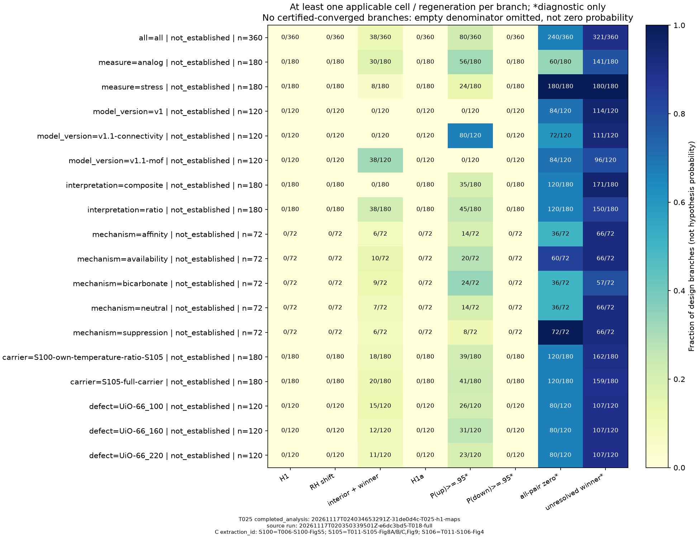

Рисунок: доли элементов дизайна с признаком хотя бы в одной ячейке; звёздочкой
отмечена диагностика. run_id `20261117T024034653291Z-31de0d4c-T025-h1-maps` (completed_analysis),
ансамбль `20261117T020350339501Z-e6dc3bd5-T018-full`, extraction_id T006-S100-FigS5, T011-S105-Fig8A, T011-S105-Fig8B, T011-S105-Fig8C, T011-S105-Fig9, T011-S106-Fig4.
Строки перекрываются, их нельзя суммировать как независимые выборки.

## Карты q_work

Одна карта — одна ветвь, R1/R2 × квантили 2.5/50/97.5%; единицы — ммоль CO2/г
сухого композита. Цветовая шкала общая внутри карты, между картами различается.
RH показана дискретными равномерно размещёнными строками 0/40/70%, не непрерывной
координатой. Номинальные условия: T_ads=308.15 K, P_ads=1 bar, сухой z_CO2=0.05,
t_ads=t_des=1800 s; R1: 383.15 K/1 bar, R2: 363.15 K/0.1 bar;
y_CO2=y_H2O=0.001 для R1, 0.01 для R2 (входной газ регенерации).
Все сохранённые знаки квантилей оставлены, в том числе малые отрицательные
численные значения около нуля; обрезки к нулю не выполнялось.

Выбран фиксированный факторный срез: обе меры × три структуры × два прочтения
при neutral; дополнительно четыре механизма при stress/connectivity/ratio.
Носитель S105-full-carrier и водная ветвь UiO-66_100 фиксированы для сопоставимости.
Это иллюстрация семейств, а не отбор по лучшему результату; альтернативные
носитель/дефектность покрываются полной таблицей, визуальное обобщение на них не заявляется.

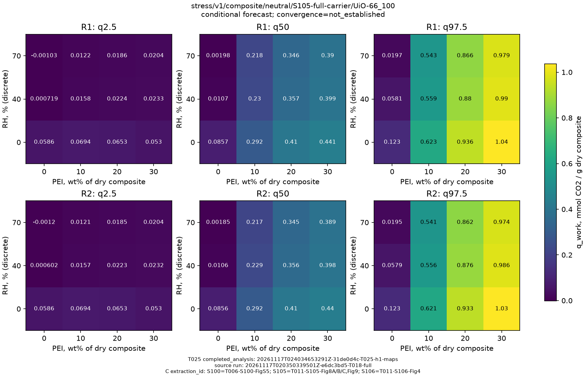

map_01.png: `stress/v1/composite/neutral/S105-full-carrier/UiO-66_100`; run_id `20261117T024034653291Z-31de0d4c-T025-h1-maps` (completed_analysis); ансамбль `20261117T020350339501Z-e6dc3bd5-T018-full`, наборы/extraction_id: T006-S100-FigS5, T011-S105-Fig8A, T011-S105-Fig8B, T011-S105-Fig8C, T011-S105-Fig9, T011-S106-Fig4.

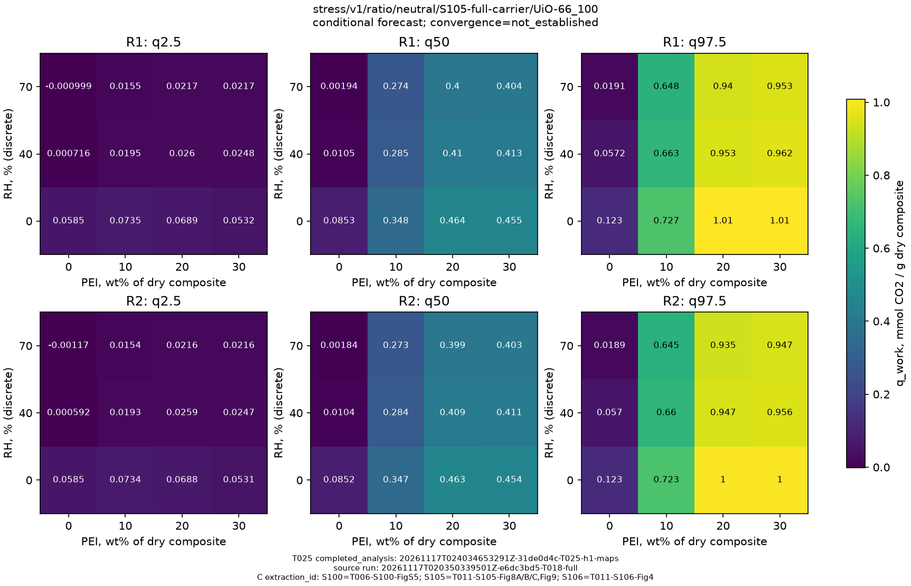

map_02.png: `stress/v1/ratio/neutral/S105-full-carrier/UiO-66_100`; run_id `20261117T024034653291Z-31de0d4c-T025-h1-maps` (completed_analysis); ансамбль `20261117T020350339501Z-e6dc3bd5-T018-full`, наборы/extraction_id: T006-S100-FigS5, T011-S105-Fig8A, T011-S105-Fig8B, T011-S105-Fig8C, T011-S105-Fig9, T011-S106-Fig4.

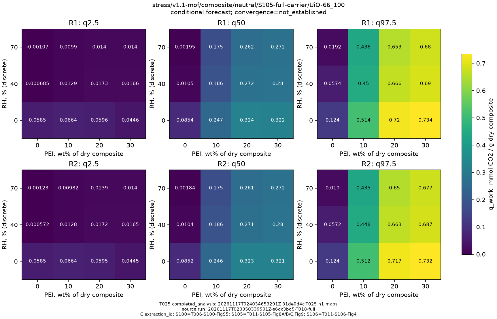

map_03.png: `stress/v1.1-mof/composite/neutral/S105-full-carrier/UiO-66_100`; run_id `20261117T024034653291Z-31de0d4c-T025-h1-maps` (completed_analysis); ансамбль `20261117T020350339501Z-e6dc3bd5-T018-full`, наборы/extraction_id: T006-S100-FigS5, T011-S105-Fig8A, T011-S105-Fig8B, T011-S105-Fig8C, T011-S105-Fig9, T011-S106-Fig4.

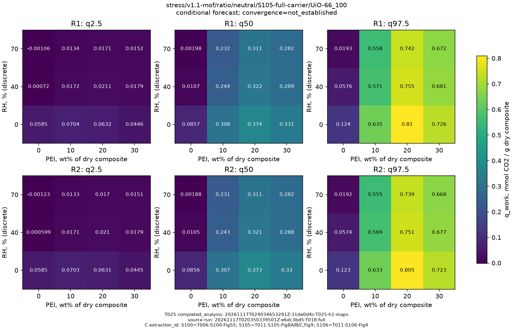

map_04.png: `stress/v1.1-mof/ratio/neutral/S105-full-carrier/UiO-66_100`; run_id `20261117T024034653291Z-31de0d4c-T025-h1-maps` (completed_analysis); ансамбль `20261117T020350339501Z-e6dc3bd5-T018-full`, наборы/extraction_id: T006-S100-FigS5, T011-S105-Fig8A, T011-S105-Fig8B, T011-S105-Fig8C, T011-S105-Fig9, T011-S106-Fig4.

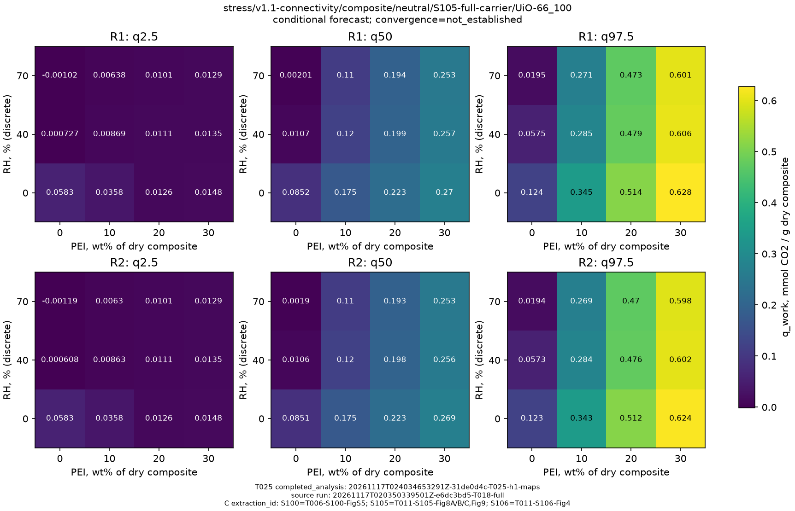

map_05.png: `stress/v1.1-connectivity/composite/neutral/S105-full-carrier/UiO-66_100`; run_id `20261117T024034653291Z-31de0d4c-T025-h1-maps` (completed_analysis); ансамбль `20261117T020350339501Z-e6dc3bd5-T018-full`, наборы/extraction_id: T006-S100-FigS5, T011-S105-Fig8A, T011-S105-Fig8B, T011-S105-Fig8C, T011-S105-Fig9, T011-S106-Fig4.


map_06.png: `stress/v1.1-connectivity/ratio/neutral/S105-full-carrier/UiO-66_100`; run_id `20261117T024034653291Z-31de0d4c-T025-h1-maps` (completed_analysis); ансамбль `20261117T020350339501Z-e6dc3bd5-T018-full`, наборы/extraction_id: T006-S100-FigS5, T011-S105-Fig8A, T011-S105-Fig8B, T011-S105-Fig8C, T011-S105-Fig9, T011-S106-Fig4.

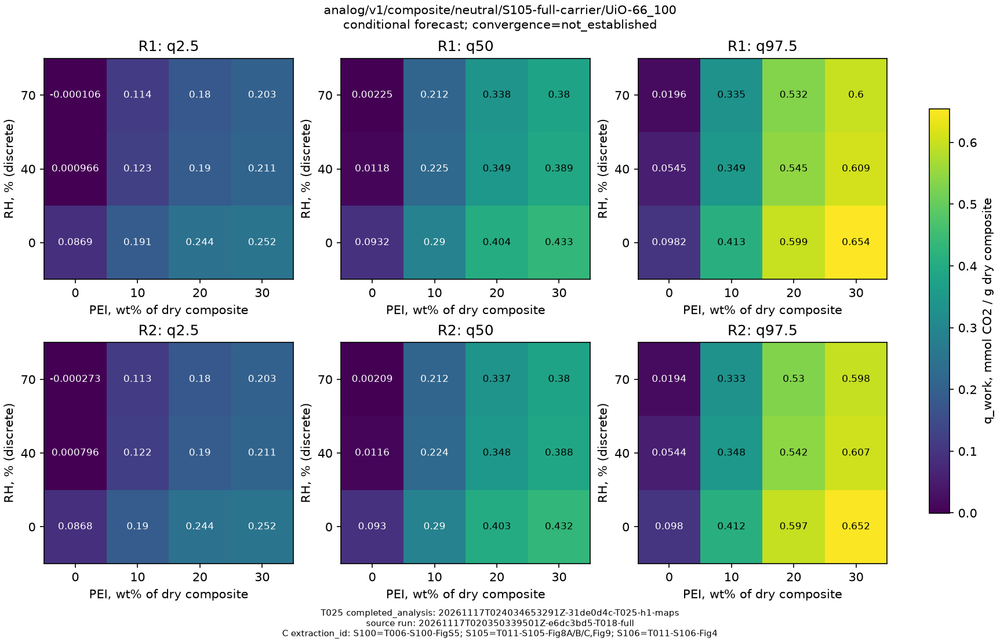

map_07.png: `analog/v1/composite/neutral/S105-full-carrier/UiO-66_100`; run_id `20261117T024034653291Z-31de0d4c-T025-h1-maps` (completed_analysis); ансамбль `20261117T020350339501Z-e6dc3bd5-T018-full`, наборы/extraction_id: T006-S100-FigS5, T011-S105-Fig8A, T011-S105-Fig8B, T011-S105-Fig8C, T011-S105-Fig9, T011-S106-Fig4.

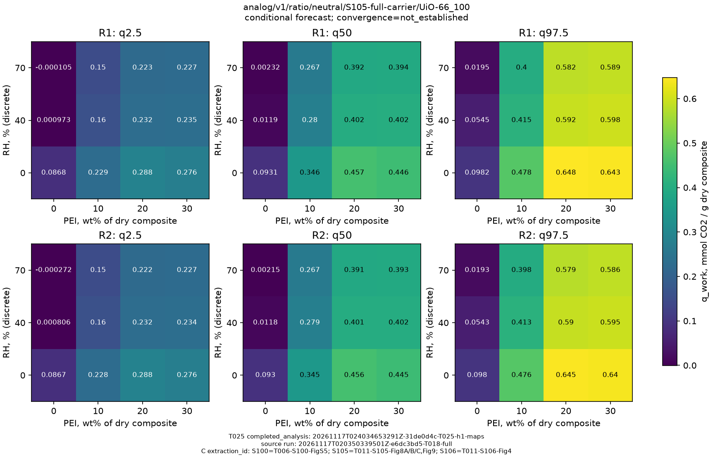

map_08.png: `analog/v1/ratio/neutral/S105-full-carrier/UiO-66_100`; run_id `20261117T024034653291Z-31de0d4c-T025-h1-maps` (completed_analysis); ансамбль `20261117T020350339501Z-e6dc3bd5-T018-full`, наборы/extraction_id: T006-S100-FigS5, T011-S105-Fig8A, T011-S105-Fig8B, T011-S105-Fig8C, T011-S105-Fig9, T011-S106-Fig4.

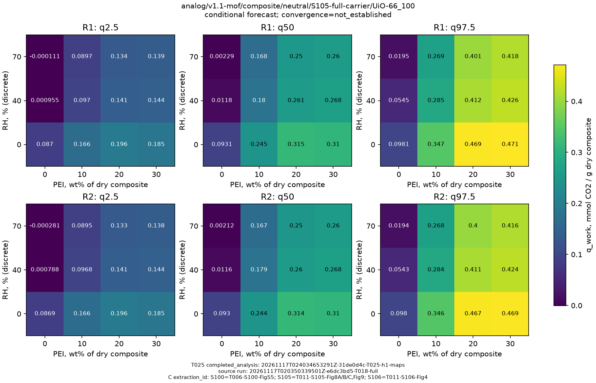

map_09.png: `analog/v1.1-mof/composite/neutral/S105-full-carrier/UiO-66_100`; run_id `20261117T024034653291Z-31de0d4c-T025-h1-maps` (completed_analysis); ансамбль `20261117T020350339501Z-e6dc3bd5-T018-full`, наборы/extraction_id: T006-S100-FigS5, T011-S105-Fig8A, T011-S105-Fig8B, T011-S105-Fig8C, T011-S105-Fig9, T011-S106-Fig4.

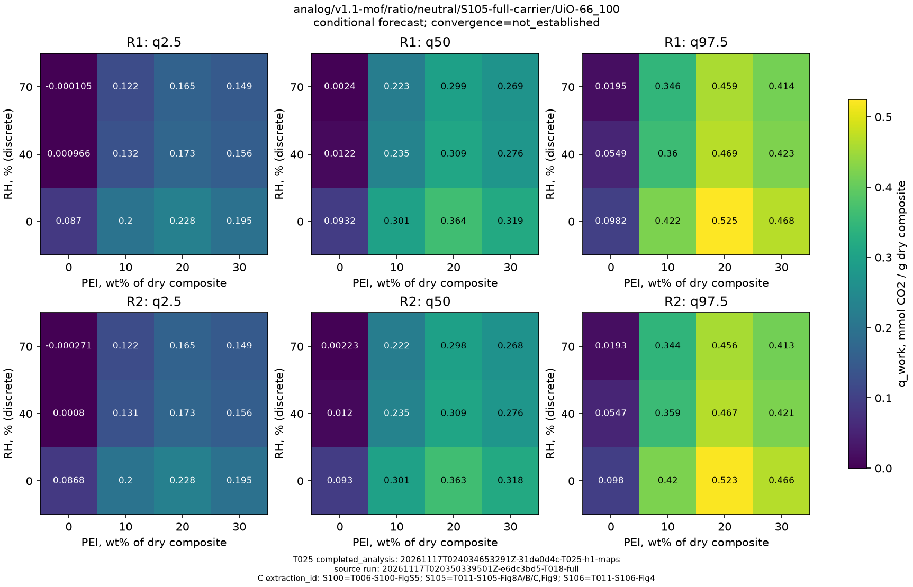

map_10.png: `analog/v1.1-mof/ratio/neutral/S105-full-carrier/UiO-66_100`; run_id `20261117T024034653291Z-31de0d4c-T025-h1-maps` (completed_analysis); ансамбль `20261117T020350339501Z-e6dc3bd5-T018-full`, наборы/extraction_id: T006-S100-FigS5, T011-S105-Fig8A, T011-S105-Fig8B, T011-S105-Fig8C, T011-S105-Fig9, T011-S106-Fig4.

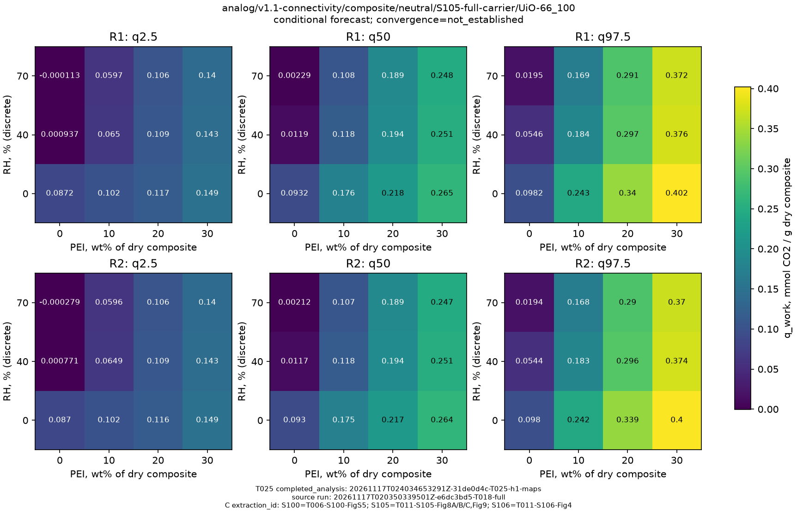

map_11.png: `analog/v1.1-connectivity/composite/neutral/S105-full-carrier/UiO-66_100`; run_id `20261117T024034653291Z-31de0d4c-T025-h1-maps` (completed_analysis); ансамбль `20261117T020350339501Z-e6dc3bd5-T018-full`, наборы/extraction_id: T006-S100-FigS5, T011-S105-Fig8A, T011-S105-Fig8B, T011-S105-Fig8C, T011-S105-Fig9, T011-S106-Fig4.

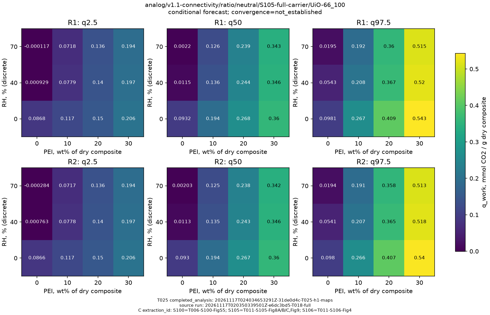

map_12.png: `analog/v1.1-connectivity/ratio/neutral/S105-full-carrier/UiO-66_100`; run_id `20261117T024034653291Z-31de0d4c-T025-h1-maps` (completed_analysis); ансамбль `20261117T020350339501Z-e6dc3bd5-T018-full`, наборы/extraction_id: T006-S100-FigS5, T011-S105-Fig8A, T011-S105-Fig8B, T011-S105-Fig8C, T011-S105-Fig9, T011-S106-Fig4.

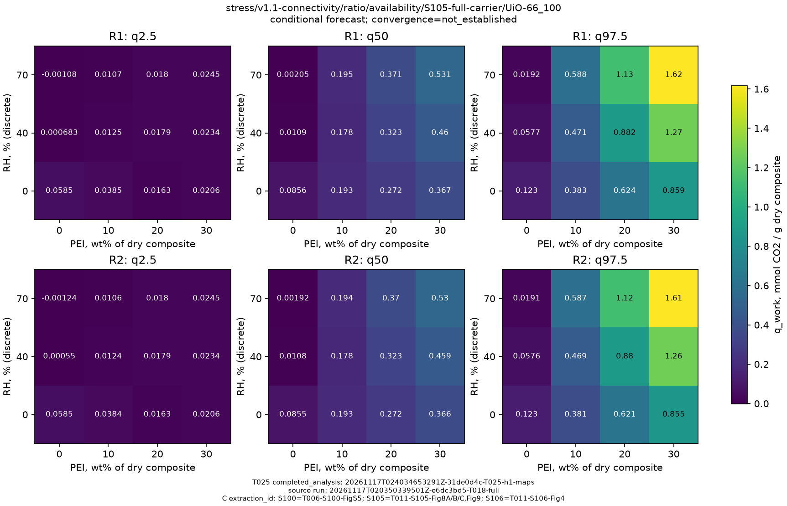

map_13.png: `stress/v1.1-connectivity/ratio/availability/S105-full-carrier/UiO-66_100`; run_id `20261117T024034653291Z-31de0d4c-T025-h1-maps` (completed_analysis); ансамбль `20261117T020350339501Z-e6dc3bd5-T018-full`, наборы/extraction_id: T006-S100-FigS5, T011-S105-Fig8A, T011-S105-Fig8B, T011-S105-Fig8C, T011-S105-Fig9, T011-S106-Fig4.

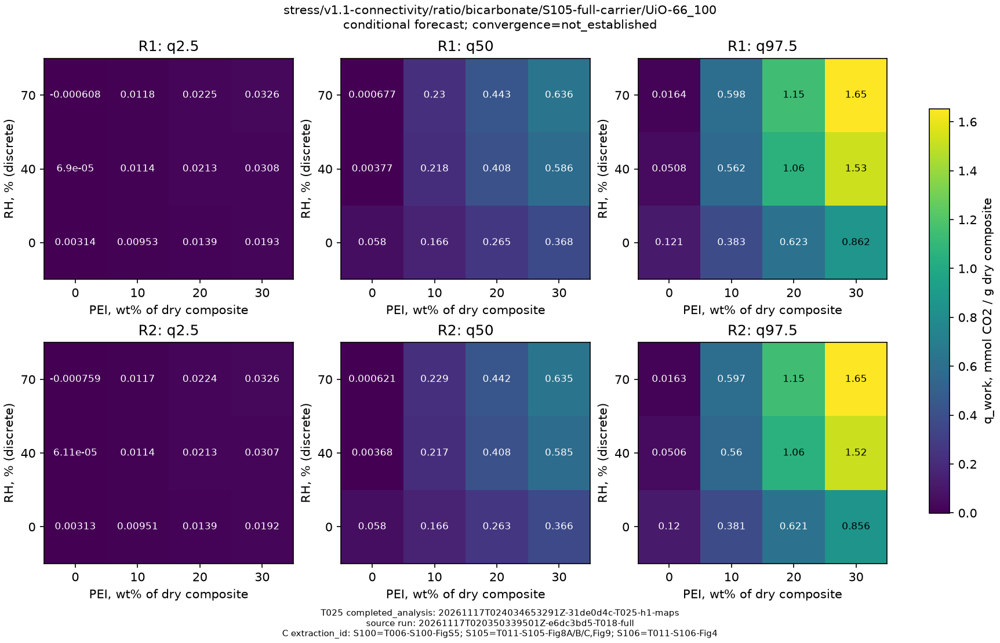

map_14.png: `stress/v1.1-connectivity/ratio/bicarbonate/S105-full-carrier/UiO-66_100`; run_id `20261117T024034653291Z-31de0d4c-T025-h1-maps` (completed_analysis); ансамбль `20261117T020350339501Z-e6dc3bd5-T018-full`, наборы/extraction_id: T006-S100-FigS5, T011-S105-Fig8A, T011-S105-Fig8B, T011-S105-Fig8C, T011-S105-Fig9, T011-S106-Fig4.

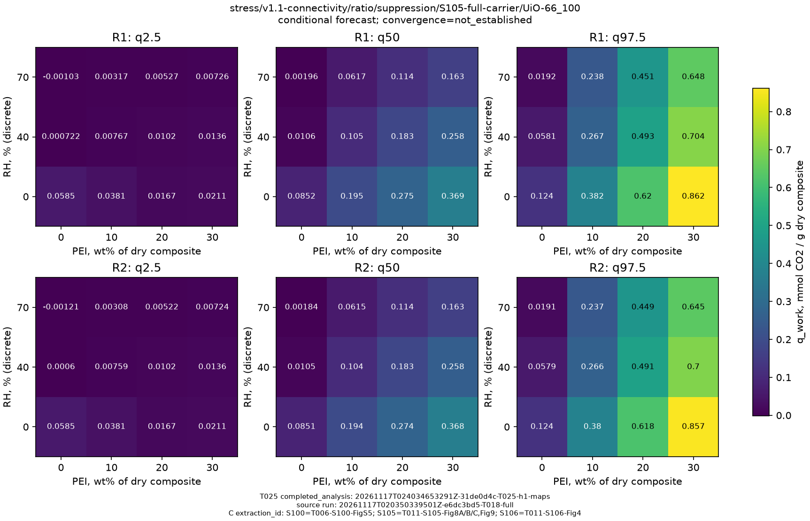

map_15.png: `stress/v1.1-connectivity/ratio/suppression/S105-full-carrier/UiO-66_100`; run_id `20261117T024034653291Z-31de0d4c-T025-h1-maps` (completed_analysis); ансамбль `20261117T020350339501Z-e6dc3bd5-T018-full`, наборы/extraction_id: T006-S100-FigS5, T011-S105-Fig8A, T011-S105-Fig8B, T011-S105-Fig8C, T011-S105-Fig9, T011-S106-Fig4.

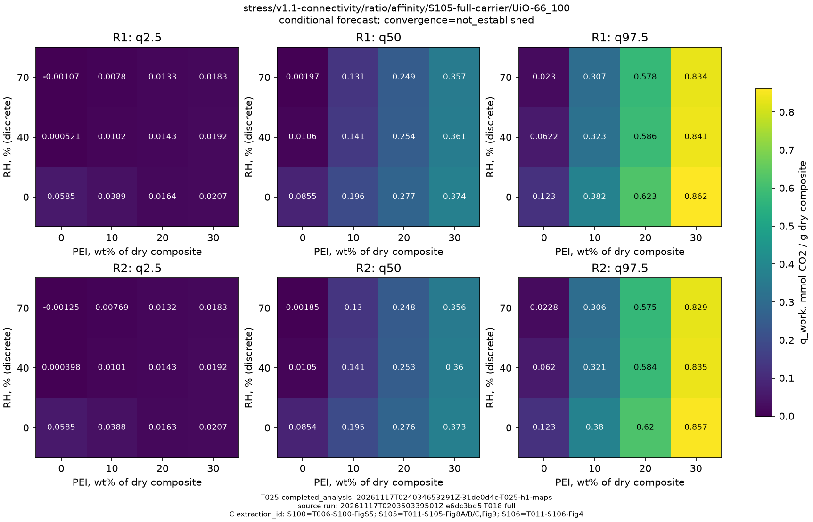

map_16.png: `stress/v1.1-connectivity/ratio/affinity/S105-full-carrier/UiO-66_100`; run_id `20261117T024034653291Z-31de0d4c-T025-h1-maps` (completed_analysis); ансамбль `20261117T020350339501Z-e6dc3bd5-T018-full`, наборы/extraction_id: T006-S100-FigS5, T011-S105-Fig8A, T011-S105-Fig8B, T011-S105-Fig8C, T011-S105-Fig9, T011-S106-Fig4.

## Приоритеты следующей проверки

Ни один состав не рекомендуется как установленный лучший. Три приоритета ниже —
проверки причин неопределённости, а не обещание результата.

1. **Идентифицировать массу и размещение PEI до новой подгонки.** Для одной
   родительской партии и нескольких загрузок определить сухую удержанную массу
   PEI и MOF независимо (например, элементный анализ с холостым носителем плюс
   согласованный массовый баланс/TGA с учётом воды). Записать одновременно
   r=m_PEI/m_MOF и w=m_PEI/(m_PEI+m_MOF), потери при обработке, неопределённости
   и базу каждого q. Так различаются прочтения `ratio` (w=r/(1+r)) и `composite`
   (w=label/100) при полной удержанности; одной изотермой их не разрешить.
   Для метки 30 различие проектных прочтений: 23.08% против 30%, не измеренный состав.
   Измерить q одновременно на г сухого композита и пересчётом на г MOF: это
   снимает v1/v1.1-mof неоднозначность оператора. Независимая порометрия до/после
   PEI по загрузкам и временны́е отклики CO2 проверят плавное объёмное блокирование
   против резкой потери связности v1.1-connectivity; нужны также структурные/водные
   характеристики носителя, а не назначение дефектности по названию PET.

2. **Получить минимальную матрицу рабочей ёмкости с полным бюджетом U.**
   Проектный минимум: w=0/0.10/0.20/0.30 (фактически измеренные), RH=0/40/70%,
   оба номинальных R1/R2 выше; одна родительская партия, одинаковое время и газ,
   минимум три независимых приготовления на состав (стартовый дизайн, мощность
   ещё unknown). Равновесные сухие q при 35 °C на тех же образцах нужны отдельно
   для H1a. Измерять q_ads и q_des, CO2 отдельно от воды, RH/точку росы у образца,
   T/P/состав и расход газа, массу сухого композита; распространить их ковариации
   в разности, ранги и интервалы. Из повторных временных отсчётов не делать
   независимые образцы. Целевая экспериментальная U позволит проверить численные
   допуски сходимости; произвольно назначать U ради pass нельзя. Если грубая сетка
   обнаружит внутреннюю область, новая заранее зафиксированная стадия уточняет
   её и края; эти уточняющие данные не объявляются прежней независимой V.
   Партии/режимы для fit и V разделить целиком и зарегистрировать до измерений;
   необходимое число повторов уточнить по пилотной U и мощности до решающего этапа.

3. **Закрыть конкретные блокеры V или заменить серии новыми данными.**
   Для S113/S103 нужны документированный RH и u_T (активация не свидетельствует
   о сухости потока); N2 вне 298 K требует T-зависимости либо нового опыта в
   калибровочной T. Для S102 нужны T/RH/массовая база/total или partial pressure
   и независимая сверка первичных маркеров. Для S2 — законная оригинальная
   вёрстка, давление 1 bar/1 atm, RH смеси, бюджет ошибок и статус вторичной
   коррекции; JATS сам по себе не закрывает T019v-03. Для Vp-ratio дополнительно
   требуется новый отдельный предрегистрированный оператор порометрии либо
   действительные обязательные входы действующего оператора: текущий прогноз
   отсутствует из-за RH, последующие блокеры P/T не исчезают. Для S117 нужны
   blank-кривая, калиброванные расход/время/сухая масса и интегральный баланс
   отдельно CO2/H2O; проскок C/C0 не равен равновесной ёмкости. Ограничения
   неполноты и независимой сверки T019v2 сохраняются до их отдельного закрытия.

Эти действия следуют из validation.json и T019v2/T023, не из подбора входов по
остаткам V. Изменение оператора или модели после раскрытия — новая версия,
с использованными сериями уже не независимая. Данных о синтезе и ресурсе эксплуатации
в этой работе не получено; вывод ограничен проверяемостью сорбционного прогноза.

## Воспроизведение и передача

Скрипт не вызывает модель, не меняет frozen-входы и не пересэмплирует ансамбль.
Сначала руководитель принимает и фиксирует код; учитываемый запуск — из чистого
дерева, без `--allow-dirty`. Команда ниже использует имеющийся locked env;
перед подготовкой среды при необходимости `UV_CACHE_DIR="$PWD/.uv-cache" uv sync --locked`.

```sh
export UV_CACHE_DIR="$PWD/.uv-cache"
uv run --locked --no-sync python scripts/run.py \
  --name T025-h1-maps --purpose 'T025 frozen branch maps and H1 analysis' \
  --hypothesis 'H1 H1a A1 A2 A3 A4' \
  --input scripts/analysis/h1_maps.py \
  --input results/prereg-v1/ensemble/summary.json \
  --input results/prereg-v1/validation/validation.json \
  --input reports/T015/demo.json \
  --input docs/hypotheses.md --input docs/decisions.md \
  --input docs/validation_protocol.md --input docs/work_order_v1.1_RU.md \
  --input docs/prereg_status.md \
  --input reviews/T013_implementation_report.md \
  --input reviews/T015_revision_report.md \
  --output reports/T025/artifacts.sha256 \
  --output reports/T025/analysis.json \
  --output reports/T025/branches.json --output reports/T025/cells.csv \
  --output reports/T025/h1_analysis.md -- \
  .venv/bin/python scripts/analysis/h1_maps.py --run-id '{run_id}'
```

Для debug тот же wrapper с `--allow-dirty` перед `--`; его статус автоматически
считывается скриптом из паспорта. Нельзя выдавать текущие debug-карты за
учитываемый новый запуск. SHA-256 каждого графика и отчёта — в artifacts.sha256;
сам файл списка хешируется runner, паспорт — `runs/<run_id>/passport.json`.
Независимые проверки T025v и учитываемый запуск руководителя остаются следующими
этапами приёмки, коммиты и публикация в T025 не выполняются.
