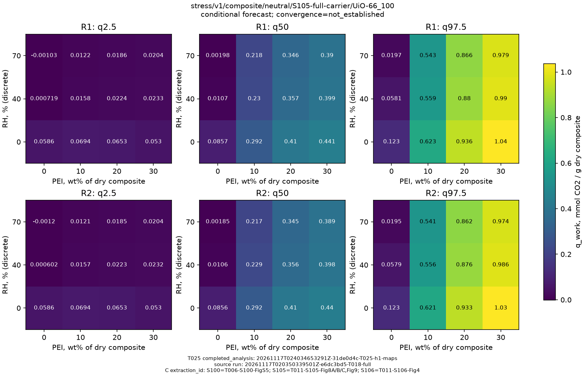

# PET2MOF: итоговый научный отчёт

Научный статус H1: **данных недостаточно**. Внешнее количественное сравнение невозможно, контроль на калибровочных данных не прошёл совокупность критериев, а ансамбль даёт условный прогноз без установленной формальной сходимости. Недостаточность данных не доказывает отсутствие максимума. Источники и ограничения этого вывода: [T025](T025/h1_analysis.md), [протокол](../docs/validation_protocol.md), [статус предрегистрации](../docs/prereg_status.md).

## Постановка и литература

Изучается возможность внутреннего максимума рабочей ёмкости CO₂ при изменении содержания PEI и влажности для композита на основе UiO-66 из ПЭТ. Под рабочей ёмкостью понимается разность загрузок при адсорбции и регенерации. Открытая литература уже обсуждает загрузку PEI, блокирование пор и действие воды; новизна конкретной постановки не доказана. Реестр и ограничения доступа: [registry.yaml](../sources/registry.yaml), [аудит](../sources/audit_report.md). PEI@UiO-66-NH2 [S2] — отдельный контрольный материал, не PET-derived PEI@UiO-66.

## Гипотезы и альтернативы

[H1](../docs/hypotheses.md) предполагает внутренний максимум и зависимость его положения и выраженности от влажности и доступности пор. H1a касается инверсии ранжирования сухой равновесной и влажной рабочей ёмкости. Альтернативы: монотонный рост, монотонное снижение, неразличимые в пределах неопределённости составы и отсутствие разрешённого сдвига оптимума с влажностью. Они не являются взаимоисключающей классификацией результатов анализа T025.

## Данные и качество извлечения

Измерения источников, оцифровка, авторские подгонки, чужие симуляции и прогнозы модели имеют разные статусы. [T004](../reviews/T004_registry_check.md) проверил реестр; [T007](../reviews/T007_extraction_review.md) — пилот извлечения; [T011v2](../reviews/T011v2_reverification.md) — калибровочные серии; [T014v](../reviews/T014v_ranges_verification.md) — диапазоны. Паспорта и проекты находятся в [data/extraction](../data/extraction/). Проверяемость условий V отдельно разобрана в [T019v2](../reviews/T019v2_holdout_reverification.md) и [T023](../reviews/T023_holdout_testability.md); их оригиналы доступны также через `git show holdout/v1:reviews/T019v2_holdout_reverification.md` и соответствующий путь T023. Сверка извлечения не устанавливает неизвестные условия опыта. Изображения S117 не публикуются из-за неустановленной лицензии; оригинальная вёрстка S2 не получена.

## Модели и допущения

[Спецификация](../docs/model_spec.md), [параметры](../docs/parameters.md) и [решения D-06–D-18](../docs/decisions.md) задают физсорбцию, конкурентное влияние воды, аминное связывание, доступность пор и конечное время, а также базовую модель B1. Версии различают массовую базу и возможную потерю связности; неоднозначность маркировки PEI учитывается разными прочтениями. Цикл квазиравновесный, релаксация — условное допущение; общая константа времени бикарбонатной ветви не является установленной кинетикой (D-08/D-17). Общая ёмкость и свободный объём не должны учитываться дважды. Стандартный GCMC с нереактивным потенциалом не описывает аминную хемосорбцию. Неизвестные свойства не заменяются выдуманными измерениями.

## Проверка: три разных уровня

**Внешние данные V.** [validation.json](../results/prereg-v1/validation/validation.json), run_id `20261117T022438705845Z-e6dc3bd5-prereg-v1-validate`: 20 серий (S2, S102, S103, S113, S117), 31 запись; полных сравнений 0, условных 0, `not_testable` 31. По правилам D-18 нет количественно сопоставимой серии. Правила проверяемости после этого результата не ослаблялись: D-18 был принят до тега, а повторное ослабление по увиденному составу V было бы выбором пути анализа по данным ([prereg_status](../docs/prereg_status.md)). Тег `prereg-v1` закрепляет commit ветки `holdout/v1` и SHA-256 файлов условий и наблюдений; прогнозы ([пакет](../results/prereg-v1/holdout_v1/), run_id `20261117T022431395228Z-e6dc3bd5-prereg-v1-predict`) побайтово совпадают с хешами `freeze.json`. Причины включают неизвестные RH, температуру или её неопределённость, массовую базу и давление; проскоковые кривые S117 не дают равновесной ёмкости без баланса и blank. [T024](../reviews/T024_freeze_reveal.md) документирует фиксацию до раскрытия. Для `S2-Table1-Vp-ratio` метка `frozen predictions missing` неточна: строки пакета прогнозов существуют, но численное значение действующего оператора недоступно из-за RH; остаются и другие блокеры, описанные T023. Статус `not_testable` не является численным провалом.

**Контроль на C.** S100, extraction_id `T006-S100-FigS5`: ни одна структура не прошла все критерии целых изотерм; улучшение по тем же данным после ревизии является подгонкой, а не независимой проверкой. Доказательства: [T013](../reviews/T013_implementation_report.md), [T015](../reviews/T015_revision_report.md), [demo.json](T015/demo.json), run_id `20261116T233859136282Z-4fea9ba6-T015-demo` (debug). Сравнение M1 и B1 не доказывает превосходство M1 только потому, что линейная B1 выбирает край. Метрики на S100 (ммоль/г; mean(U) = 0.156; критерии: MAE ≤ mean(U), ≥ 90 % точек в U, |Bias| ≤ mean(U)/2 для каждой целой изотермы; источник — [T025](T025/h1_analysis.md), раздел «Контроль на C»):

| Структура / прочтение | M1 RMSE | M1 в U | B1 RMSE | B1 в U | Все целые серии (M1) |
| --- | --- | --- | --- | --- | --- |
| v1 / composite | 0.252 | 28 % | 0.370 | 21 % | нет |
| v1 / ratio | 0.272 | 31 % | 0.339 | 38 % | нет |
| v1.1-mof / composite | 0.229 | 31 % | 0.451 | 5 % | нет |
| v1.1-mof / ratio | 0.269 | 31 % | 0.389 | 10 % | нет |
| v1.1-connectivity / composite | 0.090 | 97 % | 0.451 | 5 % | нет |
| v1.1-connectivity / ratio | 0.101 | 90 % | 0.389 | 10 % | нет |

У `v1.1-connectivity` малый суммарный Bias маскирует смещения изотерм 10PEI/20PEI, показатель связности упирается в верхнюю границу 12, AICc по четырём изотермам не определён.

**Условный ансамбль.** [T025](T025/h1_analysis.md) анализирует сохранённый ансамбль `20261117T020350339501Z-e6dc3bd5-T018-full`, run_id анализа `20261117T024913232242Z-625a5999-T025-h1-maps`. Это не внешняя проверка. Ветви не усреднены, а их частоты отражают факторный дизайн, а не вероятность гипотезы. Формальная сходимость `not_established`: целевая наблюдательная U неизвестна. Частичные проверки: устойчивость вероятностей рангов к повторам и удвоению N не пройдена у 88 ветвей, положение максимума на сетке — у 6; хотя бы одна из двух не пройдена у 93 ветвей (88 + 6 − 1 общая). N после просмотра не увеличивался. Нулевой `conditional_H1` не устанавливает отсутствия максимума в материале.

## Результаты условного ансамбля

360 ветвей (мера stress/analog × 3 версии модели × 2 прочтения маркировки PEI × 5 механизмов воды × 2 переноса носителя × 3 дефектности), по 4 × 4096 выборок, номинальные режимы R1/R2, RH 0/40/70 %; источник — [T025](T025/h1_analysis.md), [cells.csv](T025/cells.csv), run_id `20261117T024913232242Z-625a5999-T025-h1-maps`.

| Показатель (решающее правило [hypotheses.md](../docs/hypotheses.md)) | Ветвей |
| --- | --- |
| `conditional_H1` (R1 / R2): внутренний разрешённый оптимум при RH 70 % + сдвиг w* + изменение Δ | 0 / 0 из 360 |
| Разрешённый сдвиг w* между RH 0 и 70 % (R1 / R2) | 0 / 0 из 360 |
| H1a: устойчивая инверсия рангов «сухая равновесная ↔ влажная рабочая» | 0 (0 из 8640 влажных парных сравнений) |
| Внутренний разрешённый оптимум хотя бы в одной ячейке | 38 — **все** `v1.1-mof` + прочтение `ratio` (признак хотя бы в одной ячейке); 90 %-интервалы w* в ветвях с разрешённым оптимумом: R1/RH 0 (33 ветви) — от 18–19 до 22–23 %, R1/RH 70 % (29 ветвей) — от 19–20 до 23 %; при обеих RH разрешён в 24 ветвях |
| Внутренний разрешённый оптимум по ячейкам R1 (RH 0 / 40 / 70) | 33 / 24 / 29 |
| B1 (линейна по w) | всегда край, 30 % |

Единственный повторяющийся внутренний оптимум (около 20 % PEI) присущ одной версии оператора и одному прочтению маркировки; его сдвиг с влажностью **не установлен** при принятой неопределённости (интервалы перекрываются, `w_star_shift_resolved = false`). Постоянство оптимума этим **не доказано**: перекрытие интервалов не доказывает независимость от RH (протокол); A4 лишь не отвергнута, и это свойство условного прогноза, а не материала. В остальных версиях оптимум либо на краю (30 %), либо не разрешён.

## Карта и неопределённость

Карта ниже — один заранее выбранный факторный срез из [T025](T025/h1_analysis.md): строки RH дискретны, составы не интерполированы, показаны квантили условного прогноза q_work. Масштабы между отдельными картами могут различаться. Интервалы не включают неизвестные систематические ошибки модели и не подтверждают применимость к целевому материалу. Полный набор карт и таблица ячеек: [T025](T025/), [cells.csv](T025/cells.csv). Наборы и extraction_id: `T006-S100-FigS5`, `T011-S105-Fig8A`, `T011-S105-Fig8B`, `T011-S105-Fig8C`, `T011-S105-Fig9`, `T011-S106-Fig4`; run_id карты и ансамбля приведены выше.

## Отрицательные результаты, ограничения и следующие опыты

Ни один состав не установлен лучшим; отсутствие разрешённой разницы не доказывает эквивалентность. Контроль C не пройден; внешняя проверка невозможна; формальная сходимость не установлена. Невозможно заключить о синтезируемости, промышленной готовности, экологическом превосходстве или устойчивости к циклам на основании этих результатов.

Приоритеты дальнейшей проверки ([T025](T025/h1_analysis.md), раздел «Приоритеты»):

1. **Установить фактический состав и размещение PEI.** Для одной родительской партии и нескольких загрузок независимо измерить сухую удержанную массу PEI и MOF (элементный анализ с холостым носителем, массовый баланс/TGA с учётом воды), порометрию до/после PEI и временные отклики CO2. Это различает прочтения `ratio`/`composite` (для метки 30: 23 % против 30 %) и версии оператора — именно там находится единственный внутренний оптимум прогноза.
2. **Минимальная матрица рабочей ёмкости с полным бюджетом U:** w = 0/10/20/30 % (измеренные), RH 0/40/70 % с контролем точки росы у образца, номинальные R1/R2, одна партия, ≥ 3 независимых приготовления на состав; отдельно сухие равновесные изотермы при 35 °C на тех же образцах (для H1a); разделение партий на калибровку и проверку — до измерений.
3. **Закрыть блокеры V или заменить серии:** RH и u_T для S113/S103; T, RH, массовая база и смысл давления для S102; законная оригинальная вёрстка, давление и RH смеси для S2; blank, расход, сухая масса и раздельный баланс CO2/H2O для S117. Мощность опыта и целевая U должны определяться пилотными измерениями. Изменение модели после раскрытия V создаёт новую версию, для которой использованные данные не являются независимой проверкой.

## Прослеживаемость главных выводов

| Вывод | Артефакт и набор | run_id / extraction_id |
| --- | --- | --- |
| V не допускает сравнения | validation.json; серии V S2, S102, S103, S113, S117; T023 | `20261117T022438705845Z-e6dc3bd5-prereg-v1-validate`; паспорта `data/extraction/` |
| Контроль целых изотерм C не пройден | T015/demo.json; S100 | `20261116T233859136282Z-4fea9ba6-T015-demo`; `T006-S100-FigS5` |
| Карта — условный прогноз | T025/cells.csv и карты; S100, S105, S106 | `20261117T024913232242Z-625a5999-T025-h1-maps`; ансамбль `20261117T020350339501Z-e6dc3bd5-T018-full`; extraction_id перечислены в разделе карты |

## Комплект по §11 поручения

| Пункт | Расположение и незавершённое |
| --- | --- |
| 1. Код, окружение, данные | `src/`, `uv.lock`, `sources/`, `data/`; права на отдельные первичные изображения ограничены |
| 2. Контроль и тесты | `make reproduce-demo`, `make test`, `make test-ocr`; воспроизведение проверено T016; контроль научных критериев C не пройден |
| 3. Независимые данные | `docs/validation_protocol.md`, `validation.json`; количественное сравнение невозможно |
| 4. Карта и неопределённость | `reports/T025/`; область — условные дискретные сценарии, экспериментальная применимость не установлена |
| 5. Дальнейшая проверка | приоритеты выше и `reports/T025/h1_analysis.md`; лучший материал не установлен |
| 6. Паспорта и независимая проверка | `runs/`, `results/prereg-v1/runs/`, `reviews/` (T016, T021/T021r, T024, T025v и др.), таблица выше |
| 7. Очищенный пакет | `make publish-check`, `sources/LICENSES.md`; итоговая проверка публикации выполняется перед выпуском; внешняя CI запрещена |
| 8. Извлечение и OCR | `data/extraction/`, T007/T011v2, `make test-ocr`; не все V-извлечения и условия подтверждены |

## Воспроизведение

Команды и условия для чистого checkout приведены в [README](../README.md). `make report` собирает этот PDF локально из Markdown; для полного предрегистрированного расчёта нужен чистый checkout тега `prereg-v1`. Сборка отчёта не запускает научный расчёт и не меняет его результаты. Независимая проверка [T016](../reviews/T016_clean_reproduction.md) из чистого клона без `.env` и без сети: все цели `make` завершились с кодом 0; `make reproduce-full` на теге (≈16 мин) воспроизвёл 360/360 файлов выборок побайтово; JSON ветвей отличаются только `run_id`; PNG имеют другие хеши — вклад смены надписи с `run_id` ожидаем, иные возможные различия не проверены (эталонные PNG не хранятся).

## Организация работ и роль ИИ-агентов

Руководитель Claude Code отвечает за планирование, приёмку и научную редактуру; исполнители — модели Codex. Назначения и доступные фактические настройки указаны в [docs/model_policy.md](../docs/model_policy.md) и [reviews/agent_contributions.md](../reviews/agent_contributions.md). Фактические настройки текущей сессии интерфейсом не раскрыты. Согласие нескольких LLM не является подтверждением; необходимы независимая сверка с первоисточниками и проверка артефактов.

## Источники

Библиографические записи и DOI — [sources/registry.yaml](../sources/registry.yaml); доступ, ограничения и сравнительный анализ — [sources/audit_report.md](../sources/audit_report.md), [sources/LICENSES.md](../sources/LICENSES.md). Конкретные исходные рисунки, таблицы и extraction_id приведены в паспортах `data/extraction/` и связанных ревью. Решающее правило — [docs/hypotheses.md](../docs/hypotheses.md); требования сдачи — [поручение §11](../docs/work_order_v1.1_RU.md).
