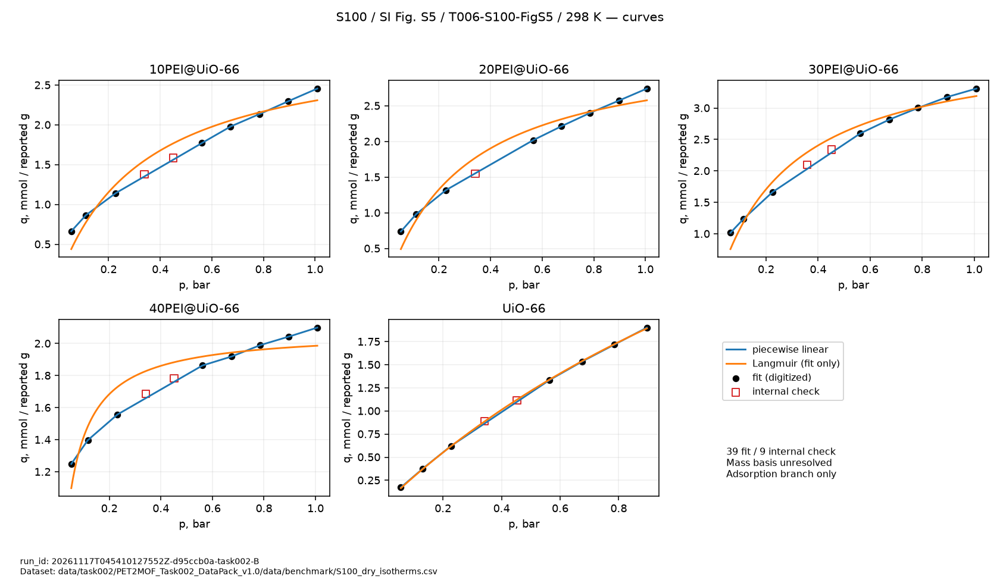

# PET2MOF v2 (PET-CO2-TASK-002): сухая адсорбция CO2 — проверенный пакет данных и выбор кандидатов

17.11.2026 · ветка `task002-dry-screening` · поручение [`docs/work_order_task002_RU.md`](../../docs/work_order_task002_RU.md).
Этап v1 (PET-CO2-TASK-001, тег `prereg-v1`, статус H1 «данных недостаточно») не изменялся.

## 1. Решение

**Для следующих исследований рекомендованы два измеренных кандидата — C72 и C96 (UiO-66-NH2 с PEI, предварительно
насыщенным CO2 и химически закреплённым; подача 72 и 96 % от MOF) — с контролем UiO-66-NH2.** Оба устойчиво выше
контроля при независимых ограниченных отклонениях каждого значения до ±5 % (пороги 9.8 % и 8.1 %), но не до ±10 %.
Между ними различие **не разрешено**: номинальный разрыв 3.5 % требует погрешности каждого измерения ниже 1.56 % (с
округлением таблицы). Победитель не назначается. Краткое решение — [decision_brief.md](decision_brief.md).

Условия: S2 (Zhu et al., ACS Omega 2019, DOI 10.1021/acsomega.8b02319), сухой чистый CO2, 25 °C, давление «1 bar»
(Table 2) / «1 atm» (текст); ёмкость на массу сорбента. Происхождение образцов из ПЭТ не установлено.

## 2. Данные и их приёмка

| Набор | Что | Статус и проверка |
| --- | --- | --- |
| S2 Table 2, сухая q | 6 измеренных значений (author_reported_measurement) | Все клетки Tables 1–2 сверены с открытым JATS первоисточника (T031, Europe PMC); вёрстка PDF не проверена |
| S2 Table 1 | подача PEI, прирост массы, N, авторская оценка PEI, BET, Vp | авторские расчёты и измерения; 22.4 % (Table 1) против 22.1 % (заключение) для C96 сохранены |
| S2 вторичные | alpha, суммарная смесь, авторская коррекция, влажный отклик, DSC (3 пусто) | только рядом с основным критерием |
| S100 | 48 оцифрованных точек 5 изотерм (298 K) + 2 в карантине | существующая оцифровка v1, совпала по Git blob SHA-1 с `66bae26`; масса-основа не установлена |

Приёмка ([intake.md](../../docs/task002/intake.md), [acceptance.json](intake/acceptance.json)): при получении архива —
37/37 SHA-256; в публичной копии — 35/35 и два явно исключённых файла поручения (имя владельца, E-02). Расчёты
подготовителя (`make reproduce-demo` пакета) воспроизведены побайтово на Python 3.9.6 и 3.12.0. Неполнота словаря
данных пакета (T031) записана как ограничение.

## 3. Расчёт А: сравнение кандидатов

Методы зафиксированы до расчётов ([analysis_plan.md](../../docs/task002/analysis_plan.md); поправка E-05 после ревью).
Интервал каждого значения `[q(1−d) − 0.005, q(1+d) + 0.005]`, d = 3/5/10 % — **сценарии**, не доверительные интервалы;
преимущество A над B устойчиво при `lo_A > hi_B`; порог `d* = (q_A − q_B − 0.01)/(q_A + q_B)`. Инвентарь
`m = 1000/(44.01·q)` кг сорбента на однократную равновесную загрузку 1 кг CO2 (не цикл).

| Образец | q, ммоль/г | к контролю | порог к контролю d* | m, кг/кг CO2 | PEI в m, кг (по авт. оценке) |
| --- | ---: | ---: | ---: | ---: | ---: |
| C72 | 3.26 | +22.1 % | 9.78 % | 6.97 | 1.35 |
| C96 | 3.15 | +18.0 % | 8.08 % | 7.21 | 1.62 |
| N72 | 2.99 | +12.0 % | 5.48 % | 7.60 | 1.31 |
| C48 | 2.75 | +3.0 % | 1.29 % | 8.26 | 0.88 |
| BASE | 2.67 | — | — | 8.51 | 0 |
| I96 | 1.87 | −30.0 % | ниже | 12.15 | 5.27 |

| Пара | q_A/q_B | d* с округлением | без округления | устойчиво при 3 / 5 / 10 % |
| --- | ---: | ---: | ---: | --- |
| C72/C96 | 1.035 | 1.56 % | 1.72 % | нет / нет / нет |
| C96/N72 | 1.054 | 2.44 % | 2.61 % | нет / нет / нет |
| C72/N72 | 1.090 | 4.16 % | 4.32 % | да / нет / нет |
| C96/I96 | 1.684 | 25.3 % | 25.5 % | да / да / да |

Пары отличаются одновременно способом подготовки, подачей и удержанным PEI — это не причинная оценка одного фактора.
Назначенный общий множитель ёмкости k не меняет отношений и рангов, m меняется как 1/k. Разногласие «1 bar / 1 atm»
к общему множителю не сводится: его влияние на отношения не оценено (зависит от формы изотерм, которых в S2 нет).
Ценовой порог при равной стоимости материала на загрузку: C72 1.22, C96 1.18 (не экономическое обоснование).
Файлы: [A/](A/) — `nominal.csv`, `stress_independent.csv`, `stress_common_factor.csv`, `pairwise.csv`, `candidates.csv`,
[candidates.md](A/candidates.md). Run `20261117T044031484585Z-1acc1c2c-task002-A`.

**Независимый пересчёт.** T033 (другой исполнитель, без доступа к T030 и эталону пакета) повторил ключевые сравнения
точной рациональной арифметикой, перебором вершин интервалов и бисекцией порогов: наибольшее расхождение с T030
1.4·10⁻¹⁴, 0 из 24 флагов устойчивости ([independent_agreement.json](A/independent_agreement.json), run
`20261117T044043117206Z-cb31d105-task002-A-agreement`). Ревью T035 повторило все 30 пар × 3 сценария точными дробями
(0 из 90 расхождений флагов). Совпадение реализаций — проверка арифметики, не измерений.

## 4. Расчёт Б: S100 — база против минимальной изотермы

Кусочно-линейная интерполяция (база пакета) независимо повторена (MAE 0.028573177766352747, отличие 2·10⁻¹⁷). На
заранее назначенном внутреннем блоке 0.33–0.46 bar (9 точек; 39 для подгонки) однопозиционный Langmuir, подогнанный
отдельно к каждой кривой, даёт суммарную MAE 0.135 против 0.029 ммоль/г «сообщённых»; у PEI-кривых ошибка формы больше
полуширины оцифровки 0.105, у UiO-66 Langmuir точнее (0.005), но q_s неустойчиво. Правило подключения Toth сработало
для четырёх PEI-кривых; Toth не идентифицируется (потеря ранга, граница или отсутствие сходимости; 36 попыток
сохранены). По заранее записанному правилу **сохранена интерполяция**; при сдвигах q ±0.105 и p ±0.042 выбор тот же.

Это ретроспективная внутренняя проверка на уже виденных данных, не слепая и не внешняя; абсолютный расход сорбента и
«оптимальная» доля PEI по S100 не вычисляются. Файлы: [B/](B/), [decision.json](B/decision.json), run
`20261117T045732361230Z-753cec58-task002-B`.

## 5. Поправка В: оператор отношения объёмов пор

`evaluate` (`src/pet2mof/calibration/prediction.py`) больше не требует RH, pCO2, CO2-носителя и температурного
коэффициента PEI для `Vp_ratio_to_w0`; проверки basis, unit, w, D-11 и `scale ≥ 0` сохранены, CO2-ветви по-прежнему
требуют RH и p. Регрессионный тест `tests/test_task002_vp_operator.py` на актуальной функции: на коде `66bae26` —
92 failed / 69 passed, после исправления — проходит; на 6 реальных строках S2 (N2, 77 K, без RH/p) вычисление
выполняется. Прогнозы и проверка `prereg-v1` не пересчитывались; статус `S2-Table1-Vp-ratio` в v1 — `not_testable`.

## 6. Следующий опыт

[next_experiment.md](next_experiment.md): сухие изотермы C72 и C96 и контроля из одной партии носителя, ≥ 3 независимых
приготовления, давление от ~0.05 до ≥ 1.1 bar (1.000 и 1.01325 bar внутри), бюджет погрешности до измерений с
разделением общей, индивидуальной и состояния образца; порог различимости < 1.56 % на значение по полной
нескомпенсированной погрешности. Перед переносом на UiO-66 из ПЭТ: способ S2 закрепляет PEI через NH2 линкера
(S2 §2.1), которого у терефталатного UiO-66 нет — нужны отдельные варианты материала и контроли носителя.

## 7. Границы

Не установлено и не заявляется: влажное поведение и влажный оптимум, рабочая ёмкость цикла, энергия регенерации,
ресурс, селективность смеси (alpha — отношение чистогазовых ёмкостей), промышленная готовность, результат для
PET-derived материала, вероятности, p-value, «победитель» C72/C96. Измерения (q S2), авторские расчёты (PEI %,
коррекция смеси), наши производные (приросты, пороги, m) и искусственные тесты разделены в CSV колонкой типа величины.

## 8. Проверка и воспроизведение

| Проверка | Кто | Результат |
| --- | --- | --- |
| Сверка S2 с первоисточником | T031, gpt-6.1-terra/medium | все клетки Tables 1–2 совпали |
| Независимый пересчёт А | T033, gpt-6.1-terra/high | расхождение ≤ 1.4·10⁻¹⁴ |
| Научное ревью А/Б/В и текстов | T035, gpt-6-astra/high | 0 critical, 2 major, 2 minor — исправлены (E-05, E-06) |
| Повторное ревью исправлений | T035r, gpt-6-astra/high | T035-01/03/04 закрыты, T035-02 частично → T035r-01 (двойной учёт округления) исправлено; числа А/Б не менялись |
| Чистое офлайн-воспроизведение | T036, gpt-6.1-terra/medium, сеть off | все 6 команд exit 0 (501 passed); числовые выходы совпали до `run_id`; отличия — метаданные коммита/плана и подпись `run_id` на PNG |

Команды (без сети, `.env`, LLM и платного OCR): `make env` (однократно, нужна сеть или локальный кэш uv), `make test`,
`make task002-intake`, `make task002-screen`, `make task002-s100`, `python scripts/task002_independent/recompute.py`,
`python scripts/task002/compare_independent.py`, `make report-task002`. Учитываемые запуски — через `scripts/run.py`
из чистого дерева, паспорта в `runs/`.

## 9. Вклад агентской команды

Руководитель — Claude Code (планирование, правила анализа до расчётов, приёмка, научная редактура, слияния,
учитываемые запуски). Исполнители — субагенты OpenAI Codex, запуск через `scripts/agents/run_codex_task.sh` с явными
моделью, effort, sandbox и сетью; фактические настройки — из rollout `turn_context` (журналы в `private/agent_logs/`,
не публикуются). Таблица — [agent_contributions.md](agent_contributions.md); журнал ошибок —
[error_log.md](../../docs/task002/error_log.md). Вмешательство человека: владелец приложил архив пакета, не
переданный с первым сообщением. Согласие нескольких LLM не считалось подтверждением: ключевые числа проверены
независимыми реализациями и первоисточником.

## Источники

S2: Zhu J., Wu L., Bu Z., Jie S., Li B.-G. ACS Omega 2019, 4, 3188–3197, DOI 10.1021/acsomega.8b02319 (Tables 1–2,
§§2.1, 2.2, 4.6). S100: Xian S. et al. Ind. Eng. Chem. Res. 2015, 54, 11151–11158, DOI 10.1021/acs.iecr.5b03517 (SI Fig.
S5, оцифровка проекта `T006-S100-FigS5`). Условия использования источников — `data/task002/…/docs/RIGHTS_AND_SOURCES.md`.
