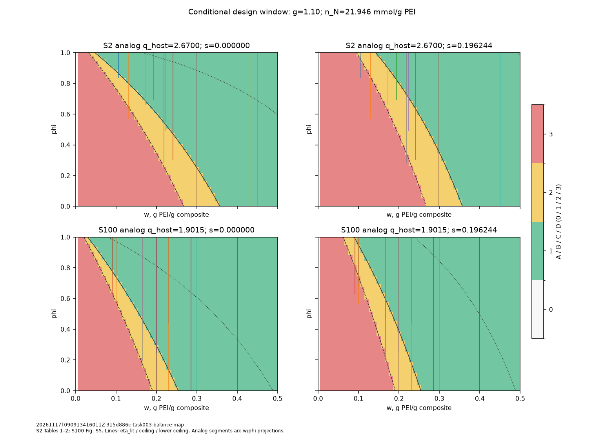
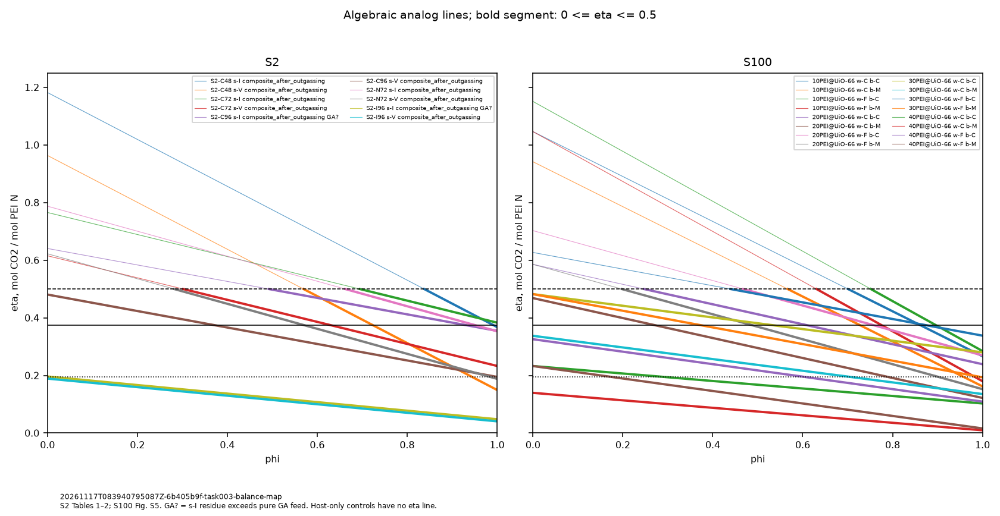
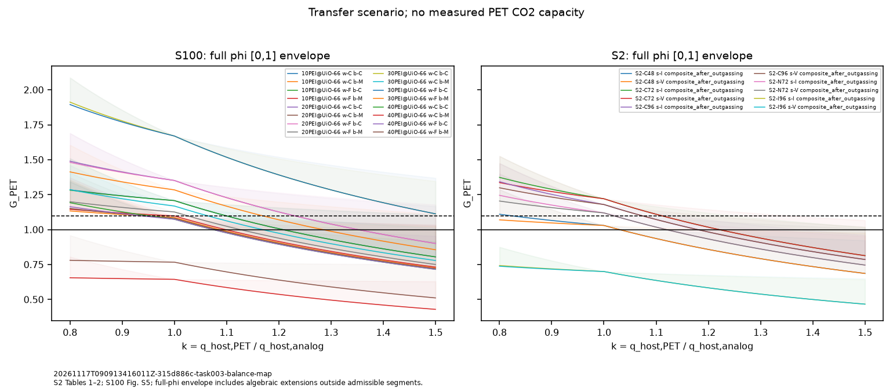

# PET-CO2-TASK-003 — перенос PEI-модификации на PET-derived UiO-66: итоговый отчёт этапа v3

17.11.2026 · ветка `task003-pet-transfer` · статус: **частично выполнено** — CO₂-ёмкость PET-derived UiO-66 в открытых
первоисточниках не найдена, поэтому все границы выигрыша сформулированы условно через отношение
k = q(PET-носителя)/q(аналога). Область: сухой чистый CO₂, ≈298 K, 0.896–1 bar (S100 при 0.896 bar; S2 «1 bar | 1 atm»).
Не смесь, не влажный газ, не цикл.

## 1. Ответ

* **Выбранный маршрут: R1 — прямое импрегнирование PEI в PET-derived UiO-66 по протоколу аналога S100 «30PEI»
  (удержанная w = 0.231 или 0.300 г/г композита в зависимости от прочтения метки). Резерв: R2 в форме смешанного
  линкера PET-BDC/NH₂-BDC (f ≈ 0.54) + PEI через GA (режим S2 C72).** R2 в форме S2 к PET-UiO-66 без NH₂ неприменим.

* **Числа, на которых держится выбор** (g = 1.10, т. е. q_target = 1.10·q_R0): порог переноса k* = G_analog/g для R1
  1.06–1.52 по четырём ветвям основы S100 (оцифровка расширяет до 0.95–1.75), для R2-ориентира C72 1.110 (1.106–1.114);
  окна класса B (η_min ≤ 0.3747) при k = 1 есть у обоих: 30PEI w-C/b-C при φ ≥ 0.53, C72 s-V при φ ≥ 0.63; у C72 в
  ветви s-I окна B нет (η(φ=1) = 0.383). Разность k* (R1 − R2 от −0.05 до +0.41) меньше размаха k* R1 по ветвям (0.455)
  → по правилу §4 ничья, решает меньшая не-PET масса: доля PET-фрагментов 0.36–0.46 (R1) против 0.14–0.20 (R2).

* **Новое:** (1) условный порог переноса k*, который превращает отсутствие q_host PET в одно измеримое условие;
  (2) окно загрузки R1: выигрыш у аналогов есть до метки 30PEI и исчезает к w 0.29–0.45; (3) массовый баланс S2
  не замыкается — 19.6–25.0 % массы композитов C/N не MOF и не PEI, а у C96 остаток больше подачи GA.

* **Не доказано:** q_host PET-UiO-66 по CO₂; перенос вклада PEI с аналога на PET-носитель; связь MOF–GA–PEI; основа
  массы S100; влага, цикл, смесь, синтезируемость. Это **условная карта, не валидированный прогноз**.

## 2. Что известно о PET-носителе

Открытые источники дали состав, но не CO₂ (`data/task003/extracted/`, `reviews/T040_report.md`, `access_attempts*.csv`):

| Источник | Что взято | Что не взято |
| --- | --- | --- |
| SRC-03 (UiO-66 из реального ПЭТ-отхода) | BET 874.6 (PET) против 873.9 м²/г (BDC); ТГА 39.75 / 40.72 % → BDC/Zr₆ ≈ 4.4 (дефекты) | аннотационное 2.06 ммоль/г CO₂ — условия и основа массы неизвестны; основной текст закрыт |
| SRC-06 (BDC из ПЭТ, смешанный NH₂) | извлечение BDC 82.7 %; выход MOF 71–78 %; f по ЯМР 34/54/80 % при подаче 25/50/75; BET 635 | фотокаталитические выводы |
| S2 (UiO-66-NH₂ + GA + PEI) | q, N, W, загрузки C48/C72/C96/N72/I96 (табл. 1–2) | — (не PET; контрольный материал) |
| S100 (PEI@UiO-66) | изотермы 10–40PEI и носителя, рис. S5, интерполяция к 0.896 bar | тип/Mw PEI и основа загрузки не указаны |

ScienceDirect, DTU и RSC отдали 403/Cloudflare — не обходились (F-01, F-02). Черновик запроса авторам SRC-03
(`reports/task003/letters/`) не отправлен.

## 3. Совместимость маршрутов

Паспорта — `reports/task003/route_compatibility.md` (T041, gpt-6-astra). R1 не требует групп, которых нет у
PET-UiO-66. R2 по схеме S2 начинается с NH₂ каркаса, которого нет; со смешанным каркасом путь возможен, но часть
линкеров покупная, мостовая доля MOF–GA–PEI нигде не измерена, PEI (≈1.4–1.6 нм) больше окна UiO-66 (≈0.6 нм) — привязка
ожидается в основном снаружи кристаллов. Собственный контроль R2 — тот же смешанный каркас без PEI плюс GA-only.

## 4. Метод (зафиксирован до расчёта)

План `docs/task003/analysis_plan.md` v1.0 (коммит `ab0b074`, SHA-256 `eaeccf4d…f036`), поправки P3-01 и P3-02 внесены
до учитываемого расчёта и не меняют правило выбора.

* **Баланс** на 1 г композита после дегазации: h + w + s = 1; q_comp = h·φ·q_host + w·n_N·η, где φ — доля сохранённой
  ёмкости носителя, η — моль CO₂ на моль N PEI, n_N = 21.946 ммоль N/г PEI (N = 30.74 мас.%; верх 23.22).
  Требуемая η_min(w, φ) = (g·q_R0 − h·φ·q_host)/(w·n_N) при g = 1.00 и 1.10.

* **Ветви состава.** S2: s-I (остаток s = сшиватель, h = 1/(1+W)) и s-V (остаток — летучее, s = 0). S100: прочтение
  метки w-C (% композита) / w-F (% MOF) и основа массы b-C (композит) / b-M (MOF). Ветви не взвешиваются.

* **Классы η (P3-02):** B ≤ 0.3747 (PEI@HP20, `T041-HP-etaapp`), C ≤ 0.5 (карбаматный потолок), D > 0.5;
  чувствительность — потолок 0.195 (только первичные N).

* **Перенос.** Аналог даёт G = q_comp/q_host. Если PET-носитель сорбирует в k раз больше, а вклад PEI тот же,
  G_PET = hφ(1 − 1/k) + G/k. Для k ≥ 1 минимум по φ при φ = 0, отсюда зарегистрированное k* = G/g (P3-01);
  при k ≤ k* выигрыш ≥ g сохраняется при любом φ ∈ [0, 1]. k_crit(φ) и k*_adm — только чувствительность.

* **Правило §4:** отклонить несовместимую форму; затем окно B при k = 1; затем больший k*; при |Δk*| меньше размаха
  k* — меньшая не-PET масса; если решение зависит от неизмеренного параметра — рекомендация условная, с порогом.

## 5. Результаты

### 5.1 Аналоги и пороги переноса (g = 1.10)

| Аналог | Ветвь | h / w / s | G | η при φ = 0 / 1 | B-окно при k = 1 | k* |
| --- | --- | --- | --- | --- | --- | --- |
| S2 C72 (R2) | s-I | 0.610 / 0.194 / 0.196 | 1.221 | 0.766 / 0.383 | нет | 1.110 |
| S2 C72 (R2) | s-V | 0.759 / 0.241 / 0 | 1.221 | 0.615 / 0.233 | φ ≥ 0.630 | 1.110 |
| S100 30PEI (R1) | w-C/b-C | 0.700 / 0.300 / 0 | 1.670 | 0.482 / 0.280 | φ ≥ 0.532 | 1.518 |
| S100 30PEI | w-C/b-M | 0.700 / 0.300 / 0 | 1.169 | 0.338 / 0.135 | при всех φ | 1.063 |
| S100 30PEI | w-F/b-C | 0.769 / 0.231 / 0 | 1.670 | 0.627 / 0.338 | φ ≥ 0.873 | 1.518 |
| S100 30PEI | w-F/b-M | 0.769 / 0.231 / 0 | 1.284 | 0.482 / 0.193 | φ ≥ 0.372 | 1.168 |
| S100 40PEI | 4 ветви | 0.60–0.71 / 0.29–0.40 / 0 | 0.64–1.07 | — | нет | 0.59–0.98 |
| S2 I96 (импрегн.) | s-I/s-V | 0.53–0.55 / 0.43–0.45 | 0.700 | 0.19 / 0.04–0.05 | нет | 0.637 |

Источник: `analog_lines.csv`, `route_windows.csv`, `transfer_kstar.csv` (запуск
`20261117T083940795087Z-6b405b9f-task003-balance-map`). Для R2 относительно R0 (а не своего NH₂-контроля) нужно
r = q_M/q_R0 ≥ 0.901 при k = 1 (C72). При g = 1.00 пороги равны G: C72 1.221; 30PEI 1.17–1.67.

### 5.2 Требуемая η и карта

`design_window.csv` (61 812 клеток: w × φ × g ∈ {1.00, 1.10} × ветви × потолки) и рис. 1. Решающая неизвестная для R2 —
природа остатка S2: при φ = 1 и g = 1.10 для C72 требуется η = 0.307 (s-I) против 0.172 (s-V). Для R1 — основа массы
S100: при одной и той же метке G = 1.17 (b-M) или 1.67 (b-C).

### 5.3 Массовый баланс на 1 кг сорбента

`material_balance.csv` (264 строки; сценарии структуры: идеальный UiO-66, верхняя граница дефектного остова, ТГА SRC-03).

| | MOF, г | PEI, г | GA (чистый, подача), г | NH₂-BDC, г | ПЭТ теор., г | ПЭТ по выходам SRC-06, г | доля PET-линкеров | доля PET-фрагментов |
| --- | --- | --- | --- | --- | --- | --- | --- | --- |
| R1, 30PEI w-C | 700 | 300 | 0 | 0 | 422–485 | 617–664 | 1.0 | 0.36–0.41 |
| R1, 30PEI w-F | 769 | 231 | 0 | 0 | 464–533 | 678–730 | 1.0 | 0.40–0.46 |
| R2, C72 s-V, f = 0.54 | 759 | 241 | 292 | 233–260 | 210–235 | 305–353 | 0.46 | 0.18–0.20 |
| R2, C72 s-I, f = 0.54 | 610 | 194 | 235 | 187–209 | 169–189 | 246–284 | 0.46 | 0.14–0.16 |

GA указан как подача по рецептуре S2, а не как удержанная масса.

### 5.4 Робастность

`sensitivity_rank.csv`, `uncertainty_vertices.csv`, `s100_coordinate_envelopes.csv`. Для R1 крупнейший фактор —
дискретная ветвь основы/метки (k* 1.063–1.518, размах 0.455), затем оцифровка изотермы носителя (до 0.168).
Совместная оболочка по вершинам координат и n_N: w-C/b-C 1.361–1.753; w-C/b-M 0.953–1.227 — **неполная**: изотерма
носителя S100 обрывается на 0.896 bar, неподдержанные угловые вершины не экстраполировались. Для C72 факторы
округления меняют k* лишь на ±0.004. Вывод «R1 ≥ R2 или ничья» устойчив; абсолютный порог R1 — нет.

### 5.5 Баланс S2 не замыкается

По формуле авторов w = [(1+W)N − N₀]/[N_PEI(1+W)] (`s2_pei_formula.csv`) у C48/C72/C96/N72 18.5–25.0 % массы композита
(C72 — 19.6 %) не являются ни MOF, ни PEI. У C96 этот остаток 0.474 г/г MOF больше подачи чистого GA 0.385 г/г MOF;
у I96 без GA остаток 3.7 %. Значит, остаток нельзя целиком приписать сухому GA — возможны вода, растворитель, иная
основа сушки. Ветвь s-I для C96 помечена как несогласованная с подачей GA.

## 6. Решение по правилу §4

1. R2 в форме S2 отклонён для PET-UiO-66 без NH₂ (только эта форма).

2. Окна B при k = 1, g = 1.10: R1 — да, у 30PEI во всех четырёх ветвях (от φ ≥ 0.87 до всех φ);
   R2-mixed — да только в ветви s-V.

3. k*: R1 1.06–1.52, R2 1.110; |Δk*| ≤ 0.41 < 0.455 → ничья.

4. Меньшая не-PET масса на 1 кг: R1 (доля PET-фрагментов 0.36–0.46 против 0.14–0.20; R2 требует 0.19–0.26 кг
   покупного NH₂-BDC). **Приоритет R1, R2 — резерв. Рекомендация условная по k.**

## 7. Новый проверяемый прогноз

**PET-UiO-66, модифицированный PEI по протоколу S100 «30PEI», даст G_PET = q_comp/q_R0 ≥ 1.10 при k ≤ 0.95 (сухой
CO₂, 298 K, одинаковое давление 0.896–1.0 bar, одна партия носителя).** Порог 0.95 — нижняя граница совместной
оболочки в худшей ветви; номинально по ветвям 1.06–1.52.

Опровержение: измерены k ≤ 0.95, удержанная w = 0.231 или 0.300 (± 0.01) по элементному N, остаток s ≤ 0.05 г/г,
и G_PET < 1.10 с запасом 2σ. Это означало бы, что вклад PEI на PET-носителе меньше, чем у аналога, — переносная
карта неверна. Если 0.95 < k ≤ 1.52, опыт не опровергает прогноз, а различает ветви основы S100. Опыт —
`reports/task003/next_experiment.md`.

## 8. Ограничения

Аналоги S2/S100 — не PET-derived; S2 основан на UiO-66-NH₂. Линии аналогов — алгебраические интервалы, не измеренные η.
η_lit взят с другого носителя (HP20). φ не выводится из BET/объёмов N₂ (оператор пористости v1 не используется,
D3-03). GCMC не применялся; хемосорбция аминами им не описывается. Проверки на невиденных данных нет. Пороги k* не
учитывают возможного изменения удержания PEI на дефектном носителе.

## 9. Проверка и воспроизведение

* Учитываемые запуски из чистого дерева: `20261117T083940795087Z-6b405b9f-task003-balance-map` (код T042,
  gpt-6.1-sol/high; 31 тест) и `20261117T084038891987Z-c3d8bdd8-task003-agreement`: независимый пересчёт T043
  (gpt-6.1-terra/medium; точные дроби, бисекция, другой код) — 124 сравнения, 0 расхождений, наибольшее 8.8·10⁻¹³.
  φ_crit сравнивался отдельно: разница ~10⁻⁴ объясняется округлением n_N в T043 (21.95 против 21.946).

* Ревью T044 и воспроизведение из чистого клона T045 — `reports/task003/review.md`. Исполнители, время и токены —
  `reports/task003/agent_contributions.md`. Ошибки — `docs/task003/error_log.md`.

* Команды (без `.env`, сети, LLM и платного OCR): `make task003-test`, `make task003-reproduce`, `make report-task003`.

## Рисунки

