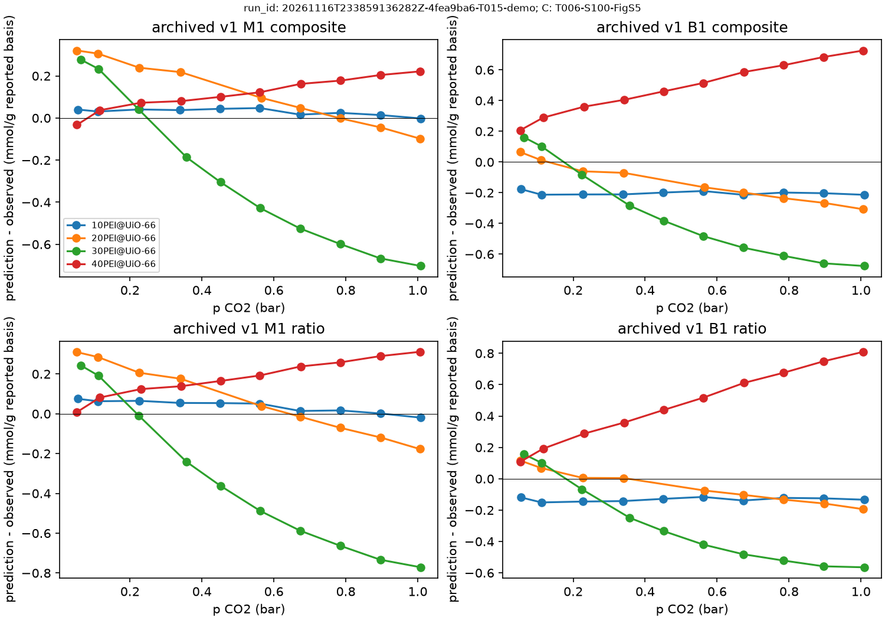
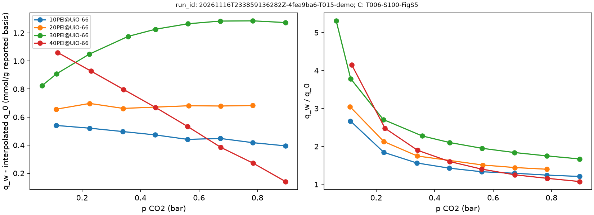

# T015 — диагностика общей структуры v1 по C

`20261116T233859136282Z-4fea9ba6-T015-demo`, исходный HEAD `4fea9ba6ddde1f03a1f00d5ce5a20dfeb87eb17a`; status **debug**. Exact SHA-256 кода/входов/конфигураций — в `runs/20261116T233859136282Z-4fea9ba6-T015-demo/passport.json`.

Только S100 SI Fig. S5, extraction_id `T006-S100-FigS5`: 48 verified маркеров,
9 носителя + 39 PEI, все четыре PEI-серии сохранены. V-источники/данные не открывались.
Температура/давление — D-15; номинальная загрузка — две интерпретации D-10;
неустановленная массовая база — D-16. Это диагностика на C, не независимая проверка.

## Остатки v1, сохранённые до ревизии

Таблица использует **архивный** T013 fit, без переподгонки/изменения U.
Bias по заранее выбранным интервалам p: low [0,0.2), mid [0.2,0.6), high [0.6,2) bar;
все ёмкости/остатки — mmol/g исходной, пока не установленной основы.

| Загрузка | Модель | Серия | Bias low | Bias mid | Bias high | RMSE |
| --- | --- | --- | --- | --- | --- | --- |
| composite | M1 | 10PEI | 0.0355 | 0.0423 | 0.0132 | 0.0329 |
| composite | M1 | 20PEI | 0.3134 | 0.1843 | -0.0239 | 0.1898 |
| composite | M1 | 30PEI | 0.2554 | -0.2196 | -0.6232 | 0.4490 |
| composite | M1 | 40PEI | 0.0023 | 0.0939 | 0.1915 | 0.1371 |
| composite | B1 | 10PEI | -0.1949 | -0.2024 | -0.2071 | 0.2031 |
| composite | B1 | 20PEI | 0.0389 | -0.0985 | -0.2520 | 0.1827 |
| composite | B1 | 30PEI | 0.1309 | -0.3081 | -0.6263 | 0.4562 |
| composite | B1 | 40PEI | 0.2479 | 0.4351 | 0.6568 | 0.5132 |
| ratio | M1 | 10PEI | 0.0691 | 0.0562 | 0.0034 | 0.0482 |
| ratio | M1 | 20PEI | 0.2976 | 0.1404 | -0.0953 | 0.1835 |
| ratio | M1 | 30PEI | 0.2173 | -0.2749 | -0.6887 | 0.4939 |
| ratio | M1 | 40PEI | 0.0451 | 0.1550 | 0.2745 | 0.2026 |
| ratio | B1 | 10PEI | -0.1350 | -0.1329 | -0.1297 | 0.1325 |
| ratio | B1 | 20PEI | 0.0927 | -0.0217 | -0.1467 | 0.1128 |
| ratio | B1 | 30PEI | 0.1286 | -0.2676 | -0.5314 | 0.3903 |
| ratio | B1 | 40PEI | 0.1499 | 0.4004 | 0.7116 | 0.5260 |

## Форма относительно собственного носителя

`q0` интерполируется линейно **между собственными маркерами носителя**;
за его измеренный диапазон не экстраполируется. Таблица — диагностическое
преобразование координат, не новые измерения и не новые свободные параметры.
Первая/последняя точки избытка относятся к допустимому общему диапазону каждой серии.

| Серия | Избыток: первая → последняя, mmol/g | Наклон избытка, mmol/(g bar) |
| --- | --- | --- |
| 10PEI@UiO-66 | 0.541 → 0.395 | -0.182 |
| 20PEI@UiO-66 | 0.656 → 0.683 | 0.020 |
| 30PEI@UiO-66 | 0.825 → 1.274 | 0.535 |
| 40PEI@UiO-66 | 1.060 → 0.141 | -1.187 |

В 20PEI избыток почти постоянен; в 10PEI он умеренно уменьшается, в 30PEI
увеличивается, в 40PEI резко уменьшается. Значит, общей поправки амплитуды или
одного химического сродства недостаточно. При больших p химический Langmuir-пул
v1 близок к насыщению, а наклон задаётся главным образом носителем. В B1 он
принудительно `(1-w) dq0/dp`, в M1 — `(1-w-kappa*w) dq0/dp`: обе формы
систематически сжимают вклад носителя при росте w. Остатки имеют систематический
знак/наклон внутри целых серий, а не случайный разброс маркеров. Особое изменение
формы 30→40PEI также не описывается одним линейным правилом потери объёма.

**Диагностируемая общая часть:** наблюдательная нормировка × правило переноса
доступности носителя из голого MOF в композит; дополнительно слишком жёсткая общая
связь геометрии и насыщаемого химического пула. Диагноз не доказывает, что множитель
(1-w) физически неверен: он обязателен для ёмкости на грамм композита. При наблюдении
на грамм MOF тот же физический баланс даёт `q_reported=q_comp/(1-w)`. SI Fig. S5
не устанавливает знаменатель; D-10 не устанавливает удержанную массу PEI.
Нельзя по остаткам объявлять другую массовую базу установленным фактом или извлекать
пористость. Нужны основной текст/авторская база нормировки, удержанный PEI,
порометрия и временные CO2-профили одной C-партии.
